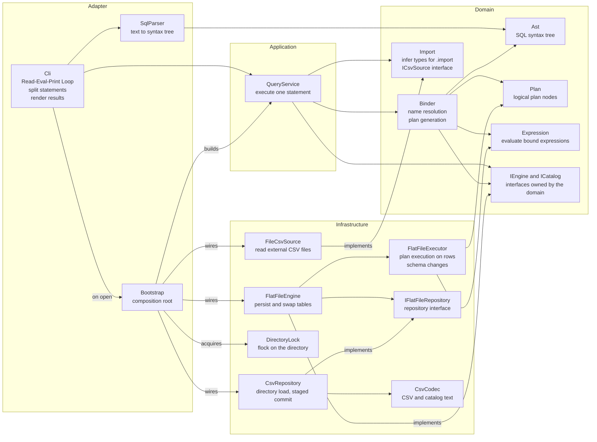
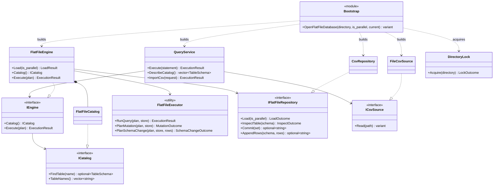
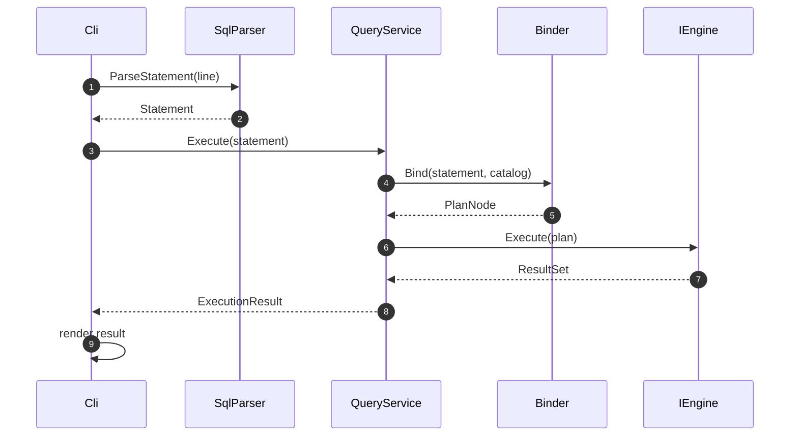
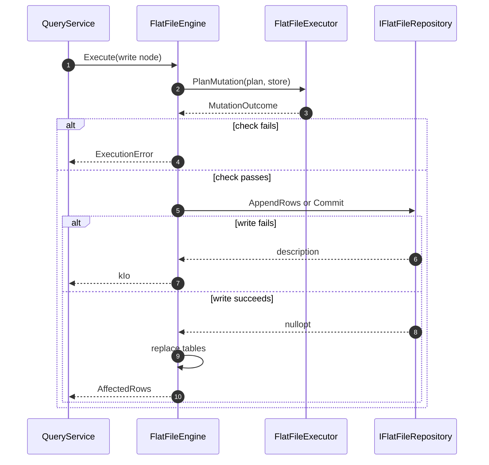
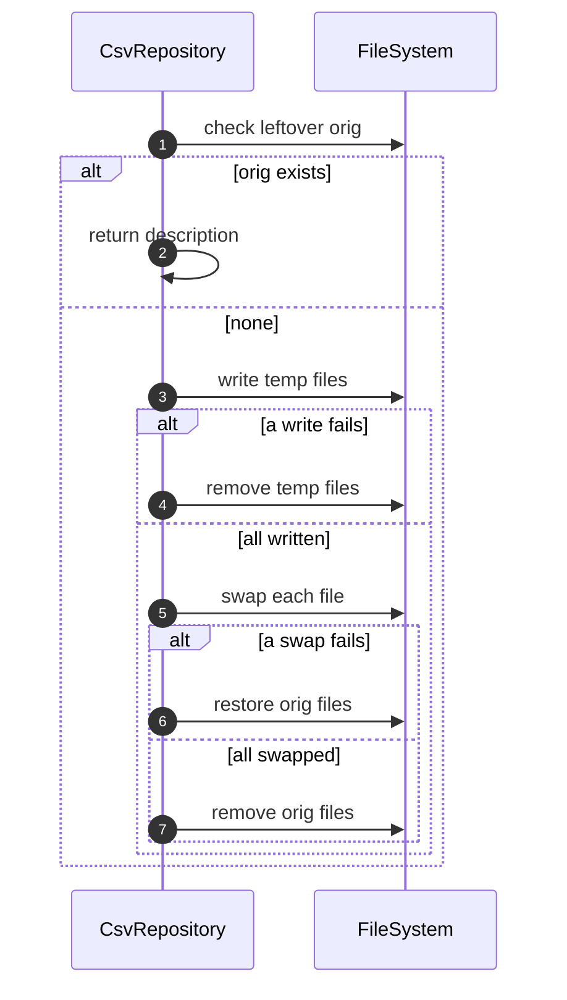
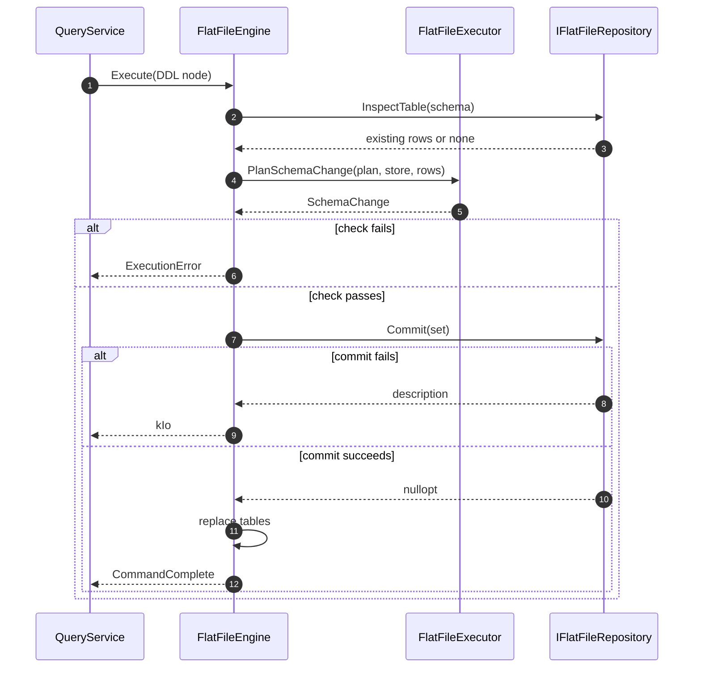
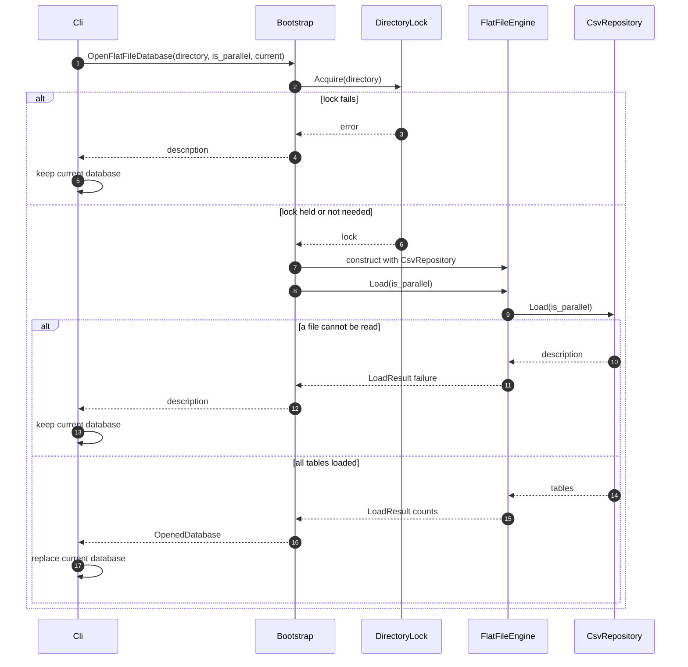
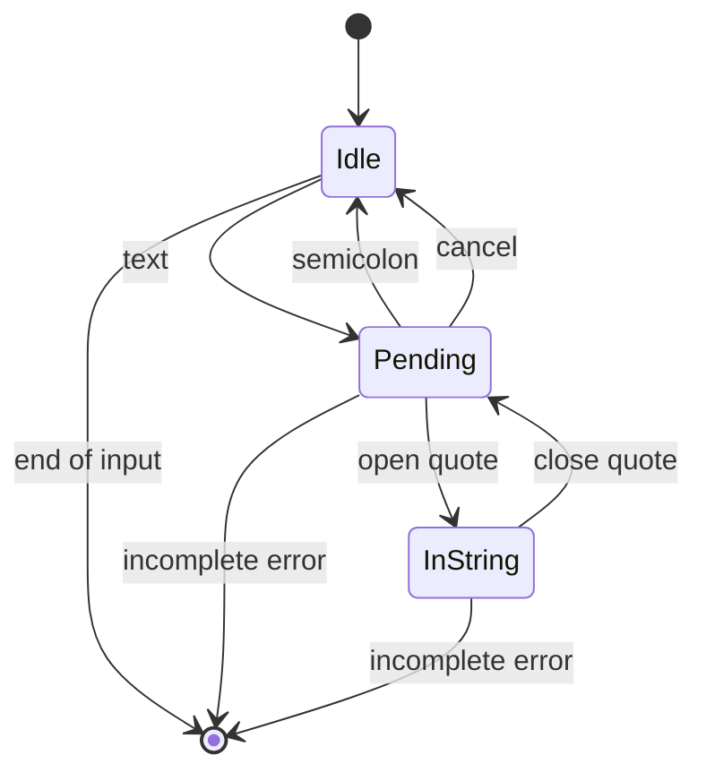
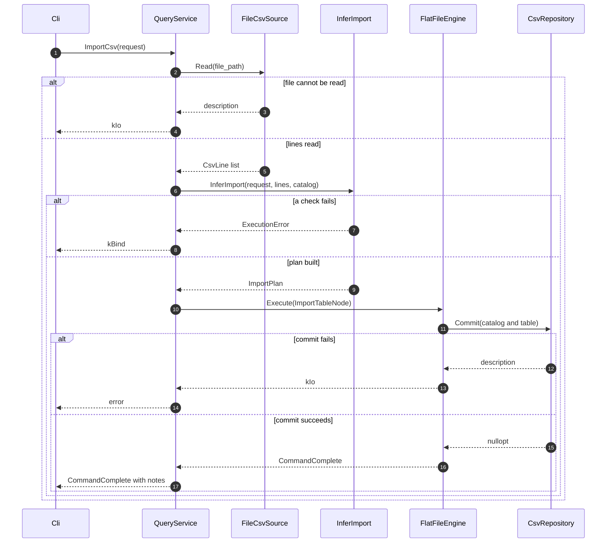

# FlatFileDB

## 1. Project Description

FlatFileDB is a terminal database that accepts Structured Query Language (SQL) statements. One front end parses each statement, resolves names and builds a plan, and a replaceable engine executes the plan. This document covers that front end, the engine port (the interface every engine implements), the flatfile engine and the Command-Line Interface (CLI). The flatfile engine treats a directory as one database. `catalog.csv` records the table definitions, each table lives in its own Comma-Separated Values (CSV) file, and `CREATE TABLE` adds a table. It is the baseline that other engines are compared with. An engine that persists data with pages and indexes implements the same port and has its own design document.

The design leaves out NULL, transactions, a Write-Ahead Log (WAL), concurrency control inside the process, composite primary keys and composite foreign keys, and table-level constraints. A statement that is not in the syntax table of section 2.3 is a syntax error.

One constraint holds throughout: SQL is the stable external contract, and the engine behind it is replaceable. Domain and Application contain no engine-specific name, storage format or table column, and a capability that one engine lacks shows up only as the `kUnsupported` response of the port. Section 4 points to the Architecture Decision Record (ADR) that records each design decision.

The text uses these terms:

| Term | Meaning | Name in the code |
|---|---|---|
| statement, Abstract Syntax Tree (AST) | The parser's output, names and types unresolved | `domain::Statement`, `domain::Expr` |
| plan | The Binder's output, columns referenced by position | `domain::PlanNode` |
| engine | Executes a plan and persists data | `domain::IEngine`; `FlatFileEngine` here |
| catalog | The table definitions | `domain::ICatalog`; `catalog.csv` |
| database directory | `catalog.csv`, one CSV file per table and `.flatfiledb.lock` | The argument of `.open` |
| command | A CLI meta command that starts with `.` | `.open`, `.import`, `.tables`, `.schema`, `.clear`, `.cancel`, `.help`, `.quit` |

## 2. Architecture

The layers keep the SQL front end fixed while engines change.

### 2.1 Component Diagram

An arrow is a call or a dependency, and `implements` points at the interface being implemented. The base types (`Value`, `Row`, `TableSchema`, `ResultSet`) are used everywhere, so the diagram draws no edges for them.



Headers are in `include/flatfiledb/` and implementations in `src/`. The Type column says whether a component is pure logic or library-backed.

| Concern | Layer | Type | Files |
|---|---|---|---|
| SQL parsing, statement splitting (a `;` in a string literal does not end one) | Adapter | Pure | `sql_parser.h`, `sql_parser.cpp`, `statement_buffer.h`, `statement_buffer.cpp` |
| Terminal input and output, commands, formatting | Adapter | Library-backed (`stdin`, `stdout`) | `cli.cpp` (`main`), `repl.h`, `repl.cpp` |
| Composition root | Adapter | Library-backed | `bootstrap.h`, `bootstrap.cpp` |
| Executing one statement: bind, then call the engine | Application | Through `IEngine` | `application.h`, `application.cpp` |
| Value, syntax tree and plan types | Domain | Pure | `domain/value.h`, `domain/ast.h`, `domain/plan.h`, `value.cpp` |
| Binder, expressions, aggregation, scalar functions, `LIKE` | Domain | Pure | `domain/binder.h`, `binder.cpp`, `domain/expression.h`, `expression.cpp`, `domain/scalar_functions.h`, `scalar_functions.cpp` |
| `.import` type inference, `ICsvSource` interface | Domain | Pure (interface implemented by Infrastructure) | `domain/import.h`, `import_inference.cpp` |
| Engine port (`IEngine`, `ICatalog`) | Domain | Interface | `domain/engine.h` |
| Plan execution, referential integrity | Infrastructure | Pure | `flat_file_executor.h`, `flat_file_executor.cpp` |
| Table storage, `ICatalog` implementation | Infrastructure | Through `IFlatFileRepository` | `flat_file_engine.h`, `flat_file_engine.cpp` |
| Directory load, staged commit, append write | Infrastructure | Library-backed (file system, threads) | `infrastructure.h`, `infrastructure.cpp` |
| CSV and `catalog.csv` text | Infrastructure | Pure | `csv_codec.h`, `csv_codec.cpp` |
| External CSV reading: Request for Comments (RFC) 4180 fields, Byte Order Mark (BOM) | Infrastructure | Library-backed (file system) | `csv_file_source.h`, `csv_file_source.cpp` |
| Exclusive lock on the database directory | Infrastructure | Library-backed (`flock`) | `directory_lock.h`, `directory_lock.cpp` |

Domain includes no other layer, and Application and Infrastructure include only Domain (headers inside Infrastructure include each other). `SqlParser` includes only Domain (ADR-0003). `Bootstrap` is the only component outside Infrastructure that includes Infrastructure headers, and `Cli` includes only Domain, Application, `SqlParser`, `StatementBuffer` and `Bootstrap`. A later entry point, such as a Hypertext Transfer Protocol (HTTP) controller, would call the same `Bootstrap`.

`Bootstrap` acquires `DirectoryLock`, creates `CsvRepository`, hands it to `FlatFileEngine` as a `std::unique_ptr<IFlatFileRepository>`, and hands the engine to `QueryService` as a `std::unique_ptr<IEngine>`. `OpenedDatabase` then holds `QueryService` and the lock, and the caller of `OpenFlatFileDatabase` owns it. The lock is an opaque `std::shared_ptr<void>`. Closing its file descriptor with the last holder releases it, and the kernel also releases it when the process exits or crashes. `Cli` owns the current `OpenedDatabase`. `.open` replaces it only after the new one opens, and reopening the same directory shares one lock between the old and the new.

`QueryService::Execute` borrows `const Statement&` and owns the plan from the Binder. The engine borrows `const PlanNode&` while `Execute` runs, and neither outlives the call. `IEngine::Catalog()` returns a `const ICatalog&` that lives as long as the engine, `ICatalog::FindTable` returns a copy of `TableSchema`, and `ExecutionResult` is returned by value. When `CsvRepository::Load` loads in parallel, it `join`s every worker before returning. Queries after the load are single-threaded, so nothing crosses threads and there is no mutex.

In the costs below, n is the number of rows scanned, m the number of rows on the other side of a join, t the number of tables and u the number of `UNIQUE` columns. A table lookup is O(log t) in a `std::map` keyed by lowercase name, and a scan of the `std::vector<Row>` is O(n) and copies rows. A hash join builds in O(m) and probes in O(n), and a nested loop, used when `ON` has no equality, is O(n · m). The residual condition is evaluated before a combined row is written, and memory is proportional to the number of output rows (ADR-0011). A single-row `INSERT` checks the primary key, `UNIQUE` and foreign keys by linear scan, O((1 + u) · n), and taking the auto-increment maximum is O(n). `UPDATE` and `DELETE` build one `std::unordered_set` per statement, O(n + m). Aggregation with a `std::unordered_map` and the primary key check on load are O(n), and sorting with `std::stable_sort` is O(n log n).

### 2.2 Types and Interfaces

The diagram shows the classes around the engine port and who builds them. The tables after it list the types and the signatures.



Domain types:

| Type | Definition |
|---|---|
| `Value` | `std::variant<int64_t, double, std::string>`; there is no NULL |
| `Row` | `std::vector<Value>` in the column order of `TableSchema::columns` |
| `ColumnDef` | Name, `DataType` (`kInt`, `kDouble`, `kText`) and `default_value` (`std::optional<Value>`, always empty in a result set) |
| `TableSchema` | Name, `columns`, `primary_key_index`, `foreign_keys` (`ForeignKey`: column position, referenced table, referenced column position; ascending by column position), `unique_indexes` (`UNIQUE` columns except the primary key; ascending) and `auto_increment_index` (an `std::optional`, always an INT primary key) |
| `ResultSet` | `std::vector<ColumnDef>` and `std::vector<Row>` |
| `AffectedRows` | `std::size_t count`, the number of rows affected |
| `CommandComplete` | `std::string tag`, the outcome of a Data Definition Language (DDL) statement or `.import`, such as `CREATE TABLE users`, and `notes` (`std::vector<std::string>`), extra output lines printed after it |
| `ExecutionError` | `ErrorKind kind` and `std::string message`; `ErrorKind` is `kBind` (name or type error), `kUnsupported`, `kConstraintViolation`, `kRuntime` (numeric overflow, internal engine error) or `kIo` |
| `ExecutionResult` | `std::variant<ResultSet, AffectedRows, CommandComplete, ExecutionError>` |
| `Statement` | A `std::variant` of `SelectStatement`, `InsertStatement`, `UpdateStatement`, `DeleteStatement`, `CreateTableStatement`, `AddColumnStatement`, `DropTableStatement` |
| `ColumnDefinition` | One column of a DDL statement: name, `DataType`, `is_primary_key`, `is_unique`, `is_auto_increment`, `default_value` (an expression, possibly null), `ref_table` and `ref_column` (empty without `REFERENCES`) |
| `Expr` | `Literal`, `ColumnRef` (qualifier and column name), `BinaryExpr` (`BinaryOp` and two operands), `AggregateCall` (`AggregateFn`; the argument of `COUNT(*)` is a null pointer), `FunctionCall` (`ScalarFn`, the arguments and `cast_type`, used only by `CAST`) |
| `PlanNode` | `ScanNode`, `FilterNode`, `JoinNode`, `AggregateNode`, `ProjectNode`, `SortNode`, `LimitNode` (`limit` as `std::optional<int64_t>`, `offset` as `int64_t`), `ImportTableNode` (the complete `TableSchema` and its rows), `InsertNode` (one or more rows, and `generated_index`, the column the engine fills with auto-increment values), `UpdateNode`, `DeleteNode`, `CreateTableNode` (the complete `TableSchema`), `AddColumnNode` (the table name and a `ColumnDef` with `default_value`), `DropTableNode` |
| `BoundExpr` | The static type `ExprType` (`kBool`, `kInt`, `kDouble`, `kText`) and `BoundLiteral`, `BoundColumn` (column position), `BoundBinary`, `BoundFunction` (`ScalarFn` and the arguments; the target type of `CAST` is the `ExprType` of the node). `BoundAggregate` exists only inside the Binder and never appears in the returned plan |

`Expr`, `BoundExpr` and `PlanNode` are recursive, so each is a struct with a `std::variant` member; C++ does not allow a recursive variant alias. Children are held by `std::unique_ptr`, and an absent clause is a null pointer. A plan refers to columns by position: `JoinNode` outputs the left row followed by the right row, and `AggregateNode` outputs the group keys followed by the aggregate values. A null predicate in `UpdateNode` or `DeleteNode` applies to the whole table. Predicates evaluate to `bool`; `kBool` is only a static type, not a storable `Value`.

Adapter and Infrastructure types:

| Type | Definition |
|---|---|
| `ParseError` | `std::size_t column` and `std::string description`. `column` starts at 1 and points to the start of the offending token. At the end of the input it is the input length plus 1, for an unterminated string literal it is the opening quote, and for `unrecognized statement` it is always 1 |
| `OpenedDatabase` | The result of `OpenFlatFileDatabase`: `std::unique_ptr<QueryService>`, `directory` (normalized path), `lock` (`std::shared_ptr<void>`, empty when no lock was acquired), `is_created` (this open created the directory) and `tables` (name, row count and rejected line numbers, in catalog order) |
| `LoadedTable` | One table's `TableSchema`, its loaded `std::vector<Row>` and `rejected_lines` (file line numbers of rejected rows, counted from 1 with the header and blank lines included) |
| `LoadOutcome` | `std::variant<std::vector<LoadedTable>, std::string>`; the string is the failure reason |
| `InspectOutcome` | `std::variant<std::optional<std::vector<Row>>, std::string>`; an empty `optional` means the table's CSV does not exist, and the string is the failure reason |
| `LoadResult` | The result of `FlatFileEngine::Load`: `bool is_success`, `std::string error` and `tables` (name and row count) |
| `TableStore` | A `std::map` keyed by lowercase name with `TableData` values (`TableSchema` and `std::vector<Row>`); it also keeps the registration order |
| `TableWrite` | One table's `TableSchema`, all its rows and `should_regenerate_header` (generate the header from the schema instead of keeping the original) |
| `CommitSet` | One commit: `catalog` (`std::optional<std::vector<TableSchema>>`; `catalog.csv` is rewritten when it has a value), `writes` (a list of `TableWrite`) and `drops` (names of tables to delete) |
| `MutationOutcome` | `MutationPlan` or `ExecutionError`. A `MutationPlan` holds the target table, the rows `INSERT` appends, the changed tables with their new rows, and the affected row count |
| `SchemaChangeOutcome` | `SchemaChange` or `ExecutionError`. A `SchemaChange` holds the `CommandComplete` tag, the kind (create, add column, drop), the affected table's name, its new content (empty for a drop) and `is_adopted` (an existing CSV is reused on create) |
| `LockOutcome` | The result of `DirectoryLock::Acquire`: `std::shared_ptr<DirectoryLock>` (empty when no lock was acquired) and an error as `std::optional<std::string>` |

`ICatalog::FindTable` matches names case-insensitively, and `TableNames` returns them in registration order.

`catalog.csv` has one row per column. Tables appear in registration order, and the columns of a table in position order.

| Column | Content |
|---|---|
| `table`, `position`, `column` | Table name, column position (from 0, consecutive) and column name, in the declared spelling |
| `type` | `INT`, `DOUBLE` or `TEXT` |
| `primary_key`, `unique`, `auto_increment` | `1` or `0`; each table has one `primary_key`, and `unique` marks non-primary-key columns only |
| `has_default`, `default` | When `has_default` is `1`, the value parsed by the column type: decimal for INT, the `FormatValue` output for DOUBLE, the original text for TEXT. Otherwise empty |
| `ref_table`, `ref_column` | The foreign key target, empty without one |

The first line is the header `table,position,column,type,primary_key,unique,auto_increment,has_default,default,ref_table,ref_column`. Lines end with `\n`, and fields are quoted per RFC 4180. For the three tables in `data/`, the file reads:

```text
table,position,column,type,primary_key,unique,auto_increment,has_default,default,ref_table,ref_column
users,0,id,INT,1,0,0,0,,,
users,1,username,TEXT,0,1,0,0,,,
users,2,location,TEXT,0,0,0,0,,,
posts,0,id,INT,1,0,0,0,,,
posts,1,content,TEXT,0,0,0,0,,,
posts,2,username,TEXT,0,0,0,0,,users,username
posts,3,views,INT,0,0,0,0,,,
engagements,0,id,INT,1,0,0,0,,,
engagements,1,postId,INT,0,0,0,0,,posts,id
engagements,2,username,TEXT,0,0,0,0,,users,username
engagements,3,type,TEXT,0,0,0,0,,,
engagements,4,comment,TEXT,0,0,0,0,,,
engagements,5,timestamp,INT,0,0,0,0,,,
```

The loader rejects the whole file when a table name repeats, a column name repeats within a table (case is ignored), positions are not consecutive, a `type` is invalid, or a table does not have exactly one primary key. It also rejects a primary key with a `unique` mark or a default, auto-increment on anything but an INT primary key, a default that does not parse by the column type, and a table named `catalog`. A foreign key is rejected when its target table (never the table itself) or target column does not exist, when the types differ, or when the target column is neither a primary key nor `UNIQUE`.

Supporting types:

| Type | Definition |
|---|---|
| `BinaryOp` | `kEq`, `kNe`, `kLt`, `kLe`, `kGt`, `kGe`, `kAnd`, `kOr`, `kAdd`, `kSub`, `kMul`, `kDiv`, `kConcat`, `kLike` |
| `AggregateFn` | `kCount`, `kSum`, `kAvg`, `kMin`, `kMax` |
| `ScalarFn` | `kLower`, `kUpper`, `kLength`, `kSubstr`, `kTrim`, `kAbs`, `kRound`, `kCast` |
| `ImportRequest` | `file_path`, `table` (empty means the file name), `primary_key` (empty means the default rule), `column_types` (column names and `DataType`) and `should_skip_bad_rows` |
| `CsvLine` | `std::size_t number` (the line number) and `std::optional<std::vector<std::string>> fields` (empty when the quoting is malformed) |
| `ImportPlan` | The complete `TableSchema`, the `std::vector<Row>` after type conversion, the number of skipped rows and the explanations (`std::vector<std::string>`) |
| `SelectStatement` | `items`, `from`, `joins`, `where`, `group_by`, `order_by`, `limit` (`std::optional<int64_t>`) and `offset` (`int64_t`, default 0) |
| `InsertStatement` | `table`, `columns` (empty means all columns) and `rows` (lists of expressions, at least one row) |
| `SelectItem` | `bool is_star`, `ExprPtr expr`, `std::string alias` and `std::string text` (the original text of the expression) |
| `TableRef` | `std::string table`, `std::string alias` |
| `JoinClause` | `TableRef table`, `ExprPtr on` |
| `OrderItem` | `ExprPtr expr`, `bool is_descending` |
| `Assignment` | `std::string column`, `ExprPtr value` |
| `ExprPtr`, `PlanPtr`, `BoundExprPtr` | `std::unique_ptr<Expr>`, `std::unique_ptr<PlanNode>`, `std::unique_ptr<BoundExpr>` |
| `AggregateSpec` | `AggregateFn fn`, `BoundExprPtr arg` |
| `BoundAssignment` | `std::size_t column_index`, `BoundExprPtr value` |
| `SortKey` | `std::size_t column_index` (the position of an output column of `ProjectNode`), `bool is_descending` |

`ScanNode::table` uses the spelling declared in the catalog. Each row of `InsertNode::rows` is in schema order with its values converted to the column types. When `generated_index` has a value, every row holds a placeholder at that position, and the engine replaces the placeholders with auto-increment values in row order.

Signatures of the functions that other components call:

| Interface | Signature | Description |
|---|---|---|
| `ParseStatement` | `std::variant<Statement, ParseError>(const std::string&)` | SQL only; text starting with `.` returns `ParseError` |
| `Bind` | `std::variant<PlanPtr, ExecutionError>(const Statement&, const ICatalog&)` | Rules in 2.4 |
| `Evaluate` | `std::optional<Value>(const BoundExpr&, const Row&, std::string* failure = nullptr)` | For non-`kBool` expressions. `std::nullopt` is a runtime error, and a non-null `failure` receives the `kRuntime` message (2.3) |
| `EvaluateCondition` | `std::optional<bool>(const BoundExpr&, const Row&, std::string* failure = nullptr)` | For `kBool` expressions; `std::nullopt` and `failure` work as in `Evaluate` |
| `AggregateAccumulator` | `Add(const Value&)` returns `bool`; `Result()` returns `Value`; `IsEmpty()` returns `bool` | Accumulates `COUNT`, `SUM`, `AVG`, `MIN` or `MAX`. `Add` returns false when an INT sum overflows or a DOUBLE sum is not finite. While `IsEmpty()` is true, `AVG`, `MIN` and `MAX` have no result, and the caller reports `<FN> over no rows` |
| `LikeMatches` | `bool(const std::string& text, const std::string& pattern)` | `LIKE` matching, rules in 2.3 |
| `ApplyScalarFunction` | `std::optional<Value>(ScalarFn, ExprType result_type, const std::vector<Value>& arguments, std::string* failure)` | One scalar function; the Binder has already checked the argument count and types. `std::nullopt` and `failure` work as in `Evaluate` |
| `FormatValue` | `std::string(const Value&)` | Output format in 2.3 |
| `CoerceValue` | `std::optional<Value>(const Value&, DataType)` | Only INT to DOUBLE changes the value; any other mismatch returns `std::nullopt` |
| `QueryService::Execute` | `ExecutionResult(const Statement&)` | Calls `Bind` with the `Catalog()` of the engine, then `IEngine::Execute` |
| `QueryService::DescribeCatalog` | `std::vector<TableSchema>() const` | All schemas in registration order; feeds `.tables` and `.schema` |
| `StatementBuffer::AddLine` | `std::vector<std::string>(const std::string& line)` | Adds one line (without its line break) and returns the statements it completes, each with its trailing `;`. `IsEmpty()` true means no statement is in progress |
| `RunRepl` | `void(std::istream&, std::ostream&, bool is_interactive, const std::optional<InitialOpen>& initial_open = std::nullopt)` | The input loop. With `is_interactive` true it prints the prompt and the control codes of `.clear`. When `initial_open` (`directory` and `is_parallel`) has a value, it runs `.open` on that directory before reading input |
| `StatementBuffer::Cancel`, `IsInString`, `HasFullWidthSemicolon` | `void()`, `bool() const`, `bool(const std::string& line) const` | Discards the accumulated text; tells whether the buffer is inside a string literal; tells whether a line contains a full-width semicolon `；` outside strings and comments |
| `InferImport` | `std::variant<ImportPlan, ExecutionError>(const ImportRequest&, const std::vector<CsvLine>&, const ICatalog&)` | Pure; rules in 2.7 |
| `ICsvSource::Read` | `std::variant<std::vector<CsvLine>, std::string>(const std::string& path)` | Reads an external CSV into one `CsvLine` per non-empty line, header first. The string is the reason the file cannot be read |
| `QueryService::ImportCsv` | `ExecutionResult(const ImportRequest&)` | Flow in 3.8; `kUnsupported` when no `ICsvSource` is injected |
| `FormatCreateTable` | `std::string(const TableSchema&, const std::vector<TableSchema>& catalog)` | One `CREATE TABLE` of `.schema`; `catalog` resolves the column name of a foreign key target |
| `FormatParseError` | `std::string(const std::string& statement, const ParseError&)` | Places the `ParseError` as a column on a single line, or as a line and a column number |
| `IEngine::Execute` | `ExecutionResult(const PlanNode&)` | An unsupported plan returns `kUnsupported` (ADR-0005), a write node `AffectedRows` and a DDL node `CommandComplete` |
| `OpenFlatFileDatabase` | `std::variant<OpenedDatabase, std::string>(const std::string& directory, bool is_parallel, const OpenedDatabase* current)` | Flow in 3.5. `current` is the database the caller has open, or null; the string is the failure reason |
| `DirectoryLock::Acquire` | `LockOutcome(const std::string& directory)` | Takes an exclusive `flock` on `.flatfiledb.lock` in the directory; rules in 2.6 |
| `FlatFileExecutor::RunQuery` | `ExecutionResult(const PlanNode&, const TableStore&)` | Executes Scan, Filter, Join, Aggregate, Project, Sort and Limit |
| `FlatFileExecutor::PlanMutation` | `MutationOutcome(const PlanNode&, const TableStore&)` | Checks a write node per 2.5 and computes the new rows; `TableStore` is unchanged |
| `FlatFileExecutor::PlanSchemaChange` | `SchemaChangeOutcome(const PlanNode&, const TableStore&, const std::optional<std::vector<Row>>&)` | Plans a DDL node without changing `TableStore`. The third argument holds the rows of an existing CSV when a table is created, and is empty when there is none |
| `IFlatFileRepository::Load` | `LoadOutcome(bool is_parallel)` | Reads `catalog.csv` and every table it lists; rules in 2.5 |
| `IFlatFileRepository::InspectTable` | `InspectOutcome(const TableSchema&)` | Checks whether the table's CSV exists and parses its rows by the load rules. Duplicate primary keys are kept, so that adoption can report them |
| `IFlatFileRepository::Commit` | `std::optional<std::string>(const CommitSet&)` | Staged commit, flow in 3.3; `std::nullopt` is success, otherwise the failure description |
| `IFlatFileRepository::AppendRows` | `std::optional<std::string>(const TableSchema&, const std::vector<Row>&)` | Appends one or more rows to the end of the CSV, all or none; the return value works as in `Commit` |

`Bind`, `Evaluate`, `EvaluateCondition`, `RunQuery`, `PlanMutation` and `PlanSchemaChange` are pure functions.

### 2.3 SQL Language Rules

The dialect is a small subset of standard SQL. It has no `NULL`, no subqueries and no table-level constraints. The Binder checks that go with these rules are in 2.4.

| Statement | Form |
|---|---|
| `SELECT` | `SELECT <items> FROM <table_ref> { JOIN <table_ref> ON <expr> } [WHERE <expr>] [GROUP BY <expr>, ...] [ORDER BY <expr> [ASC\|DESC], ...] [LIMIT <n> [OFFSET <n>]] [;]`. `<table_ref>` is `<table> [[AS] <alias>]`. `<items>` is a comma-separated list of `*` (no alias) or `<expr> [AS <alias>]`. `<n>` is a non-negative integer literal. The number of `JOIN`s has no upper limit |
| `INSERT` | `INSERT INTO <table> [(<column>, ...)] VALUES (<expr>, ...) { , (<expr>, ...) } [;]`, one or more rows |
| `UPDATE` | `UPDATE <table> SET <column> = <expr>, ... [WHERE <expr>] [;]` |
| `DELETE` | `DELETE FROM <table> [WHERE <expr>] [;]` |
| `CREATE TABLE` | `CREATE TABLE <table> (<column_def>, ...) [;]` |
| `ALTER TABLE` | `ALTER TABLE <table> ADD [COLUMN] <column_def> [;]` |
| `DROP TABLE` | `DROP TABLE <table> [;]` |

A column definition `<column_def>` is `<column> <type> { <constraint> }`.

| Item | Rule |
|---|---|
| Type | `INT`, `INTEGER`, `BIGINT` are INT. `DOUBLE`, `REAL`, `FLOAT` are DOUBLE. `TEXT`, `VARCHAR(<n>)`, `CHAR(<n>)` are TEXT, where `n` is a positive integer literal and the length is not enforced. The catalog stores only INT, DOUBLE and TEXT |
| Constraints | `PRIMARY KEY [AUTOINCREMENT]`, `UNIQUE`, `NOT NULL`, `DEFAULT <expr>`, `REFERENCES <table> (<column>)`, in any order and each at most once per column (a repeat returns `ParseError`). `AUTOINCREMENT` has to follow `PRIMARY KEY` directly. `NOT NULL` is accepted and does nothing, since there is no NULL |
| Not supported | Table-level `PRIMARY KEY (...)`, `FOREIGN KEY`, `IF NOT EXISTS`, `DROP COLUMN` and `CREATE INDEX` return `ParseError` |
| Keywords | `CREATE`, `ALTER`, `DROP`, `TABLE`, `ADD`, `COLUMN`, `PRIMARY`, `KEY`, `UNIQUE`, `NOT`, `DEFAULT`, `REFERENCES`, `AUTOINCREMENT` and the type names are keywords only where the grammar places them, and ordinary identifiers elsewhere |

Lexical rules and expressions:

| Item | Rule |
|---|---|
| Identifier | `[A-Za-z_][A-Za-z0-9_]*`. Keywords and identifiers are case-insensitive |
| Reserved words | `SELECT`, `FROM`, `WHERE`, `JOIN`, `ON`, `AS`, `GROUP`, `BY`, `ORDER`, `ASC`, `DESC`, `INSERT`, `INTO`, `VALUES`, `UPDATE`, `SET`, `DELETE`, `AND`, `OR`, `LIKE`, `LIMIT`, `OFFSET`, `COUNT`, `SUM`, `NULL`. Using `NULL` reports `NULL is not supported`. Function names are not reserved |
| Numeric literal | `digits` is INT and `digits.digits` is DOUBLE, with no exponents. A value outside the range of `int64_t` or DOUBLE returns `ParseError` |
| Minus sign | At an operand position (start of an expression, after an operator or a left parenthesis), a `-` directly followed by a numeric literal is a negative literal, and `-9223372036854775808` is accepted. At a binary operator position it is subtraction, so `1-2` and `1 - -2` both subtract. Any other `-` at an operand position parses as `0 - <operand>` |
| String literal | Single quotes, with a quote inside written as two single quotes |
| Operators | `=`, `<>`, `!=`, `<`, `<=`, `>`, `>=`, `LIKE`, `AND`, `OR`, `+`, `-`, `*`, `/`, `\|\|` and parentheses. Precedence from lowest to highest: `OR`, `AND`, comparison and `LIKE`, `+ -`, `* /`, `\|\|`, negative sign and parentheses. `+ -`, `* /` and `\|\|` are left-associative (ADR-0019) |
| Column reference | `[<qualifier>.]<column>` |
| Aggregates | `COUNT(*)`, `COUNT(<expr>)`, `SUM(<expr>)`, `AVG(<expr>)`, `MIN(<expr>)`, `MAX(<expr>)`. `AVG`, `MIN` and `MAX` are recognized by the name followed immediately by `(` and are not reserved words |
| Functions | `LOWER`, `UPPER`, `LENGTH`, `SUBSTR`, `TRIM`, `ABS`, `ROUND`, `CAST(<expr> AS <type>)`. Names are case-insensitive and recognized when followed immediately by `(`, so a column with the same name stays usable. `<type>` is written like a column type. An unknown `<name>(` returns `ParseError` with `unknown function <name>` |
| `LIMIT`, `OFFSET` | `LIMIT` takes a non-negative integer literal, optionally followed by `OFFSET` and another. Anything else (a negative sign, a decimal, an identifier) returns `ParseError` with `LIMIT requires a non-negative integer literal` or `OFFSET requires a non-negative integer literal`. A value beyond `int64_t` gives `numeric literal out of range`, and `OFFSET` without `LIMIT` gives `OFFSET requires LIMIT`. `LIMIT 1 + 1` fails at the `+` as an ordinary end-of-statement error |
| Unsupported syntax | `NOT`, `IN`, `IS`, `BETWEEN`, `HAVING`, `DISTINCT`, `UNION` and subqueries return `ParseError`. The words are not reserved, and in an expression the description is `<word> is not supported` |
| Join keywords | `INNER`, `LEFT`, `RIGHT`, `FULL`, `OUTER`, `CROSS` or `NATURAL` directly before `JOIN` is not read as a table alias, so the statement returns `ParseError` |
| Chained comparison | `a = b = c` and `a LIKE b LIKE c` return `ParseError` |
| Nesting limit | `ParseError` when parentheses or negative signs nest 100 levels deep, or the expression tree reaches depth 500 |
| Comments | `--` runs to the end of the line, outside a string literal. `/* */` is not supported. `SELECT 1--2` is `1` and a comment, not a subtraction |
| Whitespace | American Standard Code for Information Interchange (ASCII) whitespace, plus U+00A0, U+3000 and U+2000 to U+200A in 8-bit Unicode Transformation Format (UTF-8) |
| Unexpected character | `unexpected character '<char>'` for visible ASCII, `unexpected character U+<code point>` for valid UTF-8, `unexpected character with byte value <n>` for an invalid byte |
| Empty input | An empty or whitespace-only string returns `ParseError` at `column` 1 with `unrecognized statement` |
| Commands | `ParseStatement` handles SQL only, and input starting with `.` returns `ParseError`. `Cli` handles commands (3.6) |

The semantics follow ADR-0007. Values are INT (64-bit), DOUBLE or TEXT.

| Item | Rule |
|---|---|
| Comparison | INT and DOUBLE compare as DOUBLE, so an INT above 2^53 loses precision. TEXT compares bytewise. TEXT against a number returns `kBind` |
| Arithmetic | `+`, `-`, `*` and `/` take numbers only. Two INTs give INT, any mix gives DOUBLE. INT `/` truncates toward 0 (`-7 / 2` is `-3`) |
| Concatenation | `\|\|` takes two TEXT operands. Other types need `CAST`, otherwise `kBind` |
| `LIKE` | TEXT operands, `kBool` result. `%` matches any run of bytes, including none. `_` matches one UTF-8 character, and each invalid byte counts as one. Other characters match byte for byte, ASCII letters case-insensitively. There is no `ESCAPE` (ADR-0019). Matching takes O(n · m) for text length n and pattern length m |
| Numeric overflow | `kRuntime` with `numeric overflow` when an INT result of `+`, `-`, `*`, `/`, `SUM`, `ABS` or `CAST` leaves 64 bits, or when a DOUBLE result is not finite. The minimum INT divided by `-1` overflows too, and so does a non-finite sum inside `AVG` |
| Other runtime errors | `kRuntime` with `division by zero` (a divisor of `0.0` or `-0.0` counts), `cannot cast '<text>' to INT`, `cannot cast '<text>' to DOUBLE`, `negative substring length`, `ROUND digits out of range`, `AVG over no rows`, `MIN over no rows` or `MAX over no rows` |
| Boolean expressions | Comparisons, `AND` and `OR` give `kBool`, and `AND` and `OR` take `kBool` operands. A `kBool` expression appears only in `WHERE`, `ON` and as an operand of `AND` or `OR`. Anywhere else (SELECT list, `SET`, `VALUES`, `GROUP BY`, `ORDER BY`, `DEFAULT`) it returns `kBind`, as does a `WHERE` or `ON` expression that is not `kBool` |
| Aggregate types | `COUNT` returns INT. `SUM` keeps the argument's type and `AVG` returns DOUBLE; both return `kBind` on TEXT. `MIN` and `MAX` keep the argument's type, with TEXT compared bytewise |
| Empty aggregate input | An aggregate query without `GROUP BY` always outputs one row. On empty input `COUNT` returns 0 and `SUM` the zero of its type (standard SQL returns NULL), while `AVG`, `MIN` and `MAX` return `kRuntime` because there is no NULL. With `GROUP BY`, no rows means no groups and 0 output rows |
| Row order | Without `ORDER BY` the order of returned rows is undefined, and so is which rows `LIMIT` picks. The sort of `ORDER BY` is stable. `LIMIT` and `OFFSET` apply after it: skip `OFFSET` rows, then take at most `LIMIT`. `LIMIT 0` and an `OFFSET` beyond the row count both return 0 rows |
| Output columns | The alias when there is one; for a plain column reference, the name declared in the schema without the qualifier; for any other expression, its original text. `*` expands to the column names |
| Output format | INT in decimal. DOUBLE in fixed-point notation with the shortest number of decimals that restores the value and always a decimal point (`2.0`, `100000.0`); a value at or above 2^53 prints its exact decimal expansion. TEXT as is, with an empty string as an empty field and Tab not escaped |
| `UPDATE`, `DELETE` | `WHERE` takes any `kBool` expression. Without it the whole table is affected |
| `DEFAULT` | A constant expression (no columns or aggregates) evaluated at bind time. The type has to match the column, except that an INT may go to a DOUBLE column |
| `INSERT` | An omitted auto-increment column takes the column's current maximum plus 1, or 1 for an empty table (ADR-0016), and an explicit value is used as given. A multi-row `INSERT` is all-or-nothing (ADR-0020). Rows are checked in order and the first violation is reported, and a primary key or `UNIQUE` value repeated between rows is a duplicate. Auto-increment values continue row by row, one more each. `AffectedRows` is the row count. With several rows, Binder messages get the prefix `row <k>: `, `k` counting from 1 |

Functions follow ADR-0019. A wrong argument count or type returns `kBind`, and a `kBool` expression is not a valid argument.

| Function | Arguments | Result | Rules |
|---|---|---|---|
| `LOWER(s)`, `UPPER(s)` | TEXT | TEXT | Converts ASCII letters only |
| `LENGTH(s)` | TEXT | INT | UTF-8 character count, each invalid byte counting as one |
| `SUBSTR(s, start [, length])` | TEXT, INT [, INT] | TEXT | Counts UTF-8 characters from 1. The result is the intersection of positions `start` to `start + length - 1` with 1 to the character count, and without `length` it runs to the end. A position below 1 still counts toward `length` (`SUBSTR('abc', 0, 2)` is `a`). A `length` of 0 gives an empty string, a negative one reports `negative substring length`. A negative `start` does not count from the end, unlike SQLite |
| `TRIM(s)` | TEXT | TEXT | Strips leading and trailing spaces and Tabs; one argument only |
| `ABS(x)` | INT or DOUBLE | Argument's type | The minimum INT reports `numeric overflow` |
| `ROUND(x [, digits])` | Number [, INT] | DOUBLE | `digits` defaults to 0 and has to be 0 to 15, otherwise `ROUND digits out of range`. Rounding looks at the binary value stored in the DOUBLE: above one half rounds up, below rounds down, exactly one half rounds away from 0. So `ROUND(2.675, 2)` is `2.67` (the stored value is slightly below 2.675), `ROUND(2.5)` is `3.0` and `ROUND(-2.5)` is `-3.0` |
| `CAST(x AS type)` | INT, DOUBLE or TEXT | `type` | DOUBLE to INT truncates toward 0 and reports `numeric overflow` outside the INT range. A cast to TEXT gives the output format above. TEXT to INT takes an optional sign and digits within 64 bits. TEXT to DOUBLE takes an optional sign, digits and an optional decimal point with digits after it, and the result is finite; an exponent, surrounding whitespace or `.5` does not match. A mismatch reports `cannot cast '<text>' to INT` or `cannot cast '<text>' to DOUBLE` |

### 2.4 Binder Rules

The Binder runs the checks below in order and returns the first error.

| Step | Check | Error |
|---|---|---|
| 1 | The tables of `FROM` and `JOIN` exist, and each table's qualifier (its alias, otherwise its name) is unique | `kBind` |
| 2 | `ON` references only tables that have appeared up to that `JOIN` | `kBind` |
| 3 | Each column exists, an unqualified column appears in only one table, and a table with an alias is qualified only by the alias | `kBind`; the message contains `ambiguous` for an ambiguity |
| 4 | The type rules of 2.3, including argument count and types of functions | `kBind` |
| 5 | Aggregates appear only in the SELECT list, none inside another's argument. An aggregate in `ORDER BY` has to be structurally identical to a SELECT item | `kBind` |
| 6 | The SELECT items of an aggregate query (one with `GROUP BY` or an aggregate function) are group keys, aggregates and literals only. Group keys match by the structure of the bound expression | `kBind` |
| 7 | `ORDER BY` keys resolve in this order. An integer literal is a 1-based position. An unqualified identifier is matched against the SELECT aliases first, and the first alias wins when aliases repeat. Any other expression has to be structurally identical to a bound SELECT item | `kBind` |
| 8 | `UPDATE`: assigned columns exist and are not repeated, the target is not the primary key, and the value type equals the column type or is an INT going to a DOUBLE column | `kBind`; `kUnsupported` for a primary key |
| 9 | `INSERT`: columns of the column list exist and are not repeated. An omitted column has `DEFAULT` or is auto-increment, otherwise `no value for column <column>`. Each row has as many values as the column list (the table's columns, without one). Values are constant expressions with no columns or aggregates, though functions are allowed. Types follow step 8, and rows are checked in order | `kBind`; `kRuntime` when constant evaluation fails |

`GROUP BY username` matches `SELECT u.username`. `*` in an aggregate query returns `kBind`. An integer literal in `GROUP BY` is a constant group key, not a position. When an INT is assigned to a DOUBLE column, the `BoundExpr` of the assignment keeps the static type `kInt`, and the engine converts the value at write time.

DDL statements have their own ordered checks. Every error is `kBind`, except an evaluation overflow in `DEFAULT`, which is `kRuntime`.

| Statement | Step | Check |
|---|---|---|
| `CREATE TABLE` | 1 | The name is not `catalog` (`table name catalog is reserved`) and not already in the catalog (`table <table> already exists`), both case-insensitive |
| | 2 | Column names are unique, case-insensitively |
| | 3 | Exactly one `PRIMARY KEY` column |
| | 4 | The primary key has no `DEFAULT`. `AUTOINCREMENT` is only on an INT primary key and not with `DEFAULT` |
| | 5 | `DEFAULT` is a constant expression that evaluates successfully and matches the column's type |
| | 6 | The `REFERENCES` table already exists (a table cannot reference itself), the column exists with the same type, and it is a primary key or `UNIQUE` |
| `ALTER TABLE ADD COLUMN` | 1 | The table exists and the column name is not in it |
| | 2 | No `PRIMARY KEY`, `UNIQUE`, `REFERENCES` or `AUTOINCREMENT` |
| | 3 | `DEFAULT` is required, under the rules of `CREATE TABLE` step 5 |
| `DROP TABLE` | 1 | The table exists and no other table has a foreign key referencing it. Otherwise `table <table> is referenced by <child_table>.<column>`, naming the first reference in catalog table order and foreign key order |

A SELECT plan stacks nodes from the bottom as `ScanNode`, `JoinNode`, `FilterNode`, `AggregateNode`, `ProjectNode`, `SortNode` and `LimitNode`, leaving out any the query does not need. `JoinNode` is left-deep in the order written in `FROM`, whatever the number of tables. `LimitNode` sits above `SortNode`, so rows are taken after sorting.

`WHERE` is split at `AND`, and each term goes to the lowest position where all its columns are available (ADR-0009). A term with no columns goes above the `ScanNode` of the first table. A term on one table goes above that table's `ScanNode`, and a term on several tables above the lowest `JoinNode` covering them. Terms at the same position merge with `AND` into one `FilterNode`. The `ON` condition is neither split nor pushed down.

`ScanNode::table` keeps the spelling declared in the catalog, and the engine compares in lowercase. Each row of `InsertNode::rows` is in schema order: an omitted column holds its `DEFAULT`, and an omitted auto-increment column holds a placeholder and sets `generated_index`. `CREATE TABLE` produces a `CreateTableNode` with the complete `TableSchema` (foreign keys ascending by column position, `unique_indexes` without the primary key). `ALTER TABLE` produces an `AddColumnNode` and `DROP TABLE` a `DropTableNode`.

### 2.5 Referential Integrity

A foreign key references a primary key or `UNIQUE` column (2.4). Foreign keys are declared in `TableSchema::foreign_keys` (ADR-0006). The policy is fixed: updating a referenced column always cascades to the referencing rows, deleting a referenced row is always rejected (ADR-0002), and a primary key cannot be updated. Checks run per statement, and when one fails the statement changes neither memory nor files.

`INSERT` checks rows in order and reports the first violation. For each row the auto-increment value is computed first: 1 for an empty table, 1 more for each following row, and `kRuntime` `numeric overflow` when the maximum is already the `int64_t` maximum. The four checks below then run in the order shown. The duplicate checks cover the existing rows and the earlier rows of the same statement, while foreign keys are checked against the existing tables only (ADR-0020).

| Order | Check | Error |
|---|---|---|
| 1 | A TEXT value contains `\r` or a line break | `kUnsupported`, `flatfile engine cannot store a line break in <table>.<column>` |
| 2 | The primary key duplicates an existing row | `kConstraintViolation`, `duplicate key: <table>.<column>=<value>` |
| 3 | A `UNIQUE` value duplicates an existing row, checked ascending by column position | `kConstraintViolation`, `duplicate key: <table>.<column>=<value>` |
| 4 | A foreign key value is missing from the referenced column, checked in foreign key declaration order | `kConstraintViolation`, `no matching row: <table>.<column>=<value> not found in <ref_table>.<ref_column>` |

`UPDATE` evaluates assignments against the row before the update, so `SET a = b, b = a` swaps two columns. Checks 1 and 4 apply only to columns whose value changes, and check 2 never applies because a primary key cannot be updated. Check 3 runs only when a `UNIQUE` value changes, and the new value is a duplicate only when it equals the value of another row or two changed rows get the same value. Swapping the unique values of two rows is therefore legal, and a duplicate already in the table does not block an update that leaves the column unchanged.

When a referenced value changes, the referencing rows are rewritten in one pass through a map from old value to new value. If A changes to B and B changes to C in one statement, the rows that referenced A now reference B, not C. A cascade is one level deep. It rewrites the rows that reference the changed column and stops there, so a table that references one of the rewritten columns keeps the old value. An assignment that produces the original value rewrites nothing, cascades nothing and is not a duplicate. `AffectedRows` counts the rows selected by `WHERE`, including rows whose value does not change and excluding rows rewritten by a cascade. Only tables whose content changes are written.

`DELETE` checks the selected rows in table row order. For each row it searches the referencing rows in catalog table order and foreign key declaration order, and reports the first one found as `kConstraintViolation` with `<table>.<primary_key>=<value> is referenced by <child_table>.<child_column>`. `AffectedRows` is the number of deleted rows.

Loading (ADR-0004) fails as a whole instead of returning partial data. Without `catalog.csv` the database has no tables, and a `catalog.csv` that breaks the rules in 2.2 fails the load. Every table in the catalog needs a `<table>.csv` (table name in lowercase) that is a readable regular file, and files not in the catalog are ignored.

In each table file the first non-blank line is the header, and it has to match the catalog's column names one by one, case-insensitively. A file with no non-blank line has 0 rows. The other non-blank lines are parsed by the schema. A row is rejected when its field count is wrong or an INT or DOUBLE does not parse. TEXT columns follow RFC 4180, so double quotes can enclose commas and doubled quotes, and an unterminated quote rejects the row. A rejected row is recorded with its line number, counted from line 1 of the file including the header and blank lines, and `.open` reports it (3.5). When a primary key value appears twice, the last row in the file is kept. Rows keep the file order.

Load runs no foreign key or `UNIQUE` check. Both constrain later statements only, and loaded data is not revalidated. If the data holds duplicate `UNIQUE` values, a cascade rewrites every referencing row with that value.

`CREATE TABLE` adopts a CSV file that already exists for the table (ADR-0014). It checks the header and parses the rows by the load rules, rejecting a row that cannot be parsed. Duplicate primary keys stay at this point so the next step can report them. The remaining rows then have to satisfy the declared primary key, `UNIQUE` and foreign keys. A violation returns `kConstraintViolation` with `cannot adopt <table>.csv: ` followed by the `duplicate key` or `no matching row` description, and no table is created. A header mismatch, a file that is not a regular file or a read failure returns `kIo`.

### 2.6 Flatfile Engine Limits

The flatfile engine keeps every row in memory and stores each table as one CSV file in the database directory.

| Item | Limit |
|---|---|
| Join | No upper limit on the number of tables. Joins are left-deep, and each `JoinNode` hashes on the equality condition between the accumulated left rows and the newly added table (ADR-0011) |
| TEXT | No `\r` or line break, because load and write work line by line (ADR-0012). Commas and double quotes are stored quoted per RFC 4180 |
| Database directory | `catalog.csv`, one `<table>.csv` per table (table name in lowercase) and `.flatfiledb.lock`. Temporary files are `<file name>.temp` and `<file name>.orig`. Other files are ignored |
| Reserved table name | `catalog`, case-insensitively, because `catalog.csv` is the catalog file |
| Line break | A table write keeps the line break of the file's header line: `\r\n` when the header ends with `\r`, otherwise `\n`. `catalog.csv` always uses `\n` |
| Header | A write keeps the original first non-blank line, unless `TableWrite::should_regenerate_header` is true (set by `ALTER TABLE ADD COLUMN`) or the file is missing or empty. Then the header is generated from the schema (ADR-0012) |
| Target file type | `Commit` and `AppendRows` accept an existing target only if it is a regular file and not a symbolic link. Otherwise they return `not a regular file: <table>.csv` and change no file. Load accepts a symbolic link to a regular file |
| File permissions | `Commit` copies the original file's permissions to the new file. When the owner write permission of the original is removed, it returns `could not write <table>.csv` and changes no file |
| `Commit` arguments | `duplicate table <name>` when a table appears twice across `writes` and `drops` combined. `reserved table name catalog` when a table is named `catalog` |
| Rewrite | All in-memory rows are written out. Rows rejected at load are not written back, which is why `.open` reports them (ADR-0004) |
| Multi-file write | Staged commit (3.3, ADR-0008) |
| `AppendRows` | Writes all rows at once. It adds a line break first when the file does not end with one, and writes the header first when the file does not exist or is empty. On failure it truncates the file to its size before the append and removes a file it created; when that cleanup also fails, the description says so |
| External modification | At load, `CsvRepository` records the size and modification time of `catalog.csv` and each table file (a missing file is recorded too). Before writing or deleting, `Commit` and `AppendRows` compare each affected file with its record. On a difference they return `<file name> changed on disk since it was loaded; run .open again` and write no file. A successful write updates the record, and reads are unaffected (ADR-0022). A change that keeps both size and modification time goes unnoticed |
| Durability | `fsync` is not called. If the process stops during the renames, the leftover `.orig` makes the next `Commit` fail, and the user restores the file. If it stops during `AppendRows`, the half-appended row stays in the file, and the next load rejects it or, when the cut falls at the last field, reads a different value |
| Concurrency | One process at a time opens a database directory: `DirectoryLock::Acquire` takes an exclusive `flock` on `.flatfiledb.lock` (ADR-0015). The lock is advisory and does not stop a text editor. When the directory is not writable (creating the lock file fails with `EACCES` or `EROFS`), no lock is taken, since the process could not write anyway. When another process holds the lock, `database is locked by another process` is returned |

### 2.7 Import Rules

`.import <file.csv> [<table>] [--pk <column>] [--type <column>=<type>]... [--skip-bad-rows]` imports an external CSV file as a new table (ADR-0021).

| Item | Rule |
|---|---|
| Source file | Read line by line, each line parsed per RFC 4180. A quoted field that spans lines counts as malformed quoting. The trailing `\r` is removed, blank lines are skipped, the first non-blank line is the header, and a leading UTF-8 BOM is skipped. The file is never modified |
| Table name | Defaults to the file name without its extension. It has to match `[A-Za-z_][A-Za-z0-9_]*`, otherwise an explicit name is required. It cannot be `catalog` (case-insensitive) or the name of an existing table |
| Column names | Header names follow the same pattern and cannot repeat, case-insensitively |
| Type inference | Without `--type`, the data rows that pass the field-count and quote checks decide. A column is INT when every value is in the canonical INT form (`0` or `-?[1-9][0-9]*`, within 64 bits), DOUBLE when the text, parsed and written in the output format of 2.3, equals the original, and TEXT otherwise. A blank cell makes the column TEXT, since there is no NULL, and with no data rows every column is TEXT. The canonical form keeps "read as is, written as is" true: `007`, `+5`, `1.50` and `10` in a DOUBLE column are not canonical |
| `--type` | `<column>=<type>` sets a type, written like a column type (`INT`, `INTEGER`, `BIGINT`, `DOUBLE`, `REAL`, `FLOAT`, `TEXT`, case-insensitive). INT accepts `[+-]?[0-9]+` and DOUBLE accepts `[+-]?[0-9]+(\.[0-9]+)?`, as `CAST` does (2.3), so `007` is stored as 7. A column that does not exist, or is given twice, returns `kBind` |
| Primary key | Exactly one column. `--pk` names it, and it has to exist. Without `--pk`, the INT column named `id` (case-insensitive) is used, and when there is none the error is `no primary key: ...`. Values cannot repeat. A repeat reports two line numbers, and `--skip-bad-rows` does not skip it, because there is no way to tell which row to keep |
| Bad row | A row whose field count differs from the header, whose quoting is malformed, or whose value does not match its `--type`. By default the import fails and names the line number and reason of the first bad row. With `--skip-bad-rows` the bad rows are skipped and reported |
| Constraints | None is inferred: no `UNIQUE`, foreign key, `NOT NULL`, `DEFAULT` or `AUTOINCREMENT` |
| Result | One staged commit (3.3) writes `<table>.csv` (header generated from the schema) and `catalog.csv`. Success prints `OK IMPORT <table> (imported <n> rows)`, or `(imported <n> rows, skipped <m>)` when rows were skipped. Each skipped row then gets a line `skipped line <l>: <reason>`, at most 10, followed by `... and <k> more skipped` when there are more |

A bad row is reported with one of `expected <k> fields, found <m>`, `malformed quoting` or `<column> '<value>' is not <type>`.

## 3. Flow of Control

### 3.1 Flow: Execute a SELECT



Steps 1 and 2: parsing needs no catalog. A parse failure returns `ParseError` and the flow ends there (3.7).

Steps 3 to 5: the Binder checks the statement against 2.4 and produces a plan, or fails with `kBind`, `kUnsupported` or `kRuntime`.

Steps 6 and 7: `FlatFileEngine` passes the plan to `FlatFileExecutor::RunQuery`, which runs it from the bottom up. An `ON` condition that equates one left column with one right column gives a hash join, and anything else a nested loop. A `FilterNode` directly above a `JoinNode` runs merged with it (ADR-0011). Joins of three or more tables chain left to right, and `LimitNode` applies `OFFSET` and `LIMIT` after sorting.

Steps 8 and 9: `Cli` prints the result as described in 3.6.

### 3.2 Flow: Execute a Write Statement

`INSERT`, `UPDATE` and `DELETE` are parsed and bound as in steps 1 to 5 of 3.1.



Steps 1 to 3: `PlanMutation` applies the checks of 2.5 and computes the outcome without touching the in-memory tables. That is the rows to append for `INSERT`, and the changed tables (cascade included) for `UPDATE` and `DELETE`. A `generated_index` column is filled with the current maximum plus 1, counting up for a multi-row insert.

Step 4: a failed check returns `kConstraintViolation`, `kUnsupported` or `kRuntime`, and nothing changes. A `DELETE` that selects any referenced row fails (ADR-0002).

Steps 5 to 7: `INSERT` appends all its rows with one `AppendRows` (ADR-0020). `UPDATE` and `DELETE` write every changed table with one `Commit` (3.3), so a cascade across three tables succeeds or fails as a whole (ADR-0008). A failed write returns `kIo` with the repository's description as the message, and memory stays unchanged.

Steps 8 to 10: memory changes only after the write succeeds. A statement that changes no table content (zero rows selected, or new values equal to the old) skips `Commit` and returns `AffectedRows` directly.

### 3.3 Flow: Commit Files

A `Commit` writes `catalog.csv` (when `CommitSet::catalog` has a value) and the tables in `writes` and `drops`. It stages new content in `.temp` files, then renames each original to `.orig` and each `.temp` into place.



Steps 1 and 2: `Commit` checks, in order, that no table appears twice or has a reserved name (`duplicate table <name>`, `reserved table name catalog`), that no target has a `.orig` left by an interrupted commit (`leftover <filename>.orig`), and that each existing target is a regular file (`not a regular file: <table>.csv`) with its owner write permission intact (`could not write <table>.csv`). A failed check writes no file. The descriptions name files, not paths, and use `catalog.csv` for the catalog.

Steps 3 and 4: each target with new content is written to `<filename>.temp` with the original's permissions. When a write fails, every `.temp` file is removed, `could not write <filename>` is returned and the originals are untouched.

Steps 5 and 6: files are swapped in the order `catalog.csv`, `writes`, `drops`. The original is renamed to `<filename>.orig`, and then the `.temp` file takes its name. When a rename fails, each target that already has a `.orig` is renamed back, the remaining `.temp` files and newly created files are removed, and `could not write <filename>` is returned. When a restoring rename fails, the rest are still restored, and the first such failure is returned as `restore failed: <filename>.orig holds the original`.

Step 7: once every file is swapped in, the `.orig` files are removed, and a dropped table's data goes with them. A failed removal does not change the successful result, but the leftover `.orig` makes the next commit fail at step 1.

### 3.4 Flow: Execute a DDL Statement

`CREATE TABLE`, `ALTER TABLE ADD COLUMN` and `DROP TABLE` are parsed and bound as in steps 1 to 5 of 3.1.



Steps 1 to 3: only `CREATE TABLE` calls `InspectTable`, which looks for an existing CSV of that table. When it fails (not a regular file, read failure or header mismatch), the engine returns `kIo` and the flow ends. `ALTER TABLE` and `DROP TABLE` skip the call, and the third argument of `PlanSchemaChange` is empty.

Steps 4 to 6: `PlanSchemaChange` checks the existing rows against the adoption rules of 2.5 (create) or fills `DEFAULT` into every row (add column), and computes the content to commit. A failed check returns `kConstraintViolation`, and nothing changes.

Steps 7 to 9: the engine builds a `CommitSet` and calls `Commit`. A create and an add column both set `catalog` to the new catalog. A create puts the new table, with only a header, in `writes`; an adopted CSV stays as it is, so `writes` is empty. An add column puts the table with default values filled in in `writes`, with `should_regenerate_header` true. A drop leaves the table out of `catalog` and lists it in `drops`. The catalog and the data files therefore swap in through one commit and are restored together on failure (ADR-0008). A failure returns `kIo`, and memory stays unchanged.

Steps 10 to 12: only after the commit succeeds does the engine update the in-memory tables and catalog and return `CommandComplete`. The tag is `CREATE TABLE <table>` (`CREATE TABLE <table> (adopted <n> rows)` when an existing CSV is adopted), `ALTER TABLE <table>` or `DROP TABLE <table>`, with `<table>` in the spelling declared in `CREATE TABLE`.

### 3.5 Flow: Open a Database

A failed open never disturbs the database that is already open: `Cli` switches only after the new directory is locked and loaded.



Step 1: `Cli` parses the arguments of `.open` and calls `OpenFlatFileDatabase`; `current` is the database `Cli` has open, or a null pointer. `Bootstrap` settles the directory first. A missing path whose parent exists is created, one level only, and `OpenedDatabase::is_created` is set. A missing parent returns `no such directory`, a path that is not a directory returns `not a directory`, and a failed creation returns `cannot create directory`. Then the path is normalized. A path on the command line is opened the same way before `Cli` reads any input.

Steps 2 to 5: when the normalized path equals `current->directory`, `Bootstrap` reuses `current->lock` and skips `Acquire`, because a second `Acquire` in the same process would fail against its own earlier lock. Otherwise it calls `Acquire`. When another process holds the lock, or creating the lock file fails for a reason other than `EACCES` or `EROFS`, `Bootstrap` returns a description and `Cli` keeps the existing database.

Steps 6 to 9: `Bootstrap` creates a `CsvRepository`, moves it into a `FlatFileEngine` and calls `Load`. With `--parallel`, worker threads (at most the hardware concurrency) share the tables, and otherwise they load in sequence. Both modes give the same result.

Steps 10 to 13: when `catalog.csv` cannot be validated, or a data file is missing, is not a regular file, cannot be read or has a mismatched header, the whole load fails and returns no partial data. `Bootstrap` returns the cause, `Cli` keeps the existing database, and the lock taken for this attempt is released with it.

Steps 14 to 17: the engine registers the tables in catalog order, and `Bootstrap` builds a `QueryService` from it and returns that with the lock and the row count of each table. `Cli` replaces the old `OpenedDatabase` and prints the row counts. A new database prints `created new database <directory>`, with the directory as entered. A table with rejected rows gets ` (rejected <n>)` appended to its `loaded` line and a line `<table>.csv: rejected lines <line number>, ...` below it, listing at most 10 numbers and ending in `, ...` when there are more. Without rejected rows the output is unchanged.

### 3.6 Interface

`flatfiledb_cli [<directory> [--parallel]]` reads `stdin` line by line until the end of input and exits with status 0, as `.quit` does. If a `<directory>` is given, it is opened with the rules of `.open` before any input is read. The path is not split on whitespace, so it may contain spaces. If opening fails, the error is printed and reading continues. Arguments that do not match print `usage: flatfiledb_cli [<directory> [--parallel]]` to `stderr` and exit with status 2 without reading any input.

The input is divided into commands and statements. When no statement is in progress, a line that starts with `.` and whose first whitespace-separated token is one of the commands in the table below (case-sensitive) is handled by `Cli`, and the command takes the whole line. Any other line that starts with `.`, and every line read while a statement is in progress, belongs to a statement.

A statement ends at a `;` outside a string literal and may span several lines. Inside a literal, a single quote is written as two, and a `;` does not end the statement. One line may hold several statements, and a statement that is only `;` is skipped. The statement text is the lines joined with `\n`, including the trailing `;`, and goes to `ParseStatement`. Each statement is one `QueryService::Execute`. If the input ends before a statement does, `error: incomplete statement at end of input` is printed (ADR-0017).

When no statement is in progress and the first whitespace-separated word of a line is `open`, `import`, `tables`, `schema`, `help`, `quit`, `exit`, `clear` or `cancel` (case-insensitive) without the `.`, `Cli` prints `error: commands start with '.'; did you mean .<name>`, discards the line and does not enter continuation (ADR-0023). None of these words begins a SQL statement, so no valid statement is caught by mistake.

`--` to the end of the line is a comment (2.3). `StatementBuffer` does not look for `;` or single quotes inside a comment, and a comment after `;` does not count as a new statement. When no statement is in progress, a line with only a comment or whitespace is skipped. U+00A0, U+3000 and U+2000 to U+200A count as whitespace, including the position after `;` (ADR-0023).

A line that contains `；` (U+FF1B) outside string literals and comments prints `error: full-width ';' (U+FF1B) found; use ASCII ';'`. The line is discarded and the accumulated text stays as it was (ADR-0023).

The connection check runs only after parsing succeeds. Before `.open`, a syntax error therefore prints the syntax error, and a syntactically correct statement prints the not-connected error. A blank line is skipped.

The input buffer, `StatementBuffer`, has three states:



`Idle` has no statement in progress, and the next line may be a command. `Pending` holds statement text that no `;` has ended. `InString` is inside a string literal, where newlines and `;` both belong to the literal. A `;` in a line returns `Pending` to `Idle`, and the text after that `;` on the same line starts again from `Idle`. In `Pending`, a line that is only `.cancel` (leading and trailing whitespace removed) returns the buffer to `Idle`, discards the accumulated text and prints nothing. In `InString`, `.cancel` is not recognized and the line is literal content. The way out is a closing quote followed by `;`, or Ctrl-C (ADR-0023).

When `stdin` is a terminal (`main` decides `is_interactive` of `RunRepl` with `isatty`), the prompt `flatfiledb> ` is printed before each line is read. While a statement is in progress the prompt is the continuation prompt `       ...> `, and inside a string literal it is `         '> ` (9 spaces plus `'> `). All three are 12 characters wide, so the input column stays put, and the last one shows that the input is inside a string. For a pipe or a file no prompt is printed, so the output is identical character for character to a run without prompts.

A syntax error is reported as `syntax error at column <n>: <description>` when the statement has one line or the error falls on its first line. When the statement spans several lines and the error falls on the second line or later, the report is `syntax error at line <l>, column <c>: <description>`. Both `l` and `c` count from 1, and `c` is the position within that line.

The commands:

| Command | Operation | Output |
|---|---|---|
| `.open <directory> [--parallel]` | `OpenFlatFileDatabase` | See the table below |
| `.tables` | `QueryService::DescribeCatalog` | One table name per line in catalog order; nothing when there are no tables |
| `.schema [<table>]` | `QueryService::DescribeCatalog` | Re-executable `CREATE TABLE` statements ending with `;` (ADR-0018), all tables in catalog order without an argument |
| `.import <file.csv> [<table>] [--pk <column>] [--type <column>=<type>]... [--skip-bad-rows]` | `QueryService::ImportCsv` | Rules and output in 2.7 and 3.8; arguments are split on whitespace |
| `.clear` | `Cli` | Interactive: `ESC[H` and `ESC[2J` (cursor to the top left, clear the visible screen; the scrollback stays). Otherwise no output |
| `.cancel` | `Cli` | Discards the accumulated text and returns to the normal prompt when a statement is in progress and not inside a string literal; otherwise no effect. No output |
| `.help` | `Cli` | The commands and their usage |
| `.quit`, `.exit` | `Cli` | Ends the input loop, no output |

`.tables` and `.schema` print `error: no database open; run .open first` when no database is connected, and so does `.import`. `.clear`, `.cancel`, `.help` and `.quit` do not need an open database. A command given extra arguments prints `syntax error at column 1: usage: <usage>`. The usage is `.tables`, `.schema [<table>]`, `.clear`, `.cancel`, `.help` or `.quit`, and for `.import` it is `.import <file.csv> [<table>] [--pk <column>] [--type <column>=<type>]... [--skip-bad-rows]`. `.help` prints one more line saying that `NOT NULL` is accepted but has no effect (there is no NULL).

`.schema` prints one line per column. The constraints of a column follow the order `PRIMARY KEY [AUTOINCREMENT]`, `UNIQUE`, `DEFAULT <value>`, `REFERENCES <table>(<column>)`. `NOT NULL` has no effect and is not printed. A TEXT default is wrapped in single quotes, with a quote inside it written as two. Executing the output in a new empty directory and running `.schema` again gives the original text, character for character:

```text
CREATE TABLE users (
  id INT PRIMARY KEY,
  username TEXT UNIQUE,
  location TEXT
);
CREATE TABLE posts (
  id INT PRIMARY KEY,
  content TEXT,
  username TEXT REFERENCES users(username),
  views INT
);
```

Statements may span lines, so this output works as a schema file: `{ printf '%s\n' '.open /tmp/copy'; cat schema.sql; } | "$CLI"`.

Write statements and DDL rewrite the database directory, so the demonstration works on a copy of `data/`. The directory has no `catalog.csv`, so three `CREATE TABLE` statements adopt the CSV files in it, and later runs need only `.open data`. Run it from the project root:

```bash
(
  CLI="$PWD/build/flatfiledb_cli"
  rm -rf /tmp/flatfiledb_demo
  mkdir /tmp/flatfiledb_demo
  cp -R data /tmp/flatfiledb_demo/
  cd /tmp/flatfiledb_demo
  "$CLI" <<'EOF'
.open data
CREATE TABLE users (id INT PRIMARY KEY, username TEXT UNIQUE, location TEXT);
CREATE TABLE posts (
  id INT PRIMARY KEY,
  content TEXT,
  username TEXT REFERENCES users(username),
  views INT
);
CREATE TABLE engagements (
  id INT PRIMARY KEY,
  postId INT REFERENCES posts(id),
  username TEXT REFERENCES users(username),
  type TEXT,
  comment TEXT,
  timestamp INT
);
SELECT username, location FROM users WHERE id = 1;
EOF
)
```

```text
loaded no tables
OK CREATE TABLE users (adopted 10000 rows)
OK CREATE TABLE posts (adopted 10000 rows)
OK CREATE TABLE engagements (adopted 10000 rows)
username	location
knorman	Grahamside
```

`build/flatfiledb_cli` is what `cmake --build build` produces. `CLI` holds its absolute path, taken before the `cd`.

Each user action maps to one operation:

| Action | Operation | Command or statement | Expected output |
|---|---|---|---|
| Connect (catalog exists) | `OpenFlatFileDatabase` | `.open data --parallel` | `loaded users=10000 (rejected 3) posts=10000 engagements=10000`, then `users.csv: rejected lines 12, 17, 18` (lines 12, 17 and 18 of `data/users.csv` cannot be parsed) |
| Connect (no catalog) | `OpenFlatFileDatabase` | `.open <empty directory>` | `loaded no tables` |
| Connect (directory does not exist) | `OpenFlatFileDatabase` | `.open <nonexistent directory>` (parent directory exists) | `created new database <directory>` |
| Connect with mismatched arguments | `Cli` | `.open` | `syntax error at column 1: usage: .open <directory> [--parallel]` |
| Path on the command line | `OpenFlatFileDatabase` | `flatfiledb_cli data` | Same as `.open data`, then `stdin` is read |
| Connection failure | `OpenFlatFileDatabase` | `.open nosuch/db` (parent directory does not exist) | `error: could not open nosuch/db: no such directory` |
| Connection held by another process | `OpenFlatFileDatabase` | `.open data` while another process has `data` open | `error: could not open data: database is locked by another process` |
| List the tables | `QueryService::DescribeCatalog` | `.tables` | `users`, `posts`, `engagements`, one per line |
| Show a table definition | `QueryService::DescribeCatalog` | `.schema users` | One `CREATE TABLE`, as in the example above |
| Table does not exist | `QueryService::DescribeCatalog` | `.schema nosuch` | `error: no such table: nosuch` |
| Multi-line statement | `QueryService::Execute` | The three lines `CREATE TABLE notes (`, `  id INT PRIMARY KEY`, `);` | `OK CREATE TABLE notes` |
| Incomplete statement | `Cli` | End of input after `SELECT 1` | `error: incomplete statement at end of input` |
| Quit | `Cli` | `.quit` | No output; later input is not read |
| Cancel the accumulated statement | `Cli` | `.cancel` entered after `SELECT 1` (without `;`) | No output; the prompt returns to `flatfiledb> ` |
| Command missing `.` | `Cli` | `open shop` | `error: commands start with '.'; did you mean .open` |
| Import a CSV | `QueryService::ImportCsv` | `.import data/posts.csv` | `OK IMPORT posts (imported 10000 rows)` |
| Import a CSV with bad rows (strict by default) | `QueryService::ImportCsv` | `.import data/users.csv` | `error: bind: line 17: expected 3 fields, found 2` |
| Import a CSV with bad rows (skip bad rows) | `QueryService::ImportCsv` | `.import data/users.csv users --pk id --type id=INT --skip-bad-rows` | `OK IMPORT users (imported 10000 rows, skipped 3)`, then one line each: `skipped line 12: id '1s0' is not INT`, `skipped line 17: expected 3 fields, found 2`, `skipped line 18: expected 3 fields, found 4` |
| Create a table | `QueryService::Execute` | `CREATE TABLE notes (id INTEGER PRIMARY KEY AUTOINCREMENT, body TEXT NOT NULL, owner TEXT DEFAULT 'none');` | `OK CREATE TABLE notes` |
| Add a column | `QueryService::Execute` | `ALTER TABLE notes ADD COLUMN pinned INT DEFAULT 0;` | `OK ALTER TABLE notes` |
| Insert with omitted columns | `QueryService::Execute` | `INSERT INTO notes (body) VALUES ('a, "quoted" text');` | `OK affected=1` |
| Drop a table | `QueryService::Execute` | `DROP TABLE notes;` | `OK DROP TABLE notes` |
| Drop a referenced table | `QueryService::Execute` | `DROP TABLE users;` | `error: bind: table users is referenced by posts.username` |
| Query | `QueryService::Execute` | `SELECT username, location FROM users WHERE id = 1;` | See example 1 |
| Insert | `QueryService::Execute` | `INSERT INTO engagements (id, postId, username, type, comment, timestamp) VALUES (99999999, 1, 'ptaylor', 'like', 'None', 123456);` | `OK affected=1` |
| Update | `QueryService::Execute` | `UPDATE posts SET views = views + 1 WHERE id = 1;` | `OK affected=1` |
| Delete | `QueryService::Execute` | `DELETE FROM engagements WHERE id = 99999999;` | `OK affected=1` |
| Delete a referenced row | `QueryService::Execute` | `DELETE FROM users WHERE id = 5805;` | `error: constraint violation: users.id=5805 is referenced by posts.username` |
| Join of three tables | `QueryService::Execute` | `SELECT u.username, COUNT(*) FROM users u JOIN posts p ON p.username = u.username JOIN engagements e ON e.postId = p.id WHERE u.id = 5715 GROUP BY u.username;` | See example 4 |
| Fetch a range of rows | `QueryService::Execute` | `SELECT id, username FROM users ORDER BY id LIMIT 3 OFFSET 1;` | See example 5 |
| Aggregates | `QueryService::Execute` | `SELECT COUNT(*), MIN(timestamp), MAX(timestamp), AVG(timestamp) FROM engagements;` | See example 6 |
| Pattern matching and functions | `QueryService::Execute` | `SELECT id, UPPER(username), LENGTH(username) FROM users WHERE username LIKE 'kn%' ORDER BY id LIMIT 2;` | See example 7 |
| Multi-row insert | `QueryService::Execute` | `INSERT INTO notes (body) VALUES ('a'), ('b'), ('c');` | `OK affected=3` |
| Syntax error | `ParseStatement` | `SELEC username FROM users;` | `syntax error at column 1: unrecognized statement` |
| Not connected | `Cli` | `SELECT username FROM users WHERE id = 1;` entered before `.open` | `error: no database open; run .open first` |

Output is printed in four forms. A `ResultSet` prints the column names separated by Tab, then one line per row with the value formats of 2.3. With no rows, only the column-name line appears. `AffectedRows` prints `OK affected=<n>`, and `CommandComplete` prints `OK <tag>`. `ExecutionError` prints `error: <kind>: <message>`, where `<kind>` is `bind`, `unsupported`, `constraint violation`, `runtime` or `io`.

Example 1, columns separated by Tab:

```text
username	location
knorman	Grahamside
```

Example 2, the comments of one user:

```sql
SELECT e.postId, e.comment FROM engagements e JOIN users u ON e.username = u.username WHERE u.id = 5805 AND e.type = 'comment' ORDER BY e.postId, e.comment;
```

```text
postId	comment
7689	Of lawyer rest design game large prove.
```

Example 3, statistics by location. The row order is undefined:

```sql
SELECT e.type, COUNT(*) FROM engagements e JOIN users u ON e.username = u.username WHERE u.location = 'Patriciashire' AND (e.type = 'like' OR e.type = 'comment') GROUP BY e.type;
```

```text
type	COUNT(*)
like	3
comment	1
```

Without `AND (e.type = 'like' OR e.type = 'comment')`, the result has one more row, for the group whose `type` is an empty string, with a count of 1.

Example 4, a join of three tables:

```sql
SELECT u.username, COUNT(*) FROM users u JOIN posts p ON p.username = u.username JOIN engagements e ON e.postId = p.id WHERE u.id = 5715 GROUP BY u.username;
```

```text
username	COUNT(*)
kbrown	9
```

Example 5, `LIMIT` and `OFFSET`. The rows are sorted first, then 1 row is skipped and 3 rows are taken:

```text
id	username
2	thomas90
3	jblair
4	john04
```

Example 6, aggregates. `AVG` always outputs DOUBLE:

```text
COUNT(*)	MIN(timestamp)	MAX(timestamp)	AVG(timestamp)
10000	1690823929	1722355167	1706505303.6826
```

Example 7, pattern matching and functions:

```text
id	UPPER(username)	LENGTH(username)
1	KNORMAN	7
66	KNIGHTLAURA	11
```

State that persists across runs lives only in the CSV files of the database directory. Process memory holds the copy made at load, and every run reloads it with `.open`.

The prompt display and the line editing of a real terminal (arrow keys, history) cannot be checked headless. The prompt text is tested through `is_interactive` of `RunRepl` with string streams, but the `isatty` decision in `main` has no test. Everything else reads only `stdin` and writes only `stdout`, so it can be tested without a terminal.

### 3.7 Failure Paths

This table and the output listed verbatim in 2.5 are the contract. Other descriptions, such as `unknown column '<name>'`, fix only the error kind and the identifiers in them.

| Failure | Detected by | Output | State guarantee |
|---|---|---|---|
| Syntax error | `SqlParser` | `syntax error at column <n>: <description>` | No change |
| Mismatched arguments of `.open` | `Cli` | `syntax error at column 1: usage: .open <directory> [--parallel]` | The existing connection is kept |
| Name or type error (including DDL checks) | `Binder` | `error: bind: <description>` | No change |
| `UPDATE` of a primary key column | `Binder` | `error: unsupported: <description>` | No change |
| Unsupported by the engine (newline in TEXT) | `FlatFileEngine` | `error: unsupported: <description>` | No change |
| Referential integrity or uniqueness violation (including adoption of an existing CSV) | `FlatFileEngine` | `error: constraint violation: <description>` | The whole statement makes no change |
| Runtime error (numeric overflow including auto-increment, division by zero, cast failure, negative length in `SUBSTR`, the digit count of `ROUND`, `AVG`, `MIN` and `MAX` over an empty set; messages in 2.3) | `Binder` (constants) or `FlatFileEngine` | `error: runtime: <message>` | The whole statement makes no change |
| File write failure, or an existing CSV cannot be adopted during `CREATE TABLE` (header mismatch, not a regular file, read failure) | `CsvRepository`, reported by `FlatFileEngine` | `error: io: <description>`, with the descriptions in 3.3, and `could not append to <table>.csv` for `AppendRows` | Memory and files are unchanged; a failed restore and a leftover `.orig` are in 3.3 |
| Not connected | `Cli` | `error: no database open; run .open first` | No change |
| A file is modified externally after loading | `CsvRepository`, reported by `FlatFileEngine` | `error: io: <filename> changed on disk since it was loaded; run .open again` | Memory and files are unchanged |
| `.import` cannot read the source file | `FileCsvSource` | `error: io: cannot read <path>` | No change |
| A check of `.import` fails (table name, column name, `--pk`, `--type`, bad row, duplicate primary key, 2.7) | `InferImport` | `error: bind: <description>` | No change |
| Command name missing `.` | `Cli` | `error: commands start with '.'; did you mean .<name>` | The line is discarded |
| Full-width semicolon | `Cli` | `error: full-width ';' (U+FF1B) found; use ASCII ';'` | The line is discarded |
| Mismatched command-line arguments | `main` | `stderr`: `usage: flatfiledb_cli [<directory> [--parallel]]`, exit status 2 | No input is read |
| Incomplete statement (end of input) | `Cli` | `error: incomplete statement at end of input` | No change |
| Mismatched arguments of a command | `Cli` | `syntax error at column 1: usage: <usage>` | No change |
| The table of `.schema` does not exist | `Cli` | `error: no such table: <table>` | No change |
| `.open` failure | `Bootstrap`, reported by `Cli` | `error: could not open <directory>: <reason>`, where `<directory>` is the text as entered and `<reason>` is `no such directory`, `not a directory`, `cannot create directory`, `database is locked by another process`, `cannot read catalog.csv`, `invalid catalog.csv: <detail>`, `cannot read <table>.csv` or `header of <table>.csv does not match the catalog` | The existing connection is kept |

### 3.8 Flow: Import a CSV

`Cli` splits the `.import` arguments and parses the options. Everything after that is in the diagram.



Steps 1 to 4: `QueryService` reads the source through the injected `ICsvSource`, which `FileCsvSource` implements and `Bootstrap` wires in. A file that cannot be read ends the flow with `kIo`.

Steps 5 to 8: `InferImport` is a pure Domain function. It runs the checks of 2.7 (including `--type`), infers the column types and looks the table name up in the catalog. A failed check returns `kBind`, and nothing is written.

Steps 9 to 14: `QueryService` passes an `ImportTableNode` to the engine, which checks the table name and the primary keys again and writes `<table>.csv` and `catalog.csv` in one `Commit` (3.3). The table is registered in memory only after the commit succeeds. A failed write, or a file modified externally (2.6), returns `kIo` and leaves both files and memory as they were.

Steps 15 to 17: `QueryService` puts the number of skipped rows in the tag of `CommandComplete` and the explanations in its `notes`. `Cli` prints `OK <tag>` and then each line of `notes` (ADR-0021).

## 4. Decisions

The decisions behind this design are in [DecisionRecord.md](DecisionRecord.md). These are the ones this document relies on.

- ADR-0001: The engine port sits at the logical plan layer
- ADR-0002: `DELETE` of a referenced row uses RESTRICT
- ADR-0003: The abstract syntax tree belongs to the Domain, and parsing stays in the Adapter
- ADR-0004: flatfile loads by schema and serializes `Row` by schema on write
- ADR-0005: Engine capability differences are expressed as `kUnsupported`
- ADR-0006: Referential integrity rules are declared in the schema and enforced by each engine
- ADR-0007: SQL semantic scope
- ADR-0008: A multi-file write uses a staged commit to be all-or-nothing
- ADR-0009: The Binder produces plans with rule-based predicate pushdown and no cost estimation
- ADR-0010: SQL parsing uses a recursive-descent parser
- ADR-0011: Equality joins use a hash join
- ADR-0012: The flatfile CSV format and storage limits
- ADR-0013: Table definitions live in `catalog.csv` and change through DDL
- ADR-0014: `CREATE TABLE` adopts an existing CSV
- ADR-0015: The database directory is protected by `flock`
- ADR-0016: Auto-increment takes the current maximum plus 1
- ADR-0017: The CLI ends a statement with `;`, and a statement may span lines
- ADR-0018: `.schema` prints re-executable `CREATE TABLE` statements
- ADR-0019: Syntax and semantics of operators, functions and `LIMIT`
- ADR-0020: A multi-row `INSERT` is all-or-nothing through a single append
- ADR-0021: `.import` loads an external CSV and infers types from the data
- ADR-0022: External modification is detected by file size and modification time
- ADR-0023: CLI input tolerance rules

## 5. Testing

The test plan is in [TestDocument.md](TestDocument.md). This section covers only how the design is checked.

### 5.1 Verification Approach

`SqlParser`, `Binder`, expression evaluation, CSV encoding and `InferImport` are pure functions, so table-driven cases check them without an engine or files (2.2, 2.3, 2.4, 2.7). `QueryService` runs against a fake `IEngine`, `Binder` against a fake `ICatalog`, and a decorator around `IFlatFileRepository` injects write failures into `FlatFileEngine` (3.1, 3.2, 3.4).

`CsvRepository`, `FlatFileEngine`, `DirectoryLock`, `Bootstrap` and `QueryService::ImportCsv` (with a real engine) run in a temporary directory and reload after each write to see what reached the disk. That is how the all-or-nothing multi-file writes, the directory lock, parallel loading and the detection of outside edits are checked (2.5, 2.6, 3.3, 3.4, 3.5, 3.8).

`flatfiledb_cli` runs the actions and examples of 3.6 on a copy of `data/`, `RunRepl` and `StatementBuffer` run on string streams, and one test scans the `#include` lines of `include/` and `src/` to check the dependency direction of 2.1.
