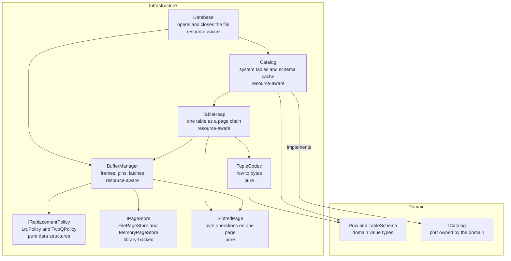
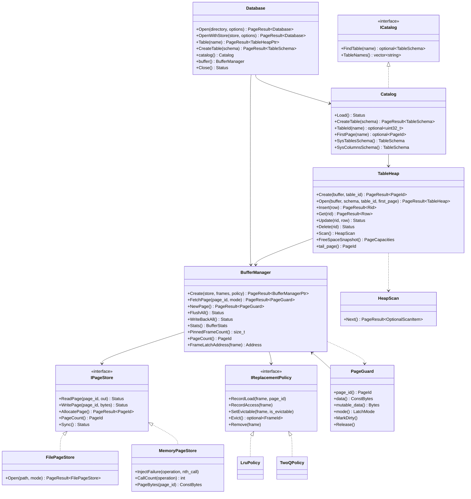
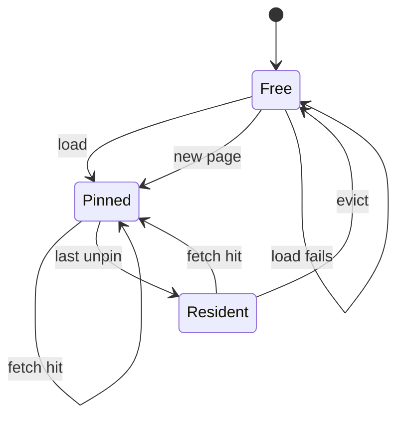
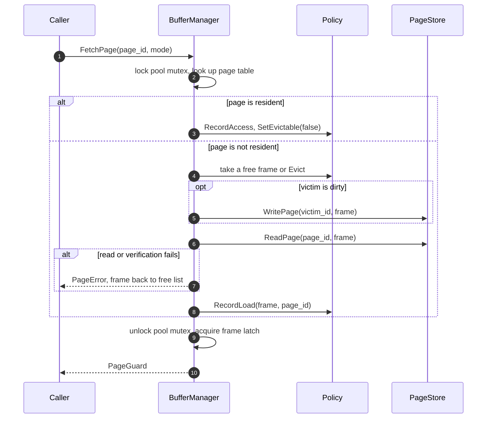
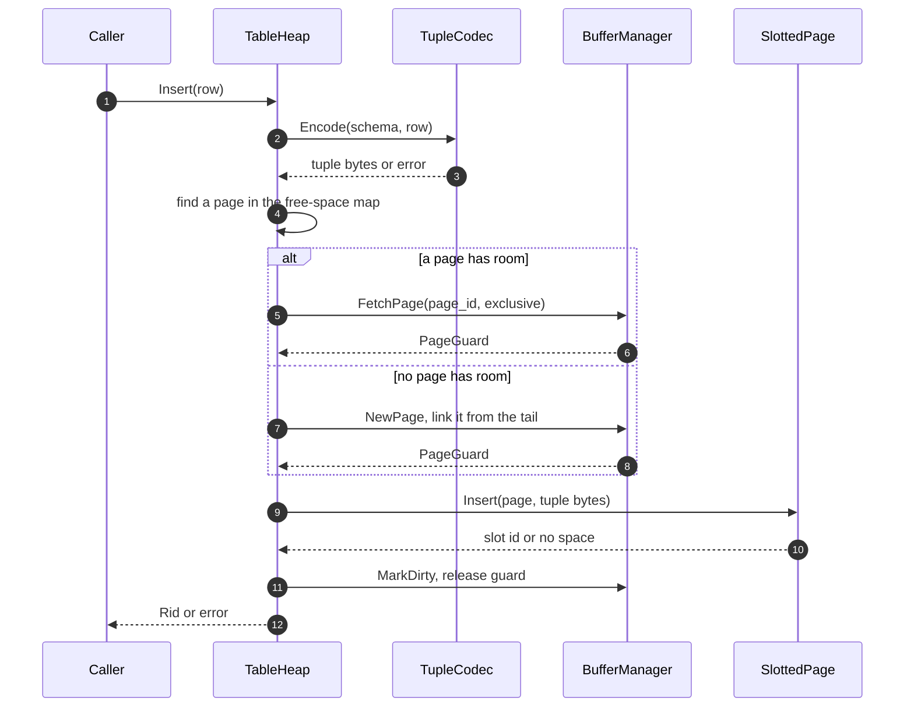
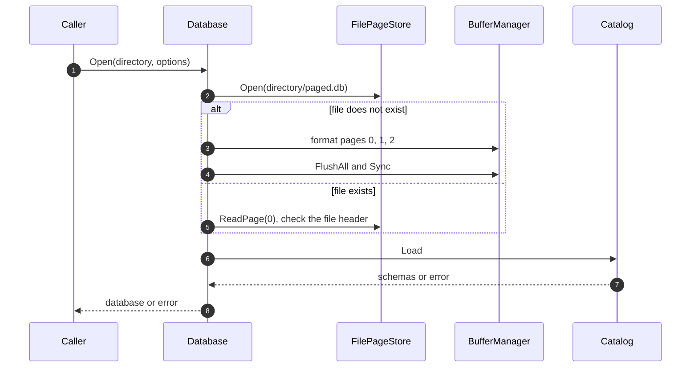
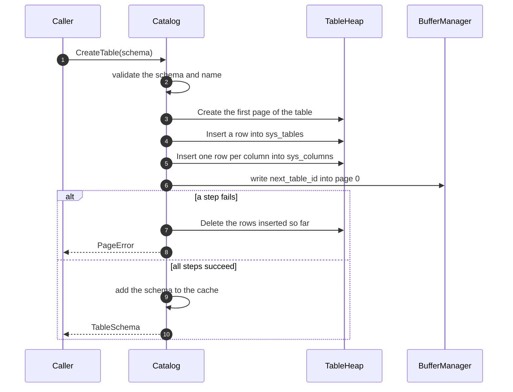

# Paged Engine

## 1. Project Description

The paged engine is the second storage engine of Strata. It persists data with fixed-size pages, a buffer pool and, later, indexes. The execution layer, which implements the same `domain::IEngine` port as the flatfile engine on top of this layer, is described in [PagedExecutionDesignDocument.md](PagedExecutionDesignDocument.md). This document covers the storage layer: the format of the single database file, tuple encoding and decoding, the slotted page, the table heap, the catalog stored in system tables, the buffer pool and two replacement policies. The Structured Query Language (SQL) front end, `IEngine` and the flatfile engine are described in [DesignDocument.md](DesignDocument.md).

This document leaves out the `IEngine` adapter and plan execution, the cross-process directory lock and the database-level reader-writer lock, which the execution design document covers. It also leaves out indexes, the Write-Ahead Log (WAL) and crash recovery, transactions, tuples larger than one page, NULL, page reclamation and file shrinking, and `DROP TABLE`. Indexes, the WAL and crash recovery are planned. This layer has no user interface. The Command-Line Interface (CLI) reaches it through `QueryService` and the paged engine.

One constraint holds throughout: computation on page bytes is kept apart from resource handling. Tuple encoding and decoding, slotted page operations, Cyclic Redundancy Check (CRC) and the replacement policies receive only bytes or numbers. They perform no Input/Output (I/O) and acquire no locks or pins. Pins, unpins, allocation, eviction and disk reads and writes live in `BufferManager`, `IPageStore`, `TableHeap`, `Catalog` and `Database`. Only `PageGuard` holds a pin and a latch.

| Term | Meaning | Name in code |
|---|---|---|
| page | The fixed-size unit exchanged between the file and memory, 4096 bytes | `kPageSize` |
| page id | The number of a page in the file, counted from 0. Page `n` sits at file offset `n * 4096` | `PageId` |
| frame | The memory slot in the buffer pool that holds one page | Internal to `BufferManager` |
| pin | A count of the uses of a frame. A frame whose pin count is not 0 is never evicted | `PageGuard` |
| latch | A reader-writer lock that protects the contents of one frame. It is distinct from the database-level lock | `std::shared_mutex` |
| slot | A 4-byte directory entry in a slotted page that points to one tuple | `SlottedPage` |
| tuple | The encoded bytes of one row of data | `TupleCodec` |
| Record Identifier (RID) | The location of a tuple, page id plus slot id | `Rid` |
| table heap | The page chain of one table | `TableHeap` |
| system table | One of the two internal tables that store the catalog | `sys_tables`, `sys_columns` |
| replacement policy | The rule that picks the frame to evict when the buffer pool is full. Two policies exist, Least Recently Used (LRU) and 2Q | `IReplacementPolicy` |

## 2. Architecture

### 2.1 Component Diagram

| Concern | Layer | Nature | Files |
|---|---|---|---|
| `Row`, `TableSchema`, `ICatalog` | Domain | Existing types and port | `domain/value.h`, `domain/engine.h` |
| Encoding and decoding of tuples | Infrastructure | Pure | `paged/tuple_codec.h`, `paged/tuple_codec.cpp` |
| Slot operations, compaction, structure check, sealing and verification on one page | Infrastructure | Pure | `paged/slotted_page.h`, `paged/slotted_page.cpp` |
| CRC-32C and little-endian integer helpers | Infrastructure | Pure | `paged/crc32c.h`, `paged/crc32c.cpp`, `paged/byte_codec.h` |
| State of LRU and 2Q | Infrastructure | Pure data structures with no locks | `paged/replacement_policy.h`, `paged/replacement_policy.cpp` |
| Reads, writes, allocation and sync of pages | Infrastructure | Library-backed, using Portable Operating System Interface (POSIX) files. This layer owns the interface | `paged/page_store.h`, `paged/page_store.cpp` |
| Frames, pins, latches, eviction, counters | Infrastructure | Resource-aware | `paged/buffer_manager.h`, `paged/buffer_manager.cpp` |
| Page chain and free-space map of a table | Infrastructure | Resource-aware | `paged/table_heap.h`, `paged/table_heap.cpp` |
| System tables and schema cache, the implementation of `ICatalog` | Infrastructure | Resource-aware | `paged/catalog.h`, `paged/catalog.cpp` |
| Creation, verification and closing of the database file | Infrastructure | Resource-aware | `paged/database.h`, `paged/database.cpp` |
| Shared numbers, locations and error types | Infrastructure | Pure | `paged/paged_types.h` |

Files in `paged/` include only `domain/` and `paged/`. They do not include the headers of the flatfile engine (`infrastructure.h` and others), the Application or the Adapter. Inside `paged/`, `TableHeap` and `Catalog` depend on `BufferManager`. The byte layer (`TupleCodec`, `SlottedPage`, `crc32c`) does not include `BufferManager` or `IPageStore`. Only tests and `bootstrap.cpp` include `paged/`. `tests/test_layering.cpp` checks the dependency direction.

`Database` owns `IPageStore`, `BufferManager`, `Catalog` and the `TableHeap` of each table, each through a `std::unique_ptr`. A `TableHeap` is opened and cached at the first `Table(name)` call, and a mutex inside `Database` protects the cache. `BufferManager` holds `IPageStore` by reference. `TableHeap` and `Catalog` hold `BufferManager` by reference. None of the three outlives `Database`, and the destruction order is `TableHeap`, `Catalog`, `BufferManager`, `IPageStore`.

`BufferManager` contains a mutex and other objects hold it by reference, so it is not movable. `BufferManager::Create` therefore returns `std::unique_ptr<BufferManager>`. Every member of `Database` is a `std::unique_ptr`, so `Database` is movable and the address of the referenced `BufferManager` does not change. `Open` therefore returns `PageResult<Database>`. `FilePageStore` is movable. `OpenWithStore(store, options)` takes a `std::unique_ptr<IPageStore>` and owns it afterwards. A test that must inject a failure after opening first keeps a non-owning pointer to the `MemoryPageStore`, which stays valid until `Database` is destroyed.

`PageGuard` owns one pin and one latch. It does not store `pin_count`, which lives in the frame metadata inside `BufferManager`. It holds the `BufferManager` it came from by reference, together with the `FrameId` of the frame in use, and its destructor and `Release` release the latch and the pin through `BufferManager`. `PageGuard` is move-only and cannot be copied. A moved-from guard is empty, and calling `Release` or the destructor on an empty or already released guard releases nothing.

Only the thread that obtained a `PageGuard` can release it, because `std::shared_mutex` requires the same thread to unlock. A guard is not handed across threads. `BufferManager` must outlive every `PageGuard`. `PinnedFrameCount()` belongs to `BufferManager`, and tests use it to confirm that no path leaks a pin. What prevents a leak is the destructor of the guard, not the count. The caller obtains `Row` by value. Page bytes are valid only while the guard exists, and they are never passed out as pointers or references.

### 2.2 Types and Interfaces

| Type | Contents |
|---|---|
| `PageId`, `FrameId` | `uint32_t`. `kInvalidPageId` is `0xFFFFFFFF` |
| `Rid` | `{PageId page_id, uint16_t slot_id}`, comparable and hashable |
| `PageErrorCode` | `kIo`, `kCorrupt`, `kNoSpace`, `kNoFrame`, `kNotFound`, `kTooLarge`, `kInvalidArgument`, `kAlreadyExists`, `kClosed` |
| `PageError` | `{PageErrorCode code, std::string message}` |
| `Status` | `std::optional<PageError>`. No value means success |
| `PageResult<T>` | A value or a `PageError`, read through `ok()`, `value()` and `error()`. No exceptions are used. `BufferManager::Create` returns `PageResult<std::unique_ptr<BufferManager>>`. `Database::Table` returns `PageResult<TableHeap*>`, a non-owning pointer that stays valid until `Close` or destruction. `HeapScan::Next` returns `PageResult<std::optional<ScanItem>>` |
| `LatchMode` | `kShared`, `kExclusive` |
| `BufferStats` | `hits`, `misses`, `evictions`, `dirty_writebacks`, `page_reads`, `page_writes`, all cumulative `uint64_t`. `hits + misses` equals the number of `FetchPage` calls, and both successful and failed calls count |
| `ReplacementPolicyKind` | `kLru`, `kTwoQ` |
| Entry points of `Database` | `Open(directory, options)` opens or creates `directory/paged.db`. `OpenWithStore(store, options)` opens with a `std::unique_ptr<IPageStore>` that the caller hands over, so tests can inject failures with `MemoryPageStore`. The flow after either call is the same (3.3). `Database::catalog()` returns a reference to `Catalog`, `Database::buffer()` returns a reference to `BufferManager`, and `Database::CreateTable(schema)` forwards to `Catalog::CreateTable` |
| `DatabaseOptions` | `pool_frames`, default 256, and `policy`, default `kLru` |
| `ScanItem` | `{Rid rid, Row row}`. When `HeapScan::Next` has no more rows, the `std::optional<ScanItem>` it returns has no value |
| `IPageStore` | `ReadPage` and `WritePage` work in whole pages of 4096 bytes. `AllocatePage` appends one all-zero page at the end of the file and returns its number. `PageCount` is the file size divided by 4096. `Sync` hands the written data to the storage device. `ReadPage` and `WritePage` return `kNotFound` for a number that is at least `PageCount`, and `AllocatePage` returns `kNoSpace` when page numbers are exhausted. Implementations are not thread-safe, and `BufferManager` calls them while holding the pool mutex |
| `IReplacementPolicy` | A single-threaded state machine, always called with the pool mutex held. `Evict` returns only an evictable frame, and returns no value when there is none |
| `TupleCodec` | `Encode(schema, row)` returns bytes, or `kInvalidArgument` or `kTooLarge`. `Decode(schema, bytes)` returns a `Row`, or `kCorrupt` |
| Accessors for tests | `TableHeap::FreeSpaceSnapshot()` returns a list of (page id, capacity) pairs sorted by page id, and `tail_page()` returns the chain tail. `MemoryPageStore::InjectFailure(operation, nth_call)` makes the `nth_call`-th call of that operation, counted from now, fail once. An `nth_call` of 1 is the next call, and the injection expires after the failure. `CallCount(operation)` returns how many times that operation was called, failed calls included. `BufferManager::FrameLatchAddress(frame)` returns the address of the latch |
| `SlottedPage` | Operates on one 4096-byte buffer through `Format`, `Insert`, `Get`, `Delete`, `Update`, `Compact`, `InsertCapacity`, `SealChecksum`, `VerifyHeader` and `CheckStructure`. It has no state beyond the pointer |

`TupleCodec::Encode` returns new bytes that the caller owns, and `Decode` returns a new `Row`, which is a copy. `SlottedPage::Get` returns a read-only byte range that points into the page. The range is valid while the guard of that page exists and the page is not modified. `TableHeap::Get` and `HeapScan` return `Row` by value. Copying page bytes into `Row` is an accepted single copy, and it lets the guard be released before the return. `PageGuard::data()` returns a `const` pointer, and only a guard that holds the exclusive latch can get a writable pointer from `mutable_data()`. `Database::Table` returns a non-owning `TableHeap` pointer, valid until `Close` or destruction.

### 2.3 File and Page Format

The database file is `paged.db` in the database directory. The directory also holds `.strata.lock`, which Bootstrap acquires. The planned WAL adds `paged.wal`. The file size is `page count * 4096`. The page count is not stored in the file, and is derived from the file size. All multi-byte integers are written little-endian at fixed width. `byte_codec.h` encodes them byte by byte, so the layout does not depend on the byte order of the host.

Common header, the start of every page, 32 bytes:

| Offset | Width | Field | Description |
|---|---|---|---|
| 0 | 4 | `checksum` | CRC-32C of bytes `[4, 4096)` |
| 4 | 4 | `page_id` | The number of the page itself. It detects a write to the wrong location |
| 8 | 1 | `page_type` | 0 is unformatted, 1 is the file header, 2 is heap data |
| 9 | 1 | `reserved` | 0 |
| 10 | 2 | `slot_count` | The length of the slot array (type 2) |
| 12 | 2 | `free_end` | The start of the tuple area, which is `[free_end, 4096)`. An empty page has 4096 (type 2) |
| 14 | 2 | `dead_bytes` | The number of bytes in the tuple area that are deleted but not yet reclaimed (type 2) |
| 16 | 4 | `next_page_id` | The next page in the table's page chain. The chain tail has `0xFFFFFFFF` (type 2) |
| 20 | 4 | `table_id` | The table that owns this page (type 2) |
| 24 | 8 | `lsn` | Log Sequence Number (LSN), reserved for the WAL and always 0 until the WAL exists |

In a type 2 (heap data) page the slot array starts at offset 32. Each slot is 4 bytes, an `offset` (`uint16_t`) and a `length` (`uint16_t`). Tuples stack from the end of the page toward the front. `free_start` is `32 + 4 * slot_count`, and the contiguous free space is `free_end - free_start`. A live slot has a `length` of at least 1 and `offset >= free_end`. A dead slot has an `offset` and a `length` of 0.

The type 1 (file header) page is always page 0. Its fields start at offset 32:

| Offset | Width | Field | Description |
|---|---|---|---|
| 32 | 8 | `magic` | ASCII `PAGEDDB` plus `0x00` |
| 40 | 4 | `format_version` | Currently 1 |
| 44 | 4 | `page_size` | 4096. Opening is rejected when it differs from `kPageSize` |
| 48 | 4 | `next_table_id` | The next table number, 3 for a new database |
| 52 | 4 | `sys_tables_first_page` | 1 for a new database |
| 56 | 4 | `sys_columns_first_page` | 2 for a new database |

A new database has three pages. Page 0 is the file header, page 1 is the first page of `sys_tables` and page 2 is the first page of `sys_columns`, so the file is 12288 bytes. The numbers of the system tables are fixed at 1 and 2.

| Check | Contents | When | Cost |
|---|---|---|---|
| `VerifyHeader` | `checksum` matches, `page_id` equals the number read, `page_type` is 0 to 2, and for type 2 `free_start <= free_end <= 4096`. An all-zero page counts as unformatted and passes | After every page read in by `BufferManager` | O(page size), from the CRC |
| Slot bounds check | Checks `slot_id < slot_count`, otherwise returns `kNotFound`. For a live slot it also checks `offset >= free_end` and `offset + length <= 4096`, otherwise returns `kCorrupt` | Every `SlottedPage` access | O(1) |
| `CheckStructure` | Adds to the checks above: `live length total + dead_bytes == 4096 - free_end`, live tuples do not overlap, and dead slots are 0 | Tests and diagnostics | O(slot count log slot count) |

A failed check returns `kCorrupt`, except for a `slot_id` out of range. The message contains the page id and the violated condition. `SealChecksum` computes and writes `checksum` before `BufferManager` writes out a page.

The largest tuple is `4096 - 32 - 4 = 4060` bytes. Such a tuple fills its page, which then holds no other tuple.

The page size of 4096 is not larger than the operating system page size and divides it evenly. The operating system page is 4096 bytes on x86 and Linux, and 16384 bytes on macOS on the Apple M4 development machine, measured with `sysctl hw.pagesize`. The start of a frame is a multiple of 4096 (2.6), and so is the offset of a page in the file, so the I/O of one page does not cross an operating system page. The cache line of the development machine is 128 bytes, not 64, measured with `sysctl hw.cachelinesize`. The header fields are aligned by width: `checksum`, `page_id`, `next_page_id` and `table_id` take 4 bytes, and `lsn` takes 8. They are always read and written byte by byte and never through a pointer cast, so alignment affects only performance, not correctness.

The header and the slot array are adjacent, so scanning all slots of a page reads only the contiguous `4 * slot_count` bytes from offset 32. Tuples stack from the end of the page toward the front in insertion order. Decoding in increasing slot order therefore reads decreasing addresses, and the hardware prefetcher can follow this sequential access.

`IPageStore` reads and writes frames directly, with no intermediate buffer. Decoding into `Row` is an accepted single copy (2.2).

### 2.4 Tuple Format

`TupleCodec` encodes column by column in the order of `TableSchema::columns`. There is no column separator and no NULL bitmap, since the system has no NULL.

| Column type | Encoding |
|---|---|
| `INT` | 8 bytes, two's complement, little-endian |
| `DOUBLE` | 8 bytes, the bits of IEEE 754 binary64, little-endian. Values are read and written by bit copy, so the bits of `-0.0`, `NaN` and infinity are all preserved |
| `TEXT` | A 2-byte little-endian length followed by that many bytes. The content is arbitrary bytes, including newlines, quotes and `0x00` |

`Encode` fails with `kInvalidArgument` when the number of columns of `Row` differs from the schema or the type of a `Value` differs from the column type. It fails with `kTooLarge` when a `TEXT` exceeds 65535 bytes or the whole tuple exceeds 4060 bytes. `Decode` fails with `kCorrupt` when there are not enough bytes, a length exceeds the remaining bytes, or extra bytes remain when decoding ends. The two are inverses: for every valid `Row`, `Decode(Encode(row)) == row`, with `DOUBLE` compared by bits.

### 2.5 Table Heap and RID Rules

A table is a page chain linked by `next_page_id`. The chain starts at the `first_page` recorded in `sys_tables`. The first page is allocated and formatted when the table is created, so the starting point never changes.

| Operation | Rule |
|---|---|
| `Insert(row)` | After encoding, takes the page with the smallest sufficient capacity from the free-space map. Among equal capacities it takes the smallest page id. When no page has room, it allocates a new page and links it at the chain tail. It returns the `Rid`. A tuple over 4060 bytes returns `kTooLarge` |
| `SlottedPage::Insert` | Looks first for the dead slot with the smallest number and reuses it, which saves the 4 bytes of a new slot. When the contiguous space suffices, it places the tuple forward from `free_end`. When the contiguous space plus `dead_bytes` suffices, it compacts first and then places the tuple. Otherwise it returns `kNoSpace`. A tuple length of 0 returns `kInvalidArgument`, and a length over 4060 bytes returns `kTooLarge` |
| Compaction | Moves the live tuples to the end of the page in descending order of offset, updates the `offset` of each slot and resets `dead_bytes` to zero. Slot numbers do not change. Afterwards the dead slots at the tail are removed, so `slot_count` decreases, and then the check for a reusable dead slot is made |
| `Delete(rid)` | The slot becomes dead, with `offset` and `length` set to 0, and `dead_bytes` grows by the length of the tuple. The bytes of the tuple are not cleared. A dead or out-of-range slot returns `kNotFound` |
| `Get(rid)` | A live slot returns `Row`. A dead or out-of-range slot returns `kNotFound` |
| `Rid` of `Get`, `Update`, `Delete` | The page of the `Rid` must be a heap data page of this table, meaning `page_type` is 2 and `table_id` matches. Otherwise `kInvalidArgument` is returned. A page number that is at least the page count of the store returns `kNotFound`, which comes from `IPageStore` |
| `Update(rid, row)` | Never crosses pages and never changes the `Rid`. When the new tuple is not longer than the old one, it is overwritten in place, and when it is shorter the difference is added to `dead_bytes`. When it is longer, it stays in the same slot if the same page can hold it after releasing the old tuple, compacting if necessary. Otherwise `kNoSpace` is returned, and the caller finishes the update with `Delete` plus `Insert`, which changes the `Rid`. During compaction the slot being updated is not removed, even at the end of the slot array |
| `Scan()` | Walks the pages in chain order. Each page is read in under a shared latch, all its live tuples are decoded into `Row`, and the latch is released. Then the rows are returned one by one, in increasing slot number within the page. The memory bound is the number of rows of one page. After a failed page load, which is a read failure, a corrupt page or a tuple that cannot be decoded, the rows already decoded from that page are dropped. The error is returned once, and every later `Next` returns no value |
| Opening a table | Walks the whole chain, reads the header of each page, checks that `page_type` is 2 and `table_id` matches, and rebuilds the free-space map and the chain tail. A mismatch, or a duplicate page id in the chain, which means a cycle, returns `kCorrupt` |

After a deletion, the next `Insert` on the same page reuses the dead slot with the smallest number. A `Rid` may therefore point to different rows before and after the deletion. A holder of `Rid`, such as the planned index, must remove the corresponding entry when a row is deleted. Compaction and in-place update do not change slot numbers.

The free-space map is a `std::set<std::pair<uint16_t, PageId>>`, ordered by capacity and then page id, plus a `std::unordered_map<PageId, uint16_t>` from page id to capacity. The capacity of a page is the longest tuple that the page can hold now. It is `contiguous space + dead_bytes`, minus 4 when no dead slot is available for reuse, and 0 when the result is less than 0. A lookup of the smallest entry whose capacity is at least the tuple length is O(log P), where P is the number of pages in the chain. Updating a page is O(log P) too. After every operation the capacity of that page is recomputed in O(slot count). The free-space map is not saved to the file (ADR-0031).

`Insert`, `Update` and `Delete` require the caller to guarantee that only one writer exists at a time. The database-level reader-writer lock in `QueryService` provides that guarantee (Paged Execution Design Document 2.5). `Get` and `Scan` can run concurrently with other readers and one writer. The frame latch protects the page content, so each page is consistent at the instant it is read, but there is no consistent snapshot across pages. A writer that appends a page holds the exclusive latch of the chain tail first and then acquires the latch of the new page, in chain order. A reader holds only one latch at a time, so no wait cycle forms.

### 2.6 Buffer Manager Rules

`BufferManager::Create(store, frames, policy)` allocates `frames * 4096` bytes of contiguous memory aligned to 4096, using the aligned `operator new` of C++17. A `frames` value below 4 returns `kInvalidArgument`, and a memory allocation failure returns `kNoSpace`. On success it returns `std::unique_ptr<BufferManager>`.

| State | Contents |
|---|---|
| Page table | `std::unordered_map<PageId, FrameId>`. Lookup and update are O(1) on average |
| Frame metadata | `page_id`, `pin_count` and `is_dirty`, packed tightly in one `std::vector` and protected by the pool mutex |
| Frame latch | One `std::shared_mutex` per frame, each `alignas(kCacheLineSize)` (128 bytes) and separate from the metadata array |
| Free frames | `std::vector<FrameId>`. Take and put back are O(1) |
| Replacement policy | `IReplacementPolicy`, with its state protected by the pool mutex |
| Counters | `BufferStats`, protected by the pool mutex |

The synchronization strategy prevents data races, lost updates and deadlocks.

The pool mutex (`std::mutex`) protects the page table, the `page_id`, `pin_count` and `is_dirty` of the frames, the free list, the replacement policy and the counters. Its critical section does only memory operations, with one exception: the disk I/O on a miss, described below.

The frame latch (`std::shared_mutex`) protects the page content of a frame. When a `PageGuard` is obtained, the pin is completed inside the pool mutex first, and the wait for the latch happens only after leaving the pool mutex. The pool mutex is never held while waiting for a latch.

Each latch occupies its own 128-byte-aligned space, and the latch array is allocated with the over-aligned `operator new` of C++17 (ADR-0034). Readers update the internal state of a latch with atomic operations outside the pool mutex. If the latches of adjacent frames share one cache line, threads that take the latches of different frames still invalidate each other's cache line, which is false sharing. `kCacheLineSize` is 128, because the cache line of the Apple M4 development machine is 128 bytes, that of x86 is 64, and 128 covers both. The metadata is not aligned. The same pool mutex serializes it, so several threads never update it at once, and packing it tightly gives the replacement policy and the counters better access locality. The price is padding. `std::shared_mutex` is 168 bytes on the development machine (measured with `sizeof` on 2026-11-15, Apple clang with libc++), so an aligned latch takes 256 bytes and the latch array of 256 frames takes 64 KiB.

The lock order is latch first, pool mutex second, and never the reverse. A thread that holds a frame latch can acquire the pool mutex, to fetch another page or to unpin. A thread that holds the pool mutex never waits for a latch, because the `pin_count` of a frame being evicted or written back is 0 and no guard holds its latch. A thread holds two latches only when it appends a page (2.5), in the order chain tail, then new page.

On a miss, writing back the dirty victim page and reading in the new page both happen inside the pool mutex. The two actions need a definite order against other `FetchPage` calls for the same two page numbers. Holding the mutex gives that order with no extra frame state and no in-progress set. The price is that misses serialize with each other, and a hit also waits for the pool mutex, including for the disk I/O that another thread is performing (ADR-0028).

Constructing a `PageGuard` acquires the pin and the latch, and the destructor releases the latch first and then the pin. `MarkDirty` is valid only when the guard holds the exclusive latch. An `assert` checks that precondition, so a Release build does not check it. On destruction the dirty flag is merged into the frame inside the pool mutex. When `pin_count` drops to 0, `SetEvictable(frame, true)` is called.

| Operation | Rule |
|---|---|
| `FetchPage(id, mode)` | On a hit it pins the frame, calls `RecordAccess` and `SetEvictable(false)`, and adds 1 to `hits`. On a miss it adds 1 to `misses` and takes a free frame, or else calls `Evict()`, which already makes the replacement policy stop tracking that frame. When there is still no frame, it returns `kNoFrame` without waiting. When the victim page is dirty, it calls `SealChecksum` and writes the page back. If the write-back fails, the page stays in the page table and stays dirty, it is registered again with the replacement policy through `RecordLoad` plus `SetEvictable(true)`, the error is returned, and `evictions` does not increase. After a successful write-back, or when the page is clean, the victim page leaves the page table and `evictions` grows by 1. If reading in the new page or `VerifyHeader` fails, the frame goes back to the free list, the page table gets no new entry, no pin is held, and the error is returned. On success the page table entry and `RecordLoad` are registered, and `SetEvictable(false)` is called. Every call, a failed one included, adds 1 to `hits + misses` |
| `NewPage()` | Obtains a frame the same way as a miss, then allocates a new page number from `IPageStore`. The frame content is all 0, except the `page_id` of the header, which is already written. `page_type` is still 0, `is_dirty` is true and the latch is exclusive. The caller formats the page. When allocation fails, that error is returned and the frame goes back to the free list. When no frame is available, `kNoFrame` is returned and the store has no new page. `NewPage` does not count toward `hits` or `misses` |
| `WriteBackAll()` | Collects the numbers of the dirty frames. For each one in turn it rechecks inside the pool mutex that the frame still has a page, pins it, takes the shared latch, calls `SealChecksum`, writes the page out, and clears `is_dirty` while still holding the latch. It does not call `Sync`. The caller must not hold any `PageGuard`. The first failure stops it and is returned, and the frames already written out stay clean. It is not safe to run at the same time as another `WriteBackAll()` or `FlushAll()`. The paged engine calls it after every successful write statement (Paged Execution Design Document 2.8) |
| `FlushAll()` | Calls `WriteBackAll()` and, after it succeeds, `Sync`. The first failure is returned, and a failed `WriteBackAll()` skips the `Sync`. The preconditions are those of `WriteBackAll()` |
| `Stats()`, `ResetStats()` | Copies or zeroes the counters inside the pool mutex |
| `PinnedFrameCount()` | The number of frames whose `pin_count > 0` at present. Several guards of the same page occupy only one frame. Tests use it to confirm that no pin leaks |
| `PageCount()` | Forwards to `IPageStore::PageCount` inside the pool mutex |
| `FrameLatchAddress(frame)` | The address of the latch of that frame. Only tests use it, to check the memory layout |

A `Free` frame holds no page. A `Pinned` frame holds a page with a `pin_count` greater than 0, so it cannot be evicted. A `Resident` frame holds a page with a `pin_count` of 0, so it can be evicted. Dirty is a separate flag, independent of the three states. A `Resident` frame that is dirty is written back first when it is evicted.

### 2.7 Replacement Policies

`BufferManager` calls every operation of `IReplacementPolicy` inside the pool mutex, and the implementations contain no locks. `SetEvictable(frame, false)` is called when a frame is pinned. `SetEvictable(frame, true)` is called when `pin_count` drops to 0, and it also counts as one access. After `RecordLoad` the frame is not evictable until `SetEvictable(frame, true)`. After `Evict` the replacement policy no longer tracks that frame, and the caller registers it again with `RecordLoad`. `Remove`, and `RecordAccess` or `SetEvictable` on an untracked frame, have no effect. A frame registered again after a failed write-back already has its page id in A1out of 2Q, placed there by `Evict`, so it enters Am when registered again.

| Policy | Rule | Cost |
|---|---|---|
| `LruPolicy` | Keeps the evictable frames in a `std::list<FrameId>`, with the most recently used at the tail. `SetEvictable(true)` and `RecordAccess` on an evictable frame move the frame to the tail. `Evict` takes the head. A `std::unordered_map<FrameId, iterator>` locates the frames | `Evict`, `RecordAccess` and `SetEvictable` are all O(1) |
| `TwoQPolicy` | Simplified 2Q. The capacity is `N` frames, `Kin = max(1, N / 4)` and `Kout = max(1, N / 2)`. A1in is a First In First Out (FIFO) queue of pages loaded for the first time. Am is an LRU of pages referenced again. A1out is a ghost FIFO that stores only page ids, at most `Kout` of them. `RecordLoad`: when the page id is in A1out, it is moved out of A1out and into Am, otherwise it goes into A1in. Afterwards A1out is truncated to `Kout` entries. A frame in A1in does not move when accessed again, because consecutive references are treated as correlated. A frame in Am moves to the tail of Am when accessed. `Evict`: when the number of frames in A1in is greater than `Kin`, or Am has no evictable frame, it takes the first evictable frame from the head of A1in and appends its page id to the tail of A1out, without truncating. Otherwise it takes from the head of Am. When the chosen queue has no evictable frame, it takes from the other queue. The truncation sits after the check in `RecordLoad`, so that the eviction of the same miss does not push the page id requested by that miss out of A1out | `RecordLoad` and `RecordAccess` are O(1). `Evict` must skip the pinned frames at the head of the queue, so it is O(N) in the worst case, where N is the number of frames |

2Q exists to resist scans. Pages loaded by a one-time sequential scan enter only A1in and do not push out the repeatedly used pages in Am. LRU has no such protection. The counters (`BufferStats`) show the difference between the two, and tests compare them with fixed access sequences (Testing Document PU-20, PI-09).

### 2.8 System Catalog

The catalog is stored in two system tables with fixed schemas. Their rows are accessed the same way as the rows of an ordinary table, through `TableHeap`.

| System table | Number | Columns |
|---|---|---|
| `sys_tables` | 1 | `table_id` INT, `name` TEXT, `first_page` INT, `primary_key_index` INT, `auto_increment_index` INT (-1 when absent) |
| `sys_columns` | 2 | `table_id` INT, `position` INT, `name` TEXT, `type` INT (0 is INT, 1 is DOUBLE, 2 is TEXT), `default_kind` INT (0 none, 1 INT, 2 DOUBLE, 3 TEXT), `default_text` TEXT, `is_unique` INT (0 or 1), `ref_table` TEXT (empty string when absent), `ref_column` INT (-1 when absent) |

`default_text` holds an INT in decimal, a DOUBLE as the 16 hexadecimal digits of its IEEE 754 bits, which round-trips exactly, and a TEXT as the original string. A `TableSchema` maps to the two system tables as follows. `columns` is rebuilt from `sys_columns` by `position`. `primary_key_index` and `auto_increment_index` come from `sys_tables`. `unique_indexes` are the column positions whose `is_unique` is 1, in ascending order. `foreign_keys` are the columns whose `ref_table` is non-empty, in ascending position.

`Load()` walks both system tables and builds an in-memory cache. The cache is a vector of schemas, ascending by `table_id`, which is the creation order, and a `std::unordered_map` keyed by lowercase name. `FindTable` is O(1) plus one schema copy, and `TableNames` is O(T), where T is the number of tables.

`Load()` returns `kCorrupt`, with a message that names the table and the column, when it finds any of these:

- A `table_id` below 3, since 1 and 2 are the system tables, or a repeated `table_id`.
- A repeated table name.
- A row of `sys_columns` that belongs to no row of `sys_tables`.
- A table with no column.
- A `first_page` that is at least the page count.
- `position` values of a table that are not contiguous from 0 or that repeat.
- A `type` or `default_kind` out of range, or an `is_unique` that is not 0 or 1.
- A `default_text` that cannot be parsed according to `default_kind`, which means an INT that is not a decimal integer or a DOUBLE that is not 16 hexadecimal digits.
- A `primary_key_index` or `auto_increment_index` that points to no existing column.
- A `ref_column` below 0 when `ref_table` is non-empty.
- A `next_table_id` in the file header that is not greater than the largest `table_id`.

`CreateTable(schema)` checks that the name is non-empty and matches `[A-Za-z_][A-Za-z0-9_]*`, does not duplicate an existing table case-insensitively, and does not start with `sys_`, also case-insensitively. It checks that the schema has at least one column and that column names do not repeat, case-insensitively. It checks that `primary_key_index` is in range, that `auto_increment_index` points to an INT column, and that the positions in `unique_indexes` and `foreign_keys` are in range. Whether the target table of a foreign key exists is the Binder's job. The catalog only stores it. A duplicate name returns `kAlreadyExists`, and every other failure returns `kInvalidArgument`. The steps and the failure handling are in 3.4.

`FirstPage(name)` returns the first page number of a table, so that `Database::Table` can open its `TableHeap`. `SysTablesSchema()` and `SysColumnsSchema()` return the schemas of the two system tables, for `Database` and tests.

`Database` reads the two page numbers of `Catalog(buffer, sys_tables_first_page, sys_columns_first_page)` from the file header. No page is read before `Load()`. A mutex serializes calls of `CreateTable`. A `std::shared_mutex` protects the cache. `FindTable`, `TableNames` and `TableId` take it shared, and `CreateTable` takes it exclusive while it updates the cache.

### 2.9 Failure and Durability Limits

| Item | Convention |
|---|---|
| Durability | `Database::Close()` writes out all dirty pages and then calls `Sync`, which is `fcntl(F_FULLFSYNC)` on Apple platforms and `fsync` on other platforms. Until `Close`, changes are guaranteed only in memory, unless the caller calls `BufferManager::WriteBackAll()`. That call writes the dirty pages to the operating system without `Sync`: the pages survive a process kill, and a power loss may still lose them. When `Close` has not been called, the destructor does the same write-out. It cannot return a failure, so it prints the error to stderr, as intentional diagnostic output |
| Crash consistency | None. The WAL and crash recovery are planned. A multi-page update, such as appending a page or creating a table, may complete only partly when the process is terminated midway. The pages and rows of a `CreateTable` may remain, and the `next_table_id` of the file header may disagree with the system tables. Detection relies on the CRC, which makes a corrupt page return `kCorrupt`, and on the validation in `Load()`. Nothing is repaired |
| Corrupt page | When `VerifyHeader` fails on read-in, `kCorrupt` is returned. Operations on the table that owns that page fail, and other tables are not affected. The frame goes back to the free list, and no pin leaks |
| File size | A size that is not a multiple of 4096 returns `kCorrupt`. An existing file of size 0 is treated as a new database. A size greater than 0 but under 3 pages returns `kCorrupt`. A `sys_tables_first_page` or `sys_columns_first_page` in the file header beyond the page count returns `kCorrupt`. A trailing all-zero page that no table or system table references is treated as unused and kept, and no error is returned. A crash leaves such a page when it happens after the file was extended and before the page was formatted |
| Version | A mismatch in `magic`, `format_version` or `page_size` returns `kCorrupt`, with a message that names the mismatching field. So does a `page_type` of page 0 that is not 1, and a `next_table_id` below 3 |
| Close | After `Database::Close()` succeeds, it can be called again and later calls return success. When `Close` fails, for example because `Sync` returns `kIo`, the database is still open. `Close` can be called again, and the destructor also tries the write-out again. After `Close`, `Database::Table` and `Database::CreateTable` return `kClosed`. `Database` makes that check, because `Catalog` has no closed state |
| I/O failure | A failure of `pread`, `pwrite` or `fsync` returns `kIo`, with a message that contains the description of `errno` and the page id. On a failed write-back, `BufferManager` keeps the frame dirty and in the page table, so no data is lost |
| Space limits | A tuple is at most 4060 bytes. The length field of `TEXT` allows 65535 bytes, but the tuple limit is the one that applies, so the `TEXT` of a single-column table is at most 4058 bytes. The page count is counted in `uint32_t` |
| Platform | POSIX (macOS, Linux). `pread`, `pwrite`, `fsync` |

## 3. Flow of Control

### 3.1 Flow: Fetch a Page

Steps 1 and 2: `FetchPage` acquires the pool mutex and looks up the page table (2.6).

Step 3: on a hit only the replacement policy and the pin are updated. No I/O happens.

Steps 4 to 6: on a miss, a free frame is taken or a victim frame is evicted. When the victim page is dirty, the CRC is sealed first and the page is written back. When the write-back fails, the error is returned directly. The victim frame stays dirty and in the page table, and is registered again with the replacement policy (2.6, 2.9). When no frame is available, `kNoFrame` is returned.

Steps 7 and 8: when reading in or verification fails, the frame goes back to the free list and the error is returned. The replacement policy is not tracking the frame at this point, because `Evict` has already stopped tracking it. No pin leaks. On success the frame is registered with the replacement policy.

Steps 9 and 10: the wait for the frame latch happens only after leaving the pool mutex. The pin is already held, so the frame cannot be evicted in the meantime. The `PageGuard` is then returned.

### 3.2 Flow: Insert a Row

Steps 1 to 3: an encoding failure, such as a type mismatch or a tuple that is too large, is returned directly and no page is touched (2.4).

Step 4: the free-space map yields the page with the smallest sufficient capacity (2.5).

Steps 5 and 6: when a page exists, it is obtained with the exclusive latch.

Steps 7 and 8: when no page has room, a new page is allocated, formatted and linked while the exclusive latch of the chain tail is held, tail first and then new page (2.5).

Steps 9 and 10: `SlottedPage::Insert` places the tuple according to the rules of 2.5, compacting when necessary. When the capacity in the free-space map differs from the actual capacity, the insert returns `kNoSpace`. Then the free-space map is updated with the actual capacity of that page, a page is chosen again by the rules of 2.5, which may be another page or a newly allocated one, and the insert is retried once. When the second attempt is still `kNoSpace`, `kCorrupt` is returned.

Steps 11 and 12: while the guard is held, the actual capacity is computed from the page, the page is marked dirty and the free-space map is updated. Then the guard is released, latch first and then pin, and `Rid` is returned.

### 3.3 Flow: Open or Create the Database

Steps 1 and 2: a directory that does not exist or is not a directory returns `kIo`. The file is opened for read and write, and is created when it does not exist.

Steps 3 and 4: a new file gets three pages written, the file header and the first pages of the two system tables (2.3). Then `FlushAll` and `Sync` run, and the later flow is the same as for an existing file.

Step 5: an existing file is checked in order for the file size, `magic`, `format_version`, `page_size`, the `page_type` of page 0, and the CRC and page id of the header. The header is read directly with `IPageStore::ReadPage(0)`, not through the buffer pool. A failure of any item returns `kCorrupt` (2.9).

Steps 6 and 7: `Catalog::Load` walks the system tables, validates them and builds the cache (2.8).

Step 8: on success `Database` holds the file, the buffer pool and the catalog, and hands them to the caller. When any step fails, the objects already built are released in the order of 2.1, and the file is not modified. A newly created file is the exception.

### 3.4 Flow: Create a Table

Steps 1 and 2: the check rules are in 2.8. On failure no page or row is written.

Steps 3 to 6: in order, the first page of the table is allocated and formatted, one row of `sys_tables` is written, one row of `sys_columns` is written per column, and the `next_table_id` of the file header is updated.

Steps 7 and 8: when any step fails, the system table rows already inserted are removed with `Delete`, on a best-effort basis, and the original error is returned. When the undo itself also fails, the error message names both. Allocated pages are not reclaimed (2.9). This is not a transaction. Until the planned WAL exists, the validation in `Load()` detects the result of a termination midway.

Steps 9 and 10: the cache is updated under the exclusive lock only when all steps succeed. The `TableSchema` returned is the same as the one passed in.

## 4. Decisions

[DecisionRecord.md](DecisionRecord.md) records the decisions. These relate to this document:

- ADR-0024: A paged database is one file in the directory, with the catalog stored in system tables
- ADR-0025: A page is 4096 bytes with a common header holding a CRC-32C and an LSN, in fixed-width little-endian
- ADR-0026: Slot numbers are stable, a RID may be reused after deletion, and an update does not cross pages
- ADR-0027: A tuple is encoded in schema column order, capped at 4060 bytes, with no overflow
- ADR-0028: The buffer pool synchronizes with one pool mutex and one latch per frame
- ADR-0029: The replacement policy is an interface, implemented as LRU and simplified 2Q
- ADR-0030: Disk I/O is isolated behind `IPageStore`
- ADR-0031: The free-space map of a table heap exists only in memory
- ADR-0032: The catalog is cached on read, and table creation has no transaction protection
- ADR-0033: The engine is named `paged`
- ADR-0034: Each frame latch occupies one cache line
- ADR-0035: Type names in the paged layer carry no engine prefix, and a table's page chain is called `TableHeap`

## 5. Testing

The testing plan is in [PagedEngineTestDocument.md](PagedEngineTestDocument.md). This section covers the verification approach only.

### 5.1 Verification Approach

- **Table-driven tests:** `TupleCodec`, `SlottedPage`, CRC-32C and the byte helpers are pure functions. Cases of input against expected bytes, fields or errors verify 2.3, 2.4 and 2.5 without a file.
- **State sequences:** `LruPolicy` and `TwoQPolicy` are state machines without locks. Fixed operation sequences verify the eviction order and the scan resistance of 2Q (2.7).
- **Fake page store:** `BufferManager`, `TableHeap` and `Catalog` use `MemoryPageStore` in place of a file. It injects read, write, allocation and sync failures, to verify error propagation, no pin leak and no data loss (2.6, 2.9, 3.1, 3.4).
- **Reference model:** `TableHeap` is compared with `std::map<Rid, Row>` under a random operation sequence with a fixed seed.
- **Temporary directory:** `FilePageStore` and `Database` create, close and reopen files in a temporary directory. Rewriting file bytes injects corrupt pages, truncation and version mismatch (2.3, 2.9, 3.3).
- **Concurrency:** Several threads scan data larger than the buffer pool at the same time, run under ThreadSanitizer. One writer and several readers access the same table at the same time (2.5, 2.6).
- **Environment:** A copy of `data/` is loaded through the existing `FileCsvSource`, written into paged tables and scanned with a buffer pool smaller than the data. The result is compared row by row with the rows of the Comma-Separated Values (CSV) files.
- **Dependency direction:** A test scans the `#include` lines of `include/` and `src/` and verifies the dependency direction of 2.1.

## 6. References

- **Johnson and Shasha, "2Q: A Low Overhead High Performance Buffer Management Replacement Algorithm" (VLDB 1994):** Influences ADR-0029 and 2.7. It supplies the three queues A1in, A1out and Am and the ratios of `Kin` and `Kout`, which this document adopts in a simplified version that takes 1/4 and 1/2.
- **RFC 3720 (iSCSI), Castagnoli polynomial CRC-32C:** Influences ADR-0025 and 2.3. It supplies the polynomial and the test vector: the CRC of `"123456789"` is `0xE3069283`.
- **Apple, `fsync(2)` and `F_FULLFSYNC` of `fcntl(2)`:** Influences 2.9. `fsync` on macOS does not guarantee that data leaves the cache of the storage device. Only `F_FULLFSYNC` does.
