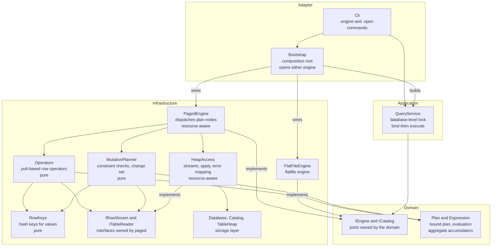
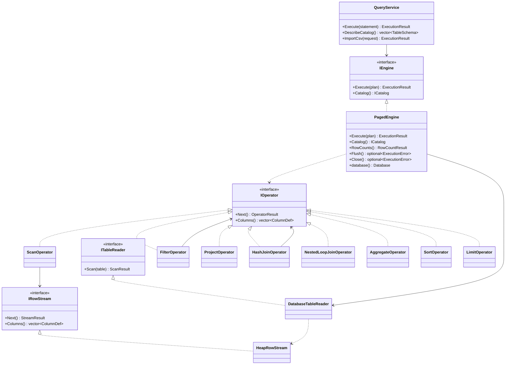
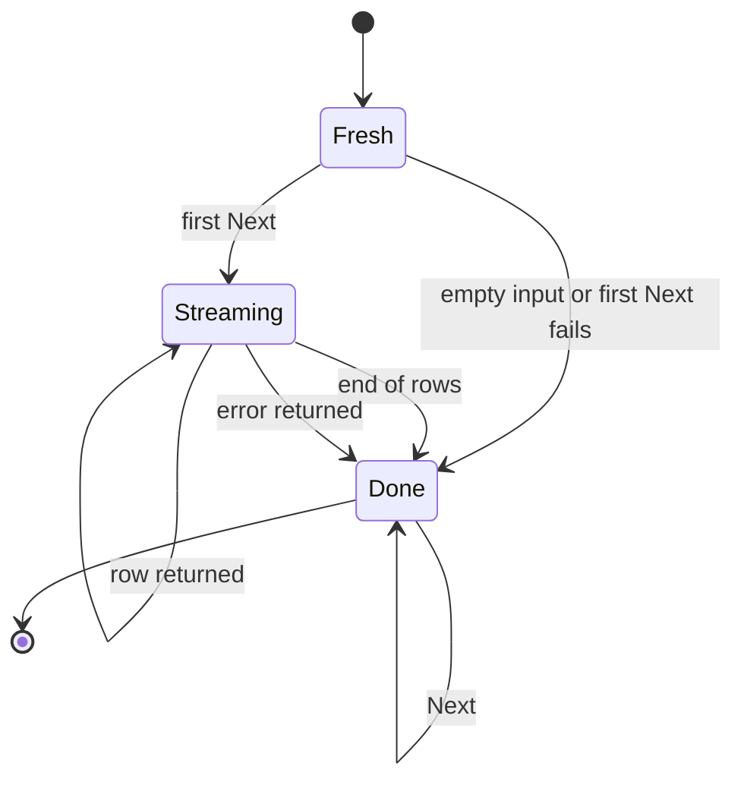
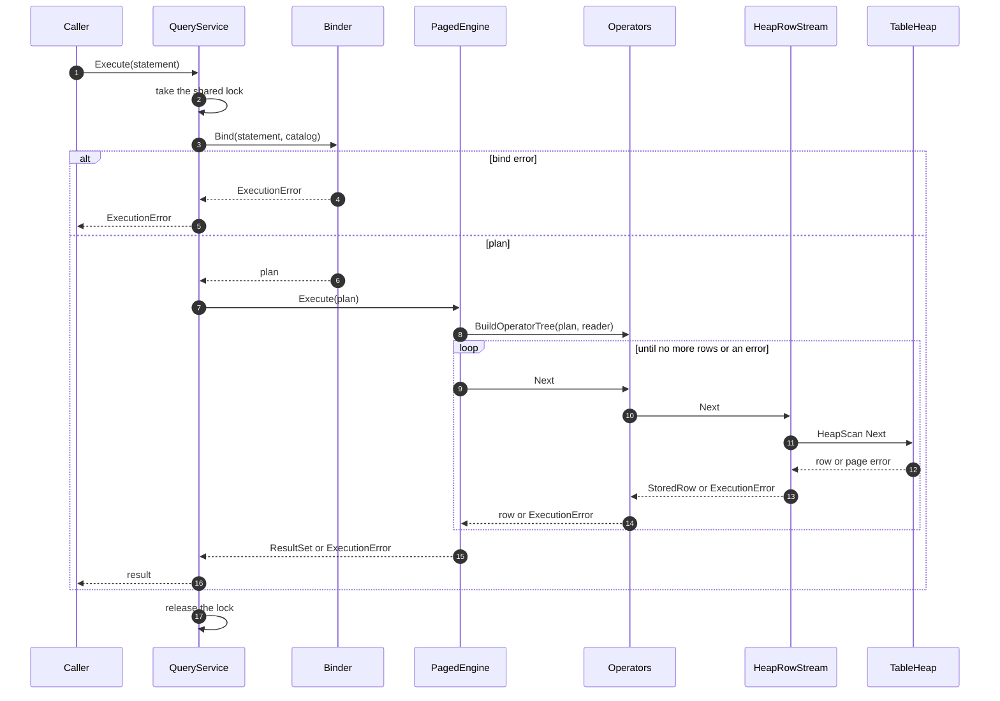
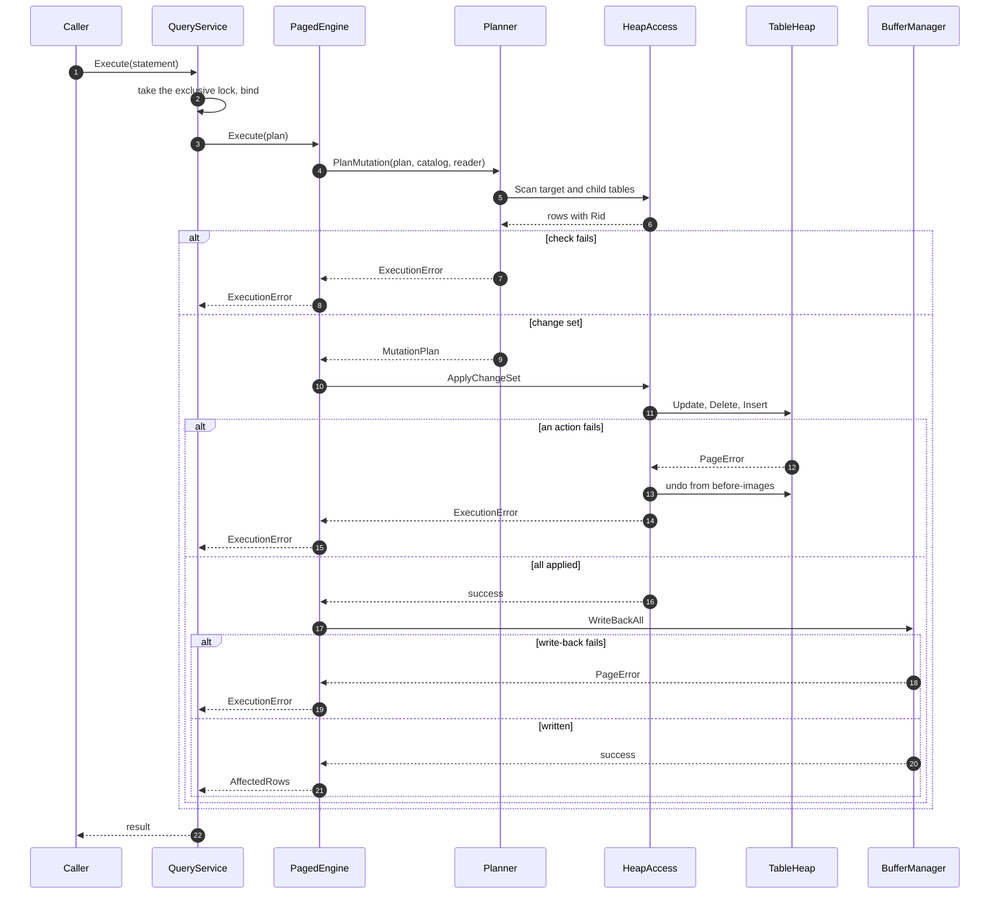
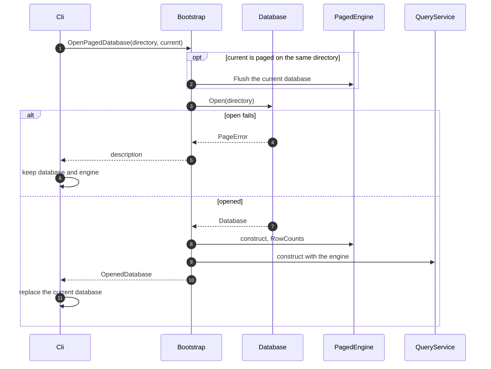

# Paged Execution

## 1. Project Description

The execution layer of the paged engine runs the logical plans that the Binder produces on top of the storage layer. With it, the flatfile and paged engines serve the same Structured Query Language (SQL) terminal through one `QueryService`. This document covers `PagedEngine`, the second implementation of `domain::IEngine`, and the query operators. It also covers constraint checking and application for `INSERT`, `UPDATE` and `DELETE`, the database-level reader-writer lock (the DB-level lock), the `.engine` command and the definition of "same result" for the two engines. The storage layer is in [PagedEngineDesignDocument.md](PagedEngineDesignDocument.md), cited below as the Paged Engine Design Document. The SQL front end, the engine port and the flatfile engine are in [DesignDocument.md](DesignDocument.md), cited below as the Design Document. Section 4 lists the Architecture Decision Record (ADR) entries that relate to this document.

The design leaves out indexes and index scans, the Write-Ahead Log (WAL), crash recovery, transactions, paged execution of `ALTER TABLE ADD COLUMN` and `DROP TABLE`, concurrent multiple writers, operators bounded by the buffer pool size, query optimization and cancellation of a running statement. Indexes, the WAL, crash recovery, transactions and those two statements are planned. The memory of Sort, hash join and aggregation is unbounded. Join order follows the `FROM` clause as written.

One constraint holds throughout: operators and constraint checks are pure logic that reads only a row stream. The code that reads and writes pages lives in one thin layer, `HeapAccess`. `operators`, `mutation_planner` and `row_keys` do not include `BufferManager`, `TableHeap`, `Database` or `Catalog`. The table they see is the `IRowStream` that `ITableReader` hands over, and tests replace it with an in-memory `std::vector`.

| Term | Meaning | Corresponding name |
|---|---|---|
| operator | A component that pulls rows from its child operator and returns one row at a time. There is one per plan node | `IOperator` |
| row stream | The rows of one table, returned one at a time, each with its `Rid` | `IRowStream` |
| change set | All changes that one write statement makes to pages. It is computed first and applied only after every check has passed | `MutationPlan`, `TableChange` |
| before-image | The row as it was before the change. It is used to undo the change when an apply fails midway | `RowUpdate::old_row`, `RowDelete::old_row` |
| DB-level lock | One reader-writer lock per database that serializes statements. It is distinct from the frame latch | `std::shared_mutex` inside `QueryService` |
| equivalence | The two engines produce the same result for the same data and statements | 2.6 |

## 2. Architecture

### 2.1 Component Diagram



The headers are in `include/flatfiledb/paged/` and the implementations in `src/paged/`. `QueryService`, `Bootstrap` and `Cli` keep their existing files.

| Concern | Layer | Nature | Files |
|---|---|---|---|
| Execution order of one statement: take the lock, bind, hand over to the engine; the lock depends on the statement kind | Application | Calls the engine through `IEngine` and holds a `std::shared_mutex` | `application.h`, `application.cpp` (modified) |
| `.engine` command and the engine preference of the session | Adapter | Library-backed, using stdin and stdout | `repl.cpp` (modified) |
| Assemble a paged database: resolve the directory, take the directory lock, open `Database`, build `PagedEngine` and `QueryService` | Adapter (composition root) | Library-backed, using the file system | `bootstrap.h`, `bootstrap.cpp` (modified) |
| Implementation of `IEngine`, dispatching on plan nodes | Infrastructure | Resource-aware | `paged/paged_engine.h`, `paged/paged_engine.cpp` |
| Interfaces for row streams and table reads, `StoredRow` | Infrastructure | Interface, owned by the paged layer | `paged/row_stream.h` |
| Hash keys of values (exact key and join key) | Infrastructure | Pure | `paged/row_keys.h`, `paged/row_keys.cpp` |
| Scan, Filter, Project, Join, Aggregate, Sort, Limit and building the operator tree | Infrastructure | Pure. Reads only `IRowStream` | `paged/operators.h`, `paged/operators.cpp` |
| Constraint checks, cascades and change set computation for `INSERT`, `UPDATE`, `DELETE` | Infrastructure | Pure. Reads only `ITableReader` and `ICatalog` | `paged/mutation_planner.h`, `paged/mutation_planner.cpp` |
| Implementations of `IRowStream` and `ITableReader`, applying and undoing change sets, mapping `PageError` to `ExecutionError` | Infrastructure | Resource-aware | `paged/heap_access.h`, `paged/heap_access.cpp` |

Files in `paged/` include only `domain/` and `paged/`, the same rule as in the storage layer. Inside `paged/`, the row layer (`row_stream.h`, `row_keys.h`, `operators.h` and `mutation_planner.h`) includes only `domain/`, `paged_types.h`, `tuple_codec.h` and other row-layer files. `tuple_codec.h` belongs to the byte layer and holds pure functions. The row layer does not include `buffer_manager.h`, `page_store.h`, `table_heap.h`, `catalog.h`, `database.h`, `heap_access.h` or `paged_engine.h`.

`Application` includes only Domain and the standard library header `<shared_mutex>`. `bootstrap.cpp` is the only non-test file outside `paged/` that includes `paged/` headers. `bootstrap.h` only forward-declares `paged::PagedEngine` and does not include it. `tests/test_layering.cpp` checks three rules: the row-layer rules, the rule that `bootstrap.cpp` is the only file outside `paged/` that includes `paged/` headers, and the rule that `paged/` is among the headers the Bootstrap layer may include. PI-12 of the Paged Engine Testing Document checks the same exception.

The engine port (`IEngine`, `ICatalog`) is not modified. `PagedEngine` implements the two existing methods, and no method needs to be added.

`Bootstrap` opens `paged::Database` and hands it to `PagedEngine` by value, together with one `std::shared_ptr<void>` of the directory lock. `Database` is movable (Paged Engine Design Document 2.1). The members of `PagedEngine` are declared in the order directory lock, then `Database`. On destruction the destructor of `Database` therefore runs first and writes out the dirty pages, and on failure it prints the error to stderr (2.8). The directory lock is released afterwards.

`Bootstrap` then hands the engine to `QueryService` as a `std::unique_ptr<IEngine>`. `OpenedDatabase` holds the `QueryService` and another `shared_ptr` of the directory lock. It also points to the `PagedEngine` inside the service through the borrowed pointer `paged_engine`, which is valid until `service` is destroyed and null for flatfile. `Bootstrap` uses that pointer to call `Flush` before it reopens the same directory (3.3). The call acquires no `QueryService` lock (2.5). The existing member order of `OpenedDatabase` is unchanged. `service` is declared before `lock`, so `lock` is destroyed first. The directory lock is still released only after the copy held by `PagedEngine` is released, which happens after the write-out.

`PagedEngine::Execute` builds and owns the operator tree and destroys it before `Execute` returns. An operator holds its child operators through `std::unique_ptr` and borrows the `BoundExpr` inside the plan by reference. `QueryService::Execute` owns the plan, which outlives the whole call.

`ITableReader::Scan` creates an `IRowStream`, and the caller owns it. `HeapRowStream` borrows `TableHeap` by pointer. `TableHeap` belongs to `Database` and is valid until `Close` or destruction, which outlasts one `Execute`.

Rows pass by value. `IRowStream::Next` returns a newly decoded `Row`, and `IOperator::Next` moves the row to the caller. `ResultSet` and `MutationPlan` are returned by value. No component holds a pointer into page bytes.

An operator holds no `PageGuard` between two `Next` calls, because `HeapScan` has released the latch and the pin before it returns a row (Paged Engine Design Document 2.5). The depth of a query plan therefore does not depend on the number of frames in the buffer pool. With a single thread, the minimum of 4 frames suffices to execute any statement, since a write statement performs one `TableHeap` operation at a time. When several readers run at the same time, each reader holds one pin while `HeapScan` loads a page. `FetchPage` returns `kNoFrame` without waiting when no frame is available (Paged Engine Design Document 2.6), so the number of concurrent readers cannot exceed the number of frames. Beyond that, some readers get `kIo` with the message `buffer pool exhausted: ...` (2.7). The default of 256 frames is far above a typical number of threads.

A `std::shared_lock` or `std::unique_lock` inside a `QueryService` member function holds the DB-level lock and releases it when the member function returns. The lock is not handed across calls or threads.

In the cost figures below, n is the number of rows of the scanned table, and m is the number of rows on the other side of a join or of the parent table. The number of groups is g, and the number of rows of an `INSERT` is k. A cascade scans c child table rows and rewrites r child rows.

- Scan: O(n) row decodes, with memory of the rows of one page. Filter, Project and Limit make O(1) calls per row.
- Hash join: the build table is `std::unordered_map<std::string, std::vector<size_t>>` plus `std::vector<Row>`, O(m). A probe costs O(1) on average per left row, plus the size of the matching bucket. Without an equality condition the join is a nested loop with O(n · m) predicate evaluations. Both variants use O(m) memory, because all of right is read in, and the output is not buffered.
- Aggregate: `std::unordered_map<std::string, size_t>` plus a `std::vector` of groups, with one O(1) lookup per row, O(n) time and O(g) memory.
- Sort: `std::stable_sort`, O(n log n) time and O(n) memory.
- `INSERT`: each statement scans the target table once to build the key sets (`std::unordered_set<std::string>`) of the primary key and `UNIQUE` columns, which costs O(n + k). A foreign key scans its parent table lazily and at most once. The scan happens the first time a row reaches the foreign key check, and later rows reuse the key set. This costs O(m).
- `UPDATE`: scans the target table once, O(n). The key counts and the rename map are `std::unordered_map`, O(n). The parent table of a foreign key is scanned only when the value of that foreign key column changed in some selected row, once per such foreign key, O(m). A cascade scans a child table once per referencing foreign key whose parent column is assigned and changed in some selected row, not once per child table. A child table with two such foreign keys is therefore scanned twice. Each scan is O(c), and O(r) `RowUpdate`s are written.
- `DELETE`: scans the target table once and scans a child table once for each foreign key that references the target, O(n + c). A `DELETE` that selects no row returns before it scans any child table. Without an index, point lookups and constraint checks are full table scans. The planned index changes this.

### 2.2 Types and Interfaces



| Type | Content |
|---|---|
| `StoredRow` | `{Rid rid, Row row}`. It is a type of the row layer with the same content as `ScanItem`, so that the row layer does not include `table_heap.h` |
| `StreamResult` | `std::variant<std::optional<StoredRow>, ExecutionError>`. When there are no more rows, the `optional` has no value. Calling `Next` after an error returns no value |
| `IRowStream` | `Next()` returns one row at a time. `Columns()` returns the columns of the table, and `ScanOperator` and the join width take their columns from it. `Columns()` is `const` and returns the vector by value. A stream is not thread-safe and is used only by the thread that created it |
| `ScanResult` | `std::variant<std::unique_ptr<IRowStream>, ExecutionError>` |
| `ITableReader` | `Scan(table)` returns the row stream of the table. The table name is case-insensitive, and a missing table returns `kBind` with the message `unknown table: <name>`. It is a `const` method that several threads can call at the same time |
| `OperatorResult` | `std::variant<std::optional<domain::Row>, ExecutionError>`, with the same semantics as `StreamResult` |
| `IOperator` | `Next()` returns the next row. `Columns()` returns the output columns, which for a Join are the left columns followed by the right columns. `Columns()` is `const` and returns the vector by value. An operator is used by only one thread |
| `BuildResult` | `std::variant<std::unique_ptr<IOperator>, ExecutionError>`: the root operator, or the error that prevented building the tree |
| `BuildOperatorTree(plan, reader)` | Returns a `BuildResult`. The plan must consist of `ScanNode`, `FilterNode`, `JoinNode`, `AggregateNode`, `ProjectNode`, `SortNode` and `LimitNode`. Any other node returns `kUnsupported` with the message `not a query plan node`. When the table of a `ScanNode` does not exist, it returns the error of `reader.Scan` |
| `ExactKey`, `AppendExactKey`, `JoinKey` | The hash keys of `row_keys.h` (2.3). `AppendExactKey(value, key)` appends the self-delimiting exact encoding of one value to a `std::string`, so the key of several values is the concatenation of the appended encodings. `ExactKey(value)` is the encoding of one value, and `JoinKey(value)` is the encoding of one join column. All three are pure |
| `RowUpdate`, `RowDelete` | `{Rid rid, Row old_row[, Row new_row]}`. `old_row` is the before-image |
| `TableChange` | `{std::string table, std::vector<Row> inserts, std::vector<RowUpdate> updates, std::vector<RowDelete> deletes}`. `table` is the lowercase table name. One `TableChange` of a statement contains only one kind of change |
| `MutationPlan` | `{std::vector<TableChange> changes, std::size_t affected}`. The order of `changes` is the order of application. When nothing changes, `changes` is empty and `affected` can still be greater than 0 |
| `PlanMutationResult` | `std::variant<MutationPlan, ExecutionError>` |
| `PlanMutation(plan, catalog, reader)` | Handles `InsertNode`, `UpdateNode` and `DeleteNode` and returns a `PlanMutationResult`. It modifies no page. Other nodes return `kUnsupported` with the message `not a write plan node` |
| `ApplyChangeSet(database, plan)` | Applies the `MutationPlan` to the `TableHeap`s of the `Database` and, on failure, undoes from the before-images (2.4). It returns `std::optional<ExecutionError>`, where no value means success |
| `InsertRows(database, table, rows)` | Inserts `rows` into one table with the same undo as `ApplyChangeSet`, without copying the rows into a `MutationPlan`. The table name is matched case-insensitively. `.import` writes its rows through it (2.8). It returns `std::optional<ExecutionError>` |
| `ToExecutionError(PageError, context)` | Maps an error of the storage layer to an `ExecutionError` according to 2.7. `context` is `ErrorContext{ErrorSite site; std::string table}` (`heap_access.h`). `ErrorSite` is `kOpenTable` when the call was `Database::Table`, `kCreateTable` when it was `Database::CreateTable`, and `kRowAccess` for a `TableHeap` read, insert, update or delete and for the write-back, flush and close of the whole database. For the whole-database operations `table` is empty. `table` is the name as the statement or the schema spells it, and it appears in the messages `unknown table: <name>`, `table <name> already exists` and `... in <table>`. The `kOpenTable` mapping of `kNotFound` to `unknown table: <name>` (kind `kBind`) applies only to a table that the catalog does not have. When `Database::Table` returns `kNotFound`, `heap_access.cpp` asks the catalog. For a table that the catalog has, for example a page chain that points past the end of the file, it returns the result of the `kNotFound`, other row of 2.7 (`kIo`, `internal error: `) |
| `HeapRowStream` | Implements `IRowStream` by wrapping `HeapScan`. `Next()` converts a `ScanItem` into a `StoredRow`, and converts a `PageError` into an `ExecutionError` through `ToExecutionError` with `ErrorSite::kRowAccess`. After an error every later `Next` returns no value, because `HeapScan` is over after an error. `Columns()` is `TableHeap::schema().columns`. It borrows `TableHeap` by pointer |
| `DatabaseTableReader` | Implements `ITableReader` and borrows `Database` by reference. `Scan(table)` calls `Database::Table(table)` and returns a `HeapRowStream`. The first time a table is used, `Database::Table` opens its `TableHeap`, walks the whole page chain and caches the result. A `kNotFound` of `Database::Table` maps to `unknown table: <name>` when the catalog has no such table. When the catalog has the table, it maps to `kIo` with `internal error: `, because the page chain is broken (2.7) |
| `RowCount`, `RowCountResult` | `RowCount` is `{std::string name, std::size_t count}`. `RowCountResult` is `std::variant<std::vector<RowCount>, ExecutionError>` |
| `PagedEngine` | Constructor `PagedEngine(Database database, std::shared_ptr<void> directory_lock)`, with both arguments taken by value. The engine is neither copyable nor movable, so `Bootstrap` and `QueryService` hold it behind a pointer made with `std::make_unique`. `Execute(plan)` dispatches on the node (2.3, 2.4, 3.1, 3.2). After a write node (`InsertNode`, `UpdateNode`, `DeleteNode`, `CreateTableNode` or `ImportTableNode`) is applied successfully, and before `Execute` returns, it calls `buffer().WriteBackAll()`, which writes out dirty pages and does not call `Sync`. A failure, a query and a write statement whose change set is empty do not call it (2.8). `Catalog()` is `const` and returns `Database::catalog()`. `RowCounts()` scans every table in catalog order and returns (name, row count). When any table cannot be opened or read, it returns that error, so `.open` fails. This is consistent with flatfile returning no partial data on a load failure (2.8). `Flush()` calls `buffer().FlushAll()`, which writes out dirty pages and calls `Sync`. `Close()` forwards to `Database::Close()`. `database()` returns a reference to `Database`, so that tests and measurements can read `buffer().Stats()` and `PinnedFrameCount()`. `Execute` modifies no member when it handles a query node (2.5) |
| `QueryService` | The public signatures are unchanged. A `std::shared_mutex` is added internally (2.5). `Execute`, `DescribeCatalog` and `ImportCsv` can be called by several threads at the same time. The mutex makes the object neither copyable nor movable, so callers hold it behind a `std::unique_ptr` |
| `bootstrap::EngineKind` | `kFlatFile`, `kPaged` |
| `bootstrap::OpenedDatabase` | Three fields are added at the end: `EngineKind engine = EngineKind::kFlatFile`, `paged::PagedEngine* paged_engine = nullptr` and `std::vector<std::string> notes`. `paged_engine` is borrowed. It points to the engine inside `service` and is null for flatfile, and `bootstrap.h` only forward-declares `paged::PagedEngine`. The last field holds the `note:` lines to print on open (3.4). The existing fields and their order are unchanged |
| `bootstrap::OpenPagedDatabase(directory, current)` | Returns `std::variant<OpenedDatabase, std::string>`, with the same rules as `OpenFlatFileDatabase` (Design Document 3.5). The differences are in 3.3. `Bootstrap` holds `DatabaseOptions` and uses the default values, 256 frames and the Least Recently Used (LRU) replacement policy. `Cli` and `bootstrap.h` do not touch `paged` types. Tests obtain other settings directly through `Database::OpenWithStore` |

An operator has three lifecycle states:



A `Fresh` operator has not yet requested a row from its child operator. A blocking operator (Sort, Aggregate, the right side of a join) reads its child to the end only on the first `Next`, so building the operator tree reads no data row. The only page read at build time is `DatabaseTableReader::Scan` opening the `TableHeap` of each table through `Database::Table` the first time the table is used. That call walks the whole page chain, which is O(P) for P pages, and caches the result. `RowCounts()` in `.open` has already opened every table, so later statements do not pay this cost.

A `Streaming` operator has returned at least one row. A `Done` operator has returned a no-value result or an error. Every later `Next` returns no value and does not request rows from the child operator again. An operator that ends on the first `Next` goes from `Fresh` directly to `Done`. This happens with empty input, with `LIMIT 0`, and with a blocking operator that meets an error while reading in. The caller stops at the first error.

### 2.3 Operator Rules

When `PagedEngine::Execute` receives a query node, it builds the tree with `BuildOperatorTree`, calls `Next` of the root operator repeatedly until there is no value, collects the rows into a `ResultSet` and takes the columns from `Columns()` of the root operator. The query plan that the Binder produces is rooted at a `ProjectNode`, with a `SortNode` and a `LimitNode` possibly above it, so the columns of the result do not contain `default_value`.

| plan node | operator | Nature | Rule |
|---|---|---|---|
| `ScanNode` | `ScanOperator` | streaming | Requests an `IRowStream` from `ITableReader::Scan(table)` and returns its rows. The order is the order of the page chain, and within a page the order of slot numbers. `Columns()` is the columns of the stream |
| `FilterNode` | `FilterOperator` | streaming | Calls `domain::EvaluateCondition` on every child row and returns the row only when the result is true. An evaluation failure returns `kRuntime`, with the `failure` that the evaluation writes out as the message |
| `ProjectNode` | `ProjectOperator` | streaming | Evaluates every expression with `domain::Evaluate` on every child row. `Columns()` is `output_columns`. A failure is handled as in Filter |
| `JoinNode` | `HashJoinOperator` or `NestedLoopJoinOperator` | right side blocking, left side streaming | The key selection rule is the same as ADR-0011. `ON` is split on `AND`, the first conjunct of the form "one left column equals one right column" is the hash key, and the other conjuncts are residual conditions. With a key, the first `Next` reads all of right in and builds buckets by `JoinKey`. Left rows probe one at a time, and a matching right row is confirmed with `ValuesEqual`, because two INTs above 2^53 can share the same double key. Without a key, all of right is read in and every left row is paired with every right row. For each pair the residual conditions are evaluated in order, and the pair is combined into a row and returned only when all of them are true. The output order is the order of left, and the pairs of one left row follow the read order of right. A `JoinNode` without an `ON` condition becomes a nested-loop join without residual conditions, so every pair is returned. The parser requires `ON`, so only a hand-built plan has none. A join whose right side is empty still drains the left side one row at a time, so an error raised by the left side still surfaces, as in flatfile |
| `AggregateNode` | `AggregateOperator` | blocking | The first `Next` reads the child operator to the end. The group key is the concatenation of `ExactKey` in order. Groups are output in order of first appearance, and accumulation uses `domain::AggregateAccumulator`. Without a group key exactly one row is always output, including when the input is empty. `AVG`, `MIN` and `MAX` over a group with no rows return `kRuntime` with the message `<FN> over no rows`. An INT sum that exceeds 64 bits, or a DOUBLE sum that is not finite, returns `kRuntime` with the message `numeric overflow`. The output columns are `group_key_<i>` and `aggregate_<i>` |
| `SortNode` | `SortOperator` | blocking | The first `Next` reads the child operator to the end and sorts by `SortKey` with `std::stable_sort`, comparing with `domain::CompareValues`. Rows that compare equal keep the input order |
| `LimitNode` | `LimitOperator` | streaming | Skips the first `offset` rows, then returns at most `limit` rows. After `limit` rows have been returned, it no longer requests rows from the child operator. When `limit` is 0, it requests no row from the child operator, not even to skip the `offset`. A `limit` that is not positive returns no row, and the parser cannot produce a negative limit |

`ExactKey(value)` is a self-delimiting byte encoding. Two keys are equal only when type and content are both equal, and `-0.0` equals `0.0`. `JoinKey(value)` puts INT and DOUBLE into the same key space by encoding both as a double value, so `2` and `2.0` fall into the same bucket. TEXT is encoded as bytes. The two functions follow the same rules as the flatfile implementation, and the code is kept separate (ADR-0039).

When `LimitOperator` ends the stream, the rows below the child operator that were not read are not evaluated. flatfile computes the whole child plan before taking rows. For `SELECT 1 / x FROM t LIMIT 1` with `x` equal to 0 in row 100, flatfile therefore reports `division by zero` and paged returns one row (the difference table in 2.6). `LIMIT 0` pulls nothing from its child, so no row below it is evaluated, even when a `SortOperator` or an `AggregateOperator` sits under it. Every error below a `LIMIT 0` is dropped: a division by zero, `AVG`, `MIN` and `MAX` over no rows, and a `SUM` overflow. flatfile reports all of them. A positive limit above a `SortOperator` or an `AggregateOperator` pulls the first row, which makes the blocking operator read its whole input, so the errors below it are reported as in flatfile.

A `FilterNode` above a `JoinNode` stays a separate `FilterOperator`, while flatfile fuses the two into one operation. The results are the same. Only the error-order case in the next paragraph can differ.

When a statement has several possible sources of `kRuntime` errors, in different nodes of the plan or in the same expression on different rows, the one reported is the one met first in pull order and scan order. flatfile computes the child plan as a whole first and follows file order, so the two can differ. The equivalence tests use only statements with a single error source (2.6).

Sort, Aggregate and the right side of a join read the input into memory and are not bounded by the buffer pool size. State this when interpreting later measurement results, and claim no conclusion for data larger than memory.

### 2.4 Mutation Rules

The constraint rules are specified in [DesignDocument.md](DesignDocument.md) 2.5 (referential integrity) and 2.3 (`INSERT` and auto-increment). paged and flatfile each implement them (ADR-0001, ADR-0039), and the equivalence tests of 2.6 cross-check the two. This section covers only the mechanism of paged and the differences that it causes.

`PagedEngine::Execute` handles `InsertNode`, `UpdateNode` and `DeleteNode` in two phases. `PlanMutation` only reads: it computes and checks all changes and returns a `MutationPlan` or an error. `ApplyChangeSet` is what modifies pages. When `PlanMutation` returns an error, no page has been modified.

| Statement | Reads and checks of `PlanMutation` | Produced `TableChange` |
|---|---|---|
| `INSERT` | Scans the target table once, builds the `ExactKey` sets of the primary key and `UNIQUE` columns, and takes the maximum of the auto-increment column. Each foreign key scans its parent table lazily and at most once. The scan happens the first time a row reaches the foreign key check, and it builds the `ExactKey` set of the referenced column for the later rows. Rows are processed one at a time in statement order. For each row, the auto-increment value is computed first: the greater of the current maximum and 0, plus 1, so an empty table and a table with only negative values both give 1, and each later row adds 1. When the maximum is the `int64_t` maximum, the result is `kRuntime` with `numeric overflow`. Then the checks run in this order: tuple length, duplicate primary key, duplicate `UNIQUE` (column position ascending) and foreign key (declaration order). A row that passes is added to the key sets, so later rows compare against it. The first violation is reported | One `TableChange` for the target table. `inserts` holds the rows, with the computed auto-increment values. `affected` is the number of rows |
| `UPDATE` | The first pass scans the target table. It evaluates `WHERE` on every row and reports a failure at once. A selected row is recorded as (`Rid`, old row). For a row that is not selected, the `ExactKey` of its "assigned `UNIQUE` columns and referenced columns" is added to the count of "other rows". The second pass runs in memory. For each selected row, it evaluates all assignments against the old row and reports a failure as `kRuntime`. It then converts the type with `CoerceValue` and reports a failure as `kBind` with the message `type mismatch assigning to <table>.<column>`. Whether a value changed is decided by `operator==` of `domain::Value`, so `-0.0` and `0.0` count as the same. When no row is selected, the first pass ends the statement with an empty `changes` and an `affected` of 0. When no selected row changes, `changes` is empty, `affected` is the number of selected rows and no further check runs. Otherwise the checks run in this order. The tuple length is checked for the rows whose value changed. Uniqueness is checked next, by column position ascending in table order, and a changed value that appears more than once in the final state is a duplicate. Foreign keys follow, for the changed foreign key columns in declaration order, against the key set of the parent table. The cascade comes last | One `TableChange` (`updates`) for the target table, followed by one `TableChange` for each cascaded child table. `affected` is the number of selected rows |
| `DELETE` | Scans the target table and evaluates `WHERE`, recording a selected row as (`Rid`, old row). For each foreign key that references the target table, with child tables in catalog order and then declaration order, it scans the child table once and builds the `ExactKey` set of the foreign key column. The selected rows are checked in scan order and the references in the order above, and the first hit is reported as `kConstraintViolation`. When no row is selected, the statement returns before it scans any child table | One `TableChange` (`deletes`) for the target table. `affected` is the number of selected rows. When no row is selected, `changes` is empty |

The kinds and messages of errors are identical to the table in Design Document 2.5: `duplicate key: <table>.<column>=<value>`, `no matching row: <table>.<column>=<value> not found in <ref_table>.<ref_column>` and `<table>.<primary_key>=<value> is referenced by <child_table>.<child_column>`. Check 1 of flatfile, "TEXT contains a line break", corresponds in paged to the tuple length check. A length above 4060 bytes returns `kUnsupported` with the message `paged engine cannot store a row longer than 4060 bytes in <table>`. The check sits at the same position as check 1 of flatfile, that is, before uniqueness and foreign keys. TEXT with a line break can be stored in paged (2.6). The message names the table with its declared spelling, and for an overlong cascaded child row it names the child table. `TupleCodec::Encode` computes the length. An `Encode` error other than `kTooLarge` means a column count or a type that does not match the schema, which breaks the precondition that the Binder keeps. It becomes `kIo` with the message `internal error: <message>`.

A target table that the catalog does not have gives `kBind` with the message `unknown table: <name>`, with the name as written in the node. The check runs before any row is read.

An assigned primary key is not treated as a unique column. The Binder rejects an assignment to the primary key with `kUnsupported`, so the planner never sees one.

For an assigned referenced column (column position ascending), a cascade builds a map from old value to new value from the selected rows whose value in that column changed. When one old value maps to several new values, the first is taken. Each foreign key that references the column scans its child table once, with child tables in catalog order and then foreign key declaration order. A child table with two foreign keys that reference assigned columns is therefore scanned twice, not once. The foreign key column of every child row is looked up in the map once and rewritten once, so when A is changed to B and B is changed to C in the same statement, the rows that reference A become B. When the same child row is rewritten by two foreign keys, the rewrites are merged into one `RowUpdate`.

The checks of the target table (tuple length, uniqueness, foreign keys) all run before the cascade. The tuple length of a cascaded child row is checked afterwards, on the final merged row, after all rewrites. Rows rewritten by a cascade are not counted in `affected`. The target table has no self-referencing foreign key, because the Binder does not accept a reference to the table being created and `ALTER TABLE ADD COLUMN` does not accept `REFERENCES` (Design Document 2.4).

A cascade is one level deep. When a cascaded child column is itself referenced by a third table, the third table is not rewritten, and its rows can keep a value that no longer exists. Both engines behave this way, and Design Document 2.5 does not cover this case.

An assignment whose coerced value equals the stored value (`operator==` of `domain::Value`, so `-0.0` equals `0.0`) leaves the stored cell untouched, also when another cell of the same row changes. flatfile does the same since the change in ADR-0039.

A row whose assignment result equals the original value produces no `RowUpdate`, does not cascade and does not count as a duplicate. A write statement whose change set is empty returns `AffectedRows` without calling `ApplyChangeSet` or `WriteBackAll`. The change set is empty when no row is selected or every assignment equals the stored value. Such a statement neither saves the dirty pages of an earlier failed statement nor reports `statement was applied but not saved` (2.8).

The order of rows is the order of the page chain and slots. flatfile reports the first row, in file order, that violates the uniqueness or foreign key of an `UPDATE` or the RESTRICT of a `DELETE`. paged reports the first row in scan order, so the reported row can differ when several rows violate (2.6).

`ApplyChangeSet(database, plan)` handles each `TableChange` in the order of `changes`. After each action succeeds, the corresponding undo entry is recorded in the undo log at once. There are three kinds of undo entry: `Inserted(rid)`, `Deleted(old_row)` and `Updated(rid, old_row)`.

| Action | Execution | Recorded after success |
|---|---|---|
| One row of `inserts` | `TableHeap::Insert(row)` | `Inserted(returned rid)` |
| One row of `deletes` | `TableHeap::Delete(rid)` | `Deleted(old_row)` |
| One row of `updates`, fits in place | `TableHeap::Update(rid, new_row)` | `Updated(rid, old_row)` |
| One row of `updates`, returns `kNoSpace` | First `TableHeap::Delete(rid)`, and on success `Deleted(old_row)` is recorded. Then `Insert(new_row)`, and on success `Inserted(returned rid)` is recorded | Both entries, as described in the Execution column |

When any action fails, the undo entries are processed in reverse order. `Inserted(rid)` is undone with `Delete(rid)`, and `Deleted(old_row)` is undone with `Insert(old_row)`. `Updated(rid, old_row)` is undone with `Update(rid, old_row)`. When that returns `kNoSpace`, it is undone with `Delete(rid)` followed by `Insert(old_row)`, because an undo `Insert` executed earlier may already have taken the space released in the same page. When the `Delete` of a move succeeds and the `Insert` fails, `Deleted(old_row)` is already in the undo log, so the old row is restored. After the undo, the original error is returned, mapped through 2.7.

When any undo action fails, the remaining undo actions continue. The error message gets `; rollback failed: <message>` appended after the original message, with the message of the first failed undo step, and the table may contain partial changes.

The undo restores the content and the number of rows. The `Rid` and the position of the row in the page can differ. No component holds a `Rid` from one statement to the next until indexes exist (ADR-0026). The undo is best-effort and is not a transaction. Until the WAL and transactions are added, there is no guarantee when the process is terminated midway (2.8).

### 2.5 Concurrency Rules

The shared state is the data of the engine: the pages and the catalog cache of paged, and the `TableStore` of flatfile. The DB-level lock prevents three failures: a data race, where a reader sees a half-finished result while a writer modifies data; a lost update, where the read-modify-write steps of two writers interleave; and reading an outdated column position, where another Data Definition Language (DDL) statement changes the schema after a statement is bound.

The lock is one `std::shared_mutex` inside `QueryService`. Both engines share it, because it sits above them.

| Call | Lock | Rationale |
|---|---|---|
| `Execute(SelectStatement)` | shared | Read only |
| `Execute` with other statements (`INSERT`, `UPDATE`, `DELETE`, `CREATE TABLE`, `ALTER TABLE`, `DROP TABLE`) | exclusive | Modifies data or schema |
| `DescribeCatalog()` | shared | Reads the catalog only |
| `ImportCsv()` | exclusive | Creates a table and writes |

The lock covers the bind and execute of a whole statement as one critical section, so the schema the Binder sees is the schema at execution time. The statement kind is decided by `std::holds_alternative<SelectStatement>` before the lock is taken. `ImportCsv` takes the exclusive lock before anything else, including the check that a Comma-Separated Values (CSV) source exists, because the inference reads the catalog that the import changes.

The DB-level lock comes before all storage-layer locks: the table heap cache mutex of `Database`, the lock of `Catalog`, the frame latch and the pool mutex. The order among those locks is in Paged Engine Design Document 2.6. Code that holds any of the latter never acquires the DB-level lock, so there is no reverse wait. The member functions of `QueryService` are not reentrant: a call that holds the lock does not call another member function that acquires a lock.

Page disk Input/Output (I/O), that is, buffer pool misses and write-backs, happens while the DB-level lock is held. The unit of the lock is a whole statement, and the consistency of a statement needs the lock from bind to apply. Readers wait during the I/O of a write statement. In return a statement runs under one lock from bind to apply (ADR-0040).

When `PagedEngine::Execute` handles a query node, it uses only local variables and thread-safe members (`Database::Table`, `BufferManager`, `Catalog`), so several threads can run it at the same time. When `FlatFileEngine::Execute` handles a query node, it calls `RunQuery`, which is a pure function over `const TableStore&` and can likewise run at the same time. The exclusive lock serializes write nodes, so the "single writer" contract of `TableHeap` holds, and a reader never reads data that is inconsistent across pages while a writer runs.

The `Flush` that `Bootstrap` calls before a same-directory reopen goes through the borrowed pointer `OpenedDatabase::paged_engine` and acquires no `QueryService` lock. The caller must not run a statement on the current database at that time. This holds for the single-threaded Command-Line Interface (CLI) (3.3).

`std::shared_mutex` does not specify fairness between readers and writers, so continuously arriving readers can delay a writer. This is not measured yet.

Across processes, the directory lock (`flock`, ADR-0015) is unchanged, and both engines share the same `.flatfiledb.lock`.

### 2.6 Equivalence Rules

Two engines are equivalent on a sequence of statements when all rules below hold after every statement.

| Item | Rule |
|---|---|
| Result kind | The result is the same kind in both engines: `ResultSet`, `AffectedRows`, `CommandComplete` or `ExecutionError` |
| Columns of `ResultSet` | Column names and types are the same one by one |
| Rows of `ResultSet`, without `ORDER BY` | The multisets of rows are the same. Cells are compared one by one with `operator==` of `domain::Value` |
| Rows of `ResultSet`, with `ORDER BY` | The sequences of sort keys are the same. Rows with equal sort keys are compared as a multiset, because the input order that a stable sort preserves differs by engine |
| `LIMIT`, `OFFSET` | Compared only when the `ORDER BY` key uniquely determines the order of the rows. Without `ORDER BY`, or when `LIMIT` and `OFFSET` cut among rows with equal sort keys, which rows are cut is undefined (Design Document 2.3), and the tests do not use such statements |
| `AffectedRows` | The counts are the same |
| `CommandComplete` | `tag` is the same (`CREATE TABLE <name>`) |
| `ExecutionError` | `kind` and `message` are the same, except for the differences listed in the table below |
| State | After a sequence of write statements, the multisets of rows retrieved with `SELECT * FROM <table>` are the same for every table. A rejected statement changes no table |

The known and accepted differences between the two engines:

| Item | flatfile | paged | Reason |
|---|---|---|---|
| TEXT containing `\r` or a line break | `kUnsupported`, `flatfile engine cannot store a line break in <table>.<column>` | Can be stored | CSV is line-based (ADR-0012), while a tuple is length-based (ADR-0027) |
| A tuple above 4060 bytes | No limit | `kUnsupported`, `paged engine cannot store a row longer than 4060 bytes in <table>` | No overflow page (ADR-0027) |
| Table names starting with `sys_` | Allowed | `kUnsupported`, reserved by the Catalog (ADR-0032) | Namespace of the system tables |
| `ALTER TABLE ADD COLUMN`, `DROP TABLE` | Supported | `kUnsupported`, planned | Outside the paged DDL scope (ADR-0042) |
| Row order without `ORDER BY` | File order | Page and slot order | The order is undefined (Design Document 2.3) |
| Which rows `LIMIT` and `OFFSET` take without `ORDER BY` (or with a non-unique key) | The rows in file order | The rows in page and slot order | Same as above |
| Which row is reported when several rows violate the uniqueness or foreign key of an `UPDATE`, or the RESTRICT of a `DELETE` | The first in file order | The first in scan order | Same as above |
| Evaluation error of rows below a `LIMIT` that are not read, and every error below a `LIMIT 0`, also below a `Sort` or an `Aggregate` (division by zero, `AVG`, `MIN` or `MAX` over no rows, `SUM` overflow) | Reported | Not reported | Early termination (2.3, ADR-0036) |
| Which one is reported when there are several `kRuntime` error sources (different nodes, or different rows) | The child plan is computed as a whole first, file order | Pull order, scan order | Error order (2.3) |
| `DOUBLE` `SUM` and `AVG`, and an INT sum near the 64-bit boundary | Accumulates in file order | Accumulates in scan order | Floating-point addition is not associative, and the INT overflow check depends on the accumulation order |
| `.import` failing midway | A staged commit makes it all-or-nothing | The tables already created and the rows already written remain (2.8) | No `DROP TABLE` and no transactions |
| `CREATE TABLE` meeting a CSV of the same name | Adopts the existing rows | Has no concept of CSV and creates an empty table | The data of paged is in `paged.db` |
| State of the files when a write statement is interrupted | Each write statement writes to the Operating System (OS) by rewriting or appending the file. Neither engine calls `fsync` after a write statement, and completed statements are not lost when the process is terminated with Ctrl-C or `kill` | After each successful write statement, dirty pages are written out without `Sync`, and completed statements are not lost when the process is terminated. When a statement that involves several pages is terminated midway through the write-out, the file may contain pages of a partial statement (2.8) | No Write-Ahead Log (WAL) exists yet (ADR-0043) |
| `.open --parallel` | Loads in parallel | Ignored | No load phase |

### 2.7 Error Mapping

`ToExecutionError` maps the `PageError` of the storage layer to an `ExecutionError`. Unless a row gives a fixed message, `message` keeps `PageError::message` with the prefix from the table below.

| `PageErrorCode` | `ErrorKind` | Message prefix and description |
|---|---|---|
| `kIo` | `kIo` | No prefix |
| `kCorrupt` | `kIo` | Prefix `corrupt: `. The source is a corrupt page or inconsistent system tables. A statement affects only the table that the corrupt page belongs to. `RowCounts()` in `.open` scans every table, so a corrupt page makes the whole open fail (2.8) |
| `kNoFrame` | `kIo` | Prefix `buffer pool exhausted: `. It does not occur with a single thread, because an operator holds no pin between two `Next` calls. It occurs when more readers than frames run at the same time (2.1) |
| `kNoSpace` | `kIo` | No prefix. Page numbers are exhausted |
| `kClosed` | `kIo` | Exactly `database is closed`. The original message is not kept |
| `kNotFound`, table | `kBind` | Exactly `unknown table: <name>`, for a table that the catalog does not have (`ErrorSite::kOpenTable`, 2.2) |
| `kNotFound`, other | `kIo` | `internal error: ` plus the original message. One source is a `next_page_id` of the page chain beyond the file, which means a corrupt chain, also for a table that the catalog has. The other is a `Rid` returned by the preceding read that is already invalid. Neither should happen |
| `kTooLarge` | `kUnsupported` | `paged engine cannot store a row longer than 4060 bytes in <table>`. `PlanMutation` and `.import` have already checked it (2.4, 2.8), so the apply phase does not meet it |
| `kInvalidArgument`, `CreateTable` | `kUnsupported` | The original message. It comes from rules of the catalog such as a table name starting with `sys_` (2.6) |
| `kInvalidArgument`, other | `kIo` | `internal error: ` plus the original message |
| `kAlreadyExists`, `CreateTable` | `kBind` | `table <name> already exists`. The Binder checks it first, so a table with the same name does not reach here |

### 2.8 Failure and Durability Limits

| Item | Convention |
|---|---|
| Statement atomicity: constraint violation and evaluation error | When `PlanMutation` returns an error, no page is modified, and `page_writes` of `BufferStats` and the number of dirty frames are unchanged |
| Statement atomicity: I/O failure midway through apply | Best-effort undo (2.4). When the undo succeeds, the table content returns to the state before the statement. When the undo fails, `rollback failed` is reported and the table may contain partial changes |
| `CREATE TABLE` | Keeps the storage-layer rules (Paged Engine Design Document 3.4). On failure the system table rows already written are removed, and the pages already allocated are not reclaimed |
| `.import` | The rows of `ImportTableNode` have been validated by `domain::InferImport`, with no duplicate primary key and correct types. `PagedEngine` first checks the tuple length of every row with `TupleCodec::Encode`. When any row exceeds 4060 bytes, it returns `kUnsupported` (2.7) and creates no table. Only after the check passes does it call `CreateTable` and then write each row with `TableHeap::Insert`. The rows are written through `InsertRows` (2.2). When a write fails midway, which can only be an I/O error, the rows already written are removed, the table remains and is empty, and the error message ends with `; table <name> was created`. When the removal fails as well, the message is `<message>; rollback failed: <message>; table <name> was created`. The planned `DROP TABLE` can remove the table |
| `AddColumnNode`, `DropTableNode` | `kUnsupported`, with the messages `paged engine does not support ALTER TABLE ADD COLUMN` and `paged engine does not support DROP TABLE`. No page is modified |
| Durability: when pages are written out | After every successful write statement (`INSERT`, `UPDATE`, `DELETE`, `CREATE TABLE`, `.import`), `BufferManager::WriteBackAll()` is called before `PagedEngine::Execute` returns. It writes out all dirty pages and does not call `Sync` (3.2). Completed statements are not lost when the process is terminated with Ctrl-C or `kill`, the same as flatfile (2.6). Both can lose them on an OS crash or a power loss, because neither calls `fsync` after a write statement (ADR-0008). A query and a failed statement do not call `WriteBackAll`, and neither does a write statement whose change set is empty, that is, no row selected or every assignment equal to the stored value. Such a statement applied nothing, so it does not retry the dirty pages of an earlier failed statement and does not fail for a change it never made. `Database::Close()`, the destructor and `PagedEngine::Flush()` write out dirty pages and call `Sync` (Paged Engine Design Document 2.9). When `.quit`, end of input, `.open` and `.engine` replace the database, the old `OpenedDatabase` is destroyed and writes out. A failure in the destructor is printed only to stderr |
| Durability: the write-out is not atomic | When a statement that involves several pages (a page append, an `UPDATE` that crosses pages, `CREATE TABLE`, `.import`) is terminated midway through `WriteBackAll`, the file may contain pages of a partial statement. Dirty pages are also written out early when the buffer pool replaces a page, so terminating midway through the execution of a statement gives the same result. Detection relies on the Cyclic Redundancy Check (CRC) and the validation of `Load()`, with no repair (Paged Engine Design Document 2.9). The planned WAL handles it (ADR-0043) |
| Durability: the write-out fails | When `WriteBackAll` fails (`kIo`), the statement is already applied in the buffer pool, and `PagedEngine::Execute` returns `kIo` with the message `<message>; statement was applied but not saved`. The dirty pages are kept. The `WriteBackAll` of the next successful write statement, `Flush` and `Close` write them out again. Retrying the same `INSERT` gets a primary key conflict, because the statement has already been applied |
| Reopening the same directory | When the current database is paged and the directory is the same, `Bootstrap` calls `Flush()` of the current engine before `Database::Open`. If `Flush` fails, it aborts the open and returns the description. The call is needed because a failed statement (after the undo), a `WriteBackAll` failure and an undo failure leave dirty pages that were not written out. The new `Database` reads the file, so without writing out first it reads the old content, and later the two instances overwrite each other. `Flush` also supplies the `Sync` that write statements omit (3.3). The `Flush` goes through the borrowed engine pointer and acquires no `QueryService` lock, so the caller does not run a statement on the current database at that time (2.5) |
| Memory | Sort, Aggregate, the right side of a join, the key sets of `PlanMutation` and the selected rows all stay in memory. Their size is proportional to the input and is not bounded by the buffer pool |
| Corrupt `paged.db` | When `Database::Open` returns `kCorrupt`, or `RowCounts()` reads a corrupt page, `.open` and `.engine` output `error: could not open <directory>: corrupt: <message>`, and the current database and engine setting stay as they were. This is consistent with flatfile returning no partial data on a load failure. A statement after the open affects only the table that the corrupt page belongs to |
| Unwritable directory | paged writes `paged.db`, so it always needs the directory lock. When `DirectoryLock::Acquire` does not obtain the lock because of `EACCES` or `EROFS`, `OpenPagedDatabase` returns `directory is not writable` and does not open. flatfile can still read without acquiring the lock in this case, because that process cannot write. paged has no read-only open mode, and without the lock two processes could write the same file at the same time. `OpenPagedDatabase` returns `database is locked by another process` when another process holds the lock, the same as flatfile. The lock of `current` is reused only when it is not null. A flatfile database that was opened in an unwritable directory has no lock, so `.engine paged` on it returns `directory is not writable` |
| Known limitation: replacing a paged database that cannot be saved | `.open <other directory>` and `.engine flatfile` replace the open paged database without a `Flush` first, and the open does not abort when the old database cannot be written out. The destructor of the old `Database` prints `paged: failed to write the database on destruction: <message>` to standard error while the new database takes its place, before the `loaded` line of the new database is printed. The statements that were applied but not saved are lost. `.open` of the same directory is not affected, because `Bootstrap` calls `Flush` first and aborts the open on failure |
| Known limitation: the directory is deleted while it is open | After the directory is deleted, `OpenPagedDatabase` creates it again when its parent exists. If the normalized path equals the one of the current database, it reuses `current->lock`, which refers to a deleted `.flatfiledb.lock` file. The new directory is then not protected against a second process. This also holds for flatfile |

## 3. Flow of Control

### 3.1 Flow: Execute a SELECT



Steps 1 to 3: `QueryService::Execute` takes the shared lock according to the statement kind and then calls the Binder. The lock is not released between bind and execute (2.5). Other statements take the exclusive lock, and that flow is in 3.2.

Steps 4 and 5: when bind fails, the error is returned directly and the engine is not touched.

Steps 6 to 8: `PagedEngine` builds the operator tree with `DatabaseTableReader`. Building only calls `ITableReader::Scan` to obtain the stream and reads no data row. The first time a table is used, `Database::Table` opens its `TableHeap`, which walks the whole page chain (2.2). When the table does not exist, `kBind` is returned.

Steps 9 to 14: `PagedEngine` calls `Next` of the root operator repeatedly. Each `Next` passes down to `ScanOperator`, and `HeapRowStream` requests rows from `HeapScan`. `HeapScan` reads one page at a time, decodes all rows under the shared latch and then releases the latch and the pin, so there is no pin between two `Next` calls. A page error is mapped to an `ExecutionError` through 2.7 and passed up along the operators. The first error ends the loop, and the operators enter `Done` (2.2).

Steps 15 to 17: on success the rows have been collected into a `ResultSet`. The operator tree is destroyed before `Execute` returns, and `QueryService` releases the lock before it returns.

### 3.2 Flow: Execute a Write Statement

The example is `UPDATE users SET username = 'x' WHERE id = 1`. It rewrites a referenced `UNIQUE` column, so it has a cascade.



Steps 1 and 2: the statement is bound after the exclusive lock is taken. The assignments and `WHERE` of the `UPDATE` have been bound into an `UpdateNode`.

Steps 3 to 6: `PlanMutation` scans the target table and the needed child tables through `ITableReader`. It only reads and modifies no page. The checks of 2.4 proceed in order.

Steps 7 and 8: when any check fails, the error is returned. No page is modified and the statement ends.

Steps 9 to 11: when all checks pass, `PlanMutation` returns a `MutationPlan` with the `updates` of the target table and the `updates` of each child table. `PagedEngine` calls `ApplyChangeSet`, which calls `Update` on `TableHeap` in order, or `Delete` plus `Insert` when needed. When the change set is empty, that is, no row is selected or every assignment equals the stored value, `PagedEngine` returns `AffectedRows` at once. It skips `ApplyChangeSet` and the write-back of the later steps (2.4).

Steps 12 to 15: when an apply fails midway, `HeapAccess` undoes from the before-images in reverse order and returns the original error. `rollback failed` is appended when the undo also fails.

Steps 16 and 17: when every action is applied, `PagedEngine` calls `BufferManager::WriteBackAll()`, which writes out all dirty pages without `Sync`. The call runs under the exclusive lock, so no other statement runs `FlushAll` or `WriteBackAll` at the same time, and no `PageGuard` is held. A failed statement (steps 7, 8 and 12 to 15) and a query (3.1) do not call it.

Steps 18 and 19: when the write-back fails, the statement has already been applied in the buffer pool. `PagedEngine` returns `kIo` with the message `<message>; statement was applied but not saved`. The dirty pages stay, and the next successful write statement, `Flush` or `Close` writes them out (2.8).

Steps 20 to 22: when the write-back succeeds, `AffectedRows` is returned. Its count is the number of rows selected by `WHERE`, not including rows rewritten by the cascade. The flow of `INSERT` and `DELETE` is the same, and only the reads and checks of `PlanMutation` differ (2.4). `CREATE TABLE` and `.import` follow the same write-back rule after they succeed.

### 3.3 Flow: Open a Database with the Paged Engine

`.engine` and `.open` enter this flow under these conditions. `.engine` without an argument prints the current engine name and opens nothing. `.engine <name>` with the same engine as the current one only prints the name. When no database is open, `.engine <name>` only records the preference. When a database is open and the engine differs, the Open function of the new engine is called with the normalized directory of the open database. `.open` calls it with the directory as typed, according to the preference. With a database open, the engine setting changes only after that open has succeeded. The diagram shows the flow when paged is selected:



Step 1: `Bootstrap` first handles the directory, creating and normalizing it as in Design Document 3.5, and then takes the directory lock. When the directory of `current` equals the normalized path and `current->lock` is not null, `current->lock` is reused, so the same process is not blocked by its own lock. paged always needs the lock. When the lock is not obtained because of `EACCES` or `EROFS`, `directory is not writable` is returned, and when another process holds the lock, `database is locked by another process` is returned (2.8).

Step 2: when `current` is a paged database with the same directory, its `Flush()` is called first, through `OpenedDatabase::paged_engine` and without the `QueryService` lock (2.5). The new `Database` reads the file, and the current instance may still have dirty pages that were not written out. A successful write statement has already been written out by `WriteBackAll` (ADR-0043), but a failed statement, a `WriteBackAll` failure and an undo failure leave dirty pages. Without writing out first, the new instance reads the old content, and later the two instances overwrite each other. When `Flush` fails, the open is aborted and the description is returned, and the current database is unchanged. A flatfile instance writes to the file on every statement and does not need this step.

Step 3: `Database::Open` creates `paged.db` when it does not exist.

Steps 4 to 6: when the open fails, `Cli` keeps the existing database and engine setting and prints `error: could not open <directory>: <reason>`. The lock obtained for this open is released as well. For `.open` the directory is printed as typed, and for `.engine <other>` it is the normalized path. No `engine <name>` line is printed.

Steps 7 to 11: on success `Bootstrap` obtains the row count of each table with `RowCounts()`, and a read failure of any table fails the whole open (2.8). It hands one copy of the directory lock to `PagedEngine`, builds the `QueryService` and returns it. `Cli` replaces the old `OpenedDatabase` with the new one. The old one writes out dirty pages, if any, on destruction and releases its own lock (2.1, 2.8).

### 3.4 Interface

This section lists the added and changed commands. The behavior of other commands and statements is unchanged (Design Document 3.6).

| Command | Operation | Output |
|---|---|---|
| `.engine` | `Cli` | `engine <name>`, where `<name>` is `flatfile` or `paged` |
| `.engine <name>` | `Cli`. When a database is open and the engine differs, `bootstrap::OpenFlatFileDatabase` or `bootstrap::OpenPagedDatabase` | When the engine is the same, only `engine <name>` is printed. When it differs and no database is open, `engine <name>` is printed and the setting changes. When it differs and a database is open, `engine <name>` is printed, followed by the output of that open, with the same rules as `.open`. A failed reopen prints only `error: could not open <directory>: <reason>`, where `<directory>` is the normalized path of the open database. The `engine <name>` line is not printed, and the setting and the database stay unchanged. The names are exact lowercase. When `<name>` is neither `flatfile` nor `paged` (`PAGED` included), or an extra argument is given, the output is `syntax error at column 1: usage: .engine [flatfile\|paged]` |
| `.open <directory> [--parallel]` | `OpenFlatFileDatabase` or `OpenPagedDatabase`, according to the current engine setting | The same rules as Design Document 3.5. The `loaded` line of paged lists the row count of each table, and `loaded no tables` when there is no table. `--parallel` only has an effect on flatfile |

The engine setting is `flatfile` at every start. The setting lives in the session of `Cli` and is not saved across processes. The state across runs is the files in the database directory, and the engine setting is not data. The command line gets no new option, so using paged starts with `.engine paged`.

The command name table of `Cli` gains `engine`. That table is the list that suggests `did you mean .<name>` when the `.` is missing (Design Document 3.6). Entering `engine paged` therefore gives `error: commands start with '.'; did you mean .engine` and is not parsed as SQL.

The data of flatfile is `catalog.csv` and the CSV file of each table, and the data of paged is `paged.db`. The two do not interact, and one directory can hold both. `Bootstrap` decides on a hint about the data of the other engine and places it in `OpenedDatabase::notes`, and `Cli` prints it line by line after the `loaded` line. The condition is that the result of this open has no table and the file of the other engine exists, either `catalog.csv` or `paged.db`. Only the existence of the file is checked, not its content. When flatfile opens, `note: this directory also has a paged database (paged.db); .engine paged opens it` is printed, and when paged opens, `note: this directory also has a flatfile catalog (catalog.csv); .engine flatfile opens it` is printed.

`.help` gains one line for `.engine`: `.engine [flatfile|paged]        show or set the engine (default flatfile)`.

The demonstration runs in a temporary directory. The shell variable `CLI` is the CLI executable `build/flatfiledb_cli` under the project root, which `cmake --build build` produces. Resolve its absolute path before `cd`:

```bash
CLI="$PWD/build/flatfiledb_cli"
cd "$(mktemp -d)"
printf '%s\n' '.engine paged' '.open demo' \
  'CREATE TABLE users (id INT PRIMARY KEY, username TEXT UNIQUE);' \
  "INSERT INTO users VALUES (1, 'ann'), (2, 'bob');" \
  'SELECT id, username FROM users ORDER BY id;' | "$CLI"
```

```text
engine paged
created new database demo
OK CREATE TABLE users
OK affected=2
id	username
1	ann
2	bob
```

Each write statement is written to `demo/paged.db` as soon as it succeeds. Open the database again in the same shell. The working directory is still the temporary directory created above:

```bash
printf '%s\n' '.engine paged' '.open demo' 'SELECT COUNT(*) FROM users;' | "$CLI"
```

```text
engine paged
loaded users=2
COUNT(*)
2
```

| Action | Operation | Command or statement | Expected output |
|---|---|---|---|
| Show the engine | `Cli` | `.engine` | `engine flatfile` (at start) |
| Switch engine, no database open yet | `Cli` | `.engine paged` | `engine paged` |
| Switch engine, a flatfile database with tables is open | `OpenPagedDatabase` | `.engine paged` (after `.open data`, where `data` already has `catalog.csv`) | `engine paged`, followed by `loaded no tables` and one line `note: this directory also has a flatfile catalog (catalog.csv); .engine flatfile opens it` |
| Wrong engine name | `Cli` | `.engine sqlite` | `syntax error at column 1: usage: .engine [flatfile\|paged]` |
| Engine name in capitals | `Cli` | `.engine PAGED` | `syntax error at column 1: usage: .engine [flatfile\|paged]` |
| Failed switch | `OpenPagedDatabase` | `.open <directory with a flatfile database and a paged.db that is not a database file>`, then `.engine paged`, then `.engine` | `loaded ...` for the first command, only `error: could not open <normalized directory>: corrupt: <message>` for the second, and `engine flatfile` for the third |
| Missing `.` | `Cli` | `engine paged` | `error: commands start with '.'; did you mean .engine` |
| Open a new directory with paged | `OpenPagedDatabase` | `.engine paged` followed by `.open <nonexistent directory>` (the parent directory exists) | `created new database <directory>` |
| Reopen the same directory with paged | `OpenPagedDatabase` | `.open <same directory>` after data was added to a paged database (without `.quit`) | `loaded ...`, and the data added before is visible |
| Open an unwritable directory with paged | `OpenPagedDatabase` | `.engine paged` followed by `.open <directory with permission 0555>` | `error: could not open <directory>: directory is not writable` |
| Create a table with paged | `QueryService::Execute` | `CREATE TABLE notes (id INT PRIMARY KEY, body TEXT);` | `OK CREATE TABLE notes` |
| Import a CSV with paged | `QueryService::ImportCsv` | `.import data/posts.csv` | `OK IMPORT posts (imported 10000 rows)` |
| DDL that paged does not support | `QueryService::Execute` | `ALTER TABLE notes ADD COLUMN pinned INT DEFAULT 0;` | `error: unsupported: paged engine does not support ALTER TABLE ADD COLUMN` |
| Queries and writes of paged | `QueryService::Execute` | The same SQL as flatfile | The output format is the same as in Design Document 3.6, and the result is equivalent according to 2.6 |
| Constraint violation in paged | `QueryService::Execute` | After the demonstration above: `CREATE TABLE posts (id INT PRIMARY KEY, username TEXT REFERENCES users(username));`, `INSERT INTO posts VALUES (1, 'ann');`, `DELETE FROM users WHERE id = 1;` | The first two give `OK CREATE TABLE posts` and `OK affected=1`, and the third gives `error: constraint violation: users.id=1 is referenced by posts.username` |
| Concurrent queries from several threads | `QueryService::Execute` | Several threads call at the same time (no CLI entry) | Each call gets the same result as when it runs alone. A write statement does not overlap with other statements |

Only the files in the database directory carry state across runs: the CSV files and `catalog.csv` of flatfile, and `paged.db` of paged. The DB-level lock and the engine setting are process memory, meaningful only within one process. Across processes the directory lock handles it.

Two behaviors cannot be verified headless. The first is the prompt and the interactive input of the terminal (same as Design Document 3.6). The second is the fairness of the reader-writer lock and the throughput of multiple threads, which depend on timing. Only the mutual exclusion and the correctness of results are verified, not the latency.

### 3.5 Failure Paths

| Failure | Detected by | Output | State guarantee |
|---|---|---|---|
| The name given to `.engine` is neither `flatfile` nor `paged` (exact lowercase; `PAGED` is refused) | `Cli` | `syntax error at column 1: usage: .engine [flatfile\|paged]` | The engine setting and the database are unchanged |
| The open fails when switching engine or reopening (unwritable directory, lock held, corrupt `paged.db`, a table fails to read, the `Flush` before reopening fails) | `Bootstrap` | `error: could not open <directory>: <reason>`, with the normalized path for `.engine`. No `engine <name>` line | The engine setting and the current database are unchanged |
| `.open <other directory>` or `.engine flatfile` replaces a paged database whose dirty pages cannot be written out | `Database::~Database` | `paged: failed to write the database on destruction: <message>` on standard error, before the `loaded` line | The new database is open. The statements that were applied but not saved are lost (2.8) |
| Constraint violation (primary key, `UNIQUE`, foreign key, `DELETE` of a referenced row) | `PlanMutation` | `error: constraint violation: <message>`, with the message as in Design Document 2.5 | No page is modified |
| Evaluation error (overflow, division by 0, etc.) | `Operators`, `PlanMutation` | `error: runtime: <message>` | A query has no effect. For a write, no page is modified |
| Row too long (`INSERT`, `UPDATE`, cascade, `.import`) | `PlanMutation`, `PagedEngine` | `error: unsupported: paged engine cannot store a row longer than 4060 bytes in <table>` | No page is modified. `.import` creates no table |
| DDL that paged does not support | `PagedEngine` | `error: unsupported: paged engine does not support <statement>` | No page is modified |
| I/O error or corrupt page on read | `HeapRowStream` | `error: io: <message>` | No state is modified. Other tables are unaffected |
| I/O failure on apply | `ApplyChangeSet` | `error: io: <message>`, and `error: io: <message>; rollback failed: <message>` when the undo fails | When the undo succeeds, the state returns to what it was before the statement. Otherwise the table may contain partial changes |
| `.import` fails midway through the write | `PagedEngine` | `error: io: <message>; table <name> was created` | The table is empty and remains in the catalog |
| Writing out dirty pages fails after a statement is applied | `PagedEngine` | `error: io: <message>; statement was applied but not saved` | The statement is applied in the buffer pool and the dirty pages are kept. The file stays at the state before the statement, and the pages are saved at the next write-out |

## 4. Decisions

[DecisionRecord.md](DecisionRecord.md) records the decisions. These relate to this document:

- ADR-0001: The engine port sits at the logical plan layer (each of the two engines implements its own executor)
- ADR-0008: A multi-file write uses a staged commit to be all-or-nothing
- ADR-0011: Equality joins use a hash join (paged reuses the key selection rule)
- ADR-0012: The flatfile CSV format and storage limits (the difference for TEXT containing a line break)
- ADR-0015: The database directory is protected by `flock` (both engines share the directory lock)
- ADR-0026: Slot numbers are stable, a Record Identifier (RID) may be reused after deletion, and an update does not cross pages
- ADR-0027: A tuple is encoded in schema column order, capped at 4060 bytes, with no overflow (the difference for rows that are too long)
- ADR-0032: The catalog is cached on read, and table creation has no transaction protection (the reserved `sys_` prefix)
- ADR-0036: Operators are pull-based row iterators, and `LIMIT` terminates early
- ADR-0037: Operators and constraint checks are pure logic that read through `IRowStream` and `ITableReader`
- ADR-0038: A write statement computes a change set before applying it, and a failed apply is undone from before-images
- ADR-0039: The paged constraint rules are implemented independently and cross-checked by the cross-engine equivalence tests
- ADR-0040: The database-level reader-writer lock lives in `QueryService` and is shared by both engines
- ADR-0041: `.engine` is a session setting, and the data of the two engines in one directory does not interact
- ADR-0042: The paged DDL scope is `CREATE TABLE` and import
- ADR-0043: paged writes dirty pages after each successful write statement and syncs at `Close`
- ADR-0044: Equivalence is defined over the result multiset, and the known differences are listed in the Design Document

## 5. Testing

The test plan is in [PagedExecutionTestDocument.md](PagedExecutionTestDocument.md). This section covers only the verification approach.

### 5.1 Verification Approach

- **Table-driven tests:** Operators, hash keys and `PlanMutation` are pure functions. An `IRowStream` and an `ITableReader` implemented with an in-memory `std::vector` replace the storage layer and verify the rules of 2.3 and 2.4 without any page.
- **Counting fake:** An `IRowStream` that counts the number of calls verifies that a blocking operator reads only on the first `Next`, plus the early termination of `LimitOperator` and the `Done` state (2.2, 2.3).
- **Fake engine:** An `IEngine` that records the number of concurrent executions verifies the reader-writer lock of `QueryService`. Readers can overlap, and a writer does not overlap with any call (2.5).
- **Integration:** `PagedEngine` runs statements on a `MemoryPageStore` plus `Database` and verifies apply, undo, error mapping, no leaked pin, the minimum buffer pool and the write-back after each write statement (2.1, 2.4, 2.7, 2.8). Failures injected into `MemoryPageStore` verify the best-effort atomicity of a statement and the "applied but not saved" failure.
- **Cross-engine equivalence:** The same sequence of statements runs on both engines and the results are compared according to 2.6. The sequences are a fixed set of statements, plus random read and write sequences with a fixed seed. The flatfile side uses the real `CsvRepository` in a temporary directory, not an in-memory fake. The sign of a `DOUBLE` zero is checked with `CAST(... AS TEXT)`, because the cell comparison of 2.6 cannot see a `-0.0`.
- **Concurrency:** Several readers and one writer run at the same time through `QueryService`, and ThreadSanitizer verifies that there is no data race (2.5).
- **Environment:** `data/` and `sample_my_db/` are loaded into both engines, the query results are compared, and the timings of both engines are output (Testing Document XE-03).
- **Dependency direction:** `tests/test_layering.cpp` verifies the separation of the row layer and the resource layer of 2.1.

## 6. References

- **Graefe, "Volcano - An Extensible and Parallel Query Evaluation System" (IEEE Transactions on Knowledge and Data Engineering, 1994):** Influences ADR-0036 and 2.2, 2.3. It supplies the model in which every operator implements an iterator interface of open, next and close, and the root operator pulls repeatedly. This design merges open into the first `Next` and has no close, because an operator holds no resource between two `Next` calls (2.1).
